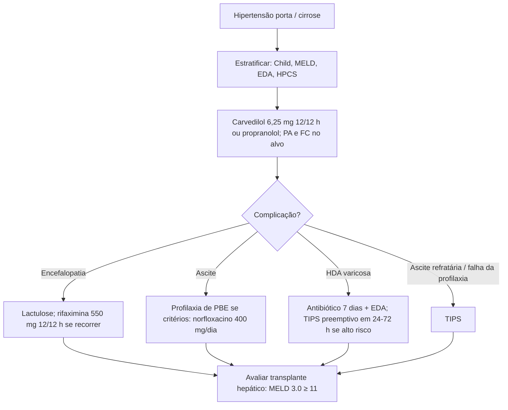

# Hipertensão Porta

> Resumo em palavras próprias do Whitebook (Condutas Cirúrgicas > Cirurgia Geral e do Aparelho Digestivo), sem fisiopatologia, autoria e referências. Confira detalhes e doses na fonte: https://whitebook.pebmed.com.br/conteudo/?id=22585&categoryId=207&subcategoryId=211

**Definição:** gradiente de pressão da veia hepática (HVPG) **≥ 5 mmHg**. **≥ 10 mmHg** = hipertensão portal clinicamente significativa (HPCS), principal preditor de varizes, descompensação da cirrose e CHC, com mortalidade muito maior. **> 12 mmHg**: risco acentuado de ruptura de varizes esofágicas.
- Classificação: pré-hepática, intra-hepática (pré-sinusoidal, sinusoidal, pós-sinusoidal) e pós-hepática.
- Causas principais: cirrose, esquistossomose, trombose de veia porta (a veia porta nasce da junção mesentérica superior + esplênica).

## Quadro clínico
- Assintomática até surgirem complicações; podem ocorrer perda de peso, mal-estar, fraqueza.
- Investigar etilismo, hepatites virais, doenças autoimunes/biliares, hepatotóxicos (medicamentos, suplementos, chás, ervas, exposição ocupacional).
- Sinais de hepatopatia crônica avançada: telangiectasias, eritema palmar, circulação colateral, atrofia testicular, ginecomastia.

## Diagnóstico
- **Hemograma:** anemia, leucopenia, plaquetopenia (a mais comum). **Hepatograma:** bilirrubina e albumina; **coagulograma:** RNI alargado.
- **Etiologia:** HBsAg, anti-HBc, anti-HBs, anti-HCV, anti-músculo liso, anti-LKM1, anti-SLA, FAN, IFI para esquistossomose, IgG/IgM/IgG4, antimitocôndria, ANCA, alfa-1-antitripsina, ferritina, IST, ceruloplasmina.
- **Biópsia hepática** se a etiologia não for definida (via transjugular na coagulopatia).
- **USG com Doppler:** ascite, trombose portal, esplenomegalia, nódulos, colaterais, inversão de fluxo, calibre da porta, índice de resistência da artéria hepática.
- **EDA:** melhor método para varizes (inclusive durante sangramento, com possibilidade terapêutica). **TC:** parênquima, ascite, varizes, colaterais, patência portal.
- **Elastografia hepática:** **> 25 kPa** indica HPCS; **> 20 kPa** + plaquetopenia também sugere. **Elastografia esplênica:** **> 55 kPa** (hepatopatia alcoólica/viral não obesos) e **> 40 kPa** (sem cirrose, doença portossinusoidal); modelos como NICER em MASLD.

## Classificação prognóstica
- **Child-Pugh** (1 ano; risco cirúrgico): bilirrubina 1–2 / 2,1–3 / ≥ 3,1 (1/2/3 pontos); encefalopatia nenhuma / grau 1–2 / grau 3–4; ascite nenhuma / leve / moderada; prolongamento do TP 1–4 / 4,1–6 / ≥ 6,1 s; albumina ≥ 3,5 / 2,8–3,4 / ≤ 2,7. **A 5–6; B 7–9; C 10–15.**
- **MELD** (3 meses; prioridade em transplante): tradicional (TP, bilirrubina, creatinina), MELD-Na (+ sódio), MELD 3.0 (+ sexo e albumina).

## Diferenciais (conforme manifestação)
Hematêmese/melena: úlcera péptica, Mallory-Weiss, esofagite, GAVE. Ascite: neoplasia, nefrogênica, TB, pancreática. Esplenomegalia: hemato-oncológica, infecção, inflamação. Peritonite: secundária a perfuração. Hidrotórax: neoplasia, sarcoidose, nefrótica, ICC, lúpus, AR. Hipoxemia e hipertensão pulmonar: causas cardíacas, SNC, muscular, infecciosas, HAP idiopática, valvopatia, colagenoses, DPOC.

## Internação
Sangramento varicoso é a complicação mais ameaçadora; mortalidade ligada à reserva hepática. Risco de ressangramento maior nos primeiros dias: cirróticos com HDA devem ser internados para suporte e monitorização intensiva.

## Complicações
- **Varizes esofágicas:** HDA (hematêmese, melena/enterorragia, instabilidade).
- **Gastropatia hipertensiva:** comum, raramente causa sangramento importante (gotejamento difuso).
- **Ascite:** distensão, ganho de peso, ortopneia, saciedade precoce, dispneia; piparote, Skoda, macicez móvel.
- **PBE:** febre, abdome doloroso/rígido, alteração mental (investigar se houver insuficiência renal ou encefalopatia sem causa).
- **Síndrome hepatorrenal:** sedimento benigno, baixa excreção de sódio, creatinina em elevação.
- **Hidrotórax hepático:** passagem de ascite por defeitos diafragmáticos (geralmente direita).
- **Síndrome hepatopulmonar:** anormalidades vasculares pulmonares; dispneia e hipóxia. **Hipertensão portopulmonar:** fadiga, dispneia, edema, dor torácica, síncope. **Cardiomiopatia cirrótica.**

## Tratamento clínico (ambulatorial)
- **Carvedilol** (preferido; não precisa atingir betabloqueio): alvo **6,25 mg VO 12/12 h**; não subir se FC **< 55** ou PAS **< 90**.
- **Propranolol:** iniciar 20–40 mg 12/12 h, FC alvo **50–60**; máximo **320 mg/dia** (sem ascite) ou **160 mg/dia** (com ascite).
- Estudo PREDESCI: betabloqueador reduz descompensação (sobretudo ascite) e mortalidade em HPCS mesmo sem varizes; Baveno VII recomenda betabloqueador (de preferência carvedilol) em todo HPCS.
- **Encefalopatia:** lactulose para 2–3 evacuações/dia; se recorrer, associar **rifaximina 550 mg 12/12 h**.
- **Profilaxia de PBE:**
  - Primária: proteína do líquido ascítico **< 1,5 g/L** e (Child ≥ B9 + bilirrubina ≥ 3) ou creatinina ≥ 1,2 ou Na ≤ 130 → norfloxacino **400 mg/dia** enquanto houver ascite.
  - Secundária: norfloxacino 400 mg/dia após PBE prévia.
  - Após HDA: ciprofloxacino **500 mg VO 12/12 h** ou norfloxacino 400 mg 12/12 h por **7 dias** (Child A/B); ceftriaxona **1 g/dia** por 7 dias (Child C).

## Indicações cirúrgicas/intervencionistas
- **TIPS:** descompressão do sistema porta; controle provisório de sangramento e ponte para transplante. **TIPS preemptivo** em 24–72 h após HDA em alto risco de ressangramento (Child > B7 e < C14, ou sangramento ativo na EDA). Também em ascite refratária e falha da profilaxia secundária. Aumenta risco de encefalopatia.
- **Transplante hepático:** considerar em todo cirrótico com HPCS ou complicações (MELD 3.0 ≥ 11); única terapia definitiva.

## Fluxograma (refeito, a partir do texto; o original não traz algoritmo)

