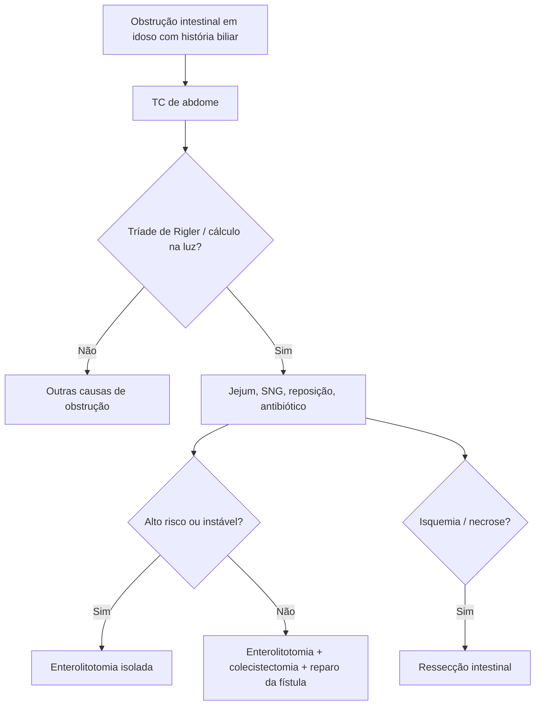

# Íleo Biliar

> Resumo em palavras próprias do Whitebook (Condutas Cirúrgicas > Cirurgia Geral e do Aparelho Digestivo), sem fisiopatologia, autoria e referências. Confira detalhes e doses na fonte: https://whitebook.pebmed.com.br/conteudo/?id=23710&categoryId=207&subcategoryId=211

**Definição:** complicação rara da colelitíase: obstrução intestinal por cálculo biliar impactado, que migra por uma fístula bilioentérica (mais comum a colecistoduodenal).

## Epidemiologia e mecanismo
- 1–4% das obstruções mecânicas; 0,5% dos portadores de colelitíase; mulheres 3,5:1; até 25% das obstruções em > 70 anos; recorrência 5–8% (precoce).
- Fatores: colelitíase de longa data, colecistites recorrentes, cálculos > 2 cm. Pode ocorrer após colecistectomia (fístula, cálculo transpapilar, cálculo perdido, cirurgia reconstrutiva). Forma colônica é a mais rara (sigmoide).
- Vesícula inflamada em contato com o TGI → necrose por pressão → fístula; > 70% com o duodeno. Cálculo > 2 cm oclui, mais no íleo terminal (50–70%); no piloro/duodeno = **síndrome de Bouveret**. Raramente sem fístula, pelo colédoco (papila dilatada ou esfincterotomia).

## Clínica
Episódios subagudos de obstrução com dor, distensão e vômitos; a desimpactação ocasional alivia e atrasa o diagnóstico (“tumbling obstruction”). Gravidade: comorbidades, desidratação, febre. Risco: colelitíase, idoso, mulher, pós-esfincterotomia, cálculos > 2–2,5 cm. Exame: distensão, dor em HCD, timpanismo, ruídos aumentados, ± Murphy.

## Diagnóstico
Laboratório inespecífico; **TC é o exame de escolha** (sensibilidade 93%, especificidade 100%, acurácia 99%): obstrução, pneumobilia, cálculo na luz, fístula bilioentérica, espessamento da vesícula, colelitíase/coledocolitíase, mudança de posição do cálculo. RX e USG também ajudam. RM/colangiorressonância: fístulas complexas, Bouveret. **Tríade de Rigler:** obstrução de delgado + pneumobilia + cálculo ectópico.
**Diferenciais:** hérnias, bridas, íleo pós-operatório, pancreatite, tumores de delgado ou cólon, invaginação, volvo de sigmoide.

## Tratamento
- **Inicial:** internar; jejum, reposição, SNG, antibiótico perioperatório, HBPM.
- **Não operatório:** casos selecionados (alto risco, cálculos pequenos); endoscopia/litotripsia se o cálculo for acessível (duodeno, proximal, cólon); risco de obstrução prolongada e perfuração.
- **Cirurgia (essencial):**
  - *Enterolitotomia isolada* (enterotomia na borda antimesentérica proximal à impactação, ordenha e retirada): idosos, ASA III–IV, choque; mais simples e curta.
  - *Enterolitotomia + colecistectomia + reparo da fístula* (um tempo): ASA I–II, estáveis, com reserva e achados favoráveis.
  - *Ressecção intestinal:* isquemia ou necrose.
  - *Via laparoscópica:* paciente estável, sem distensão maciça, sem perfuração/peritonite, equipe experiente.
  - Decidir pela estratégia por risco, estabilidade, reserva funcional, cálculo residual, inflamação e anatomia da fístula; se piorar no intraoperatório, converter para enterolitotomia isolada.
- **Complicações:** obstrução, pancreatite, deiscência de ferida/anastomose, fístula biliar, sepse, abscesso. Prognóstico reservado (diagnóstico tardio, idosos, comorbidades).

**Armadilhas:** colecistectomia prévia não exclui; ausência de pneumobilia não exclui; obstrução em idoso com história biliar → pensar em íleo biliar.

## Fluxograma (refeito, a partir do texto; o texto original traz um atlas de radiologia)

