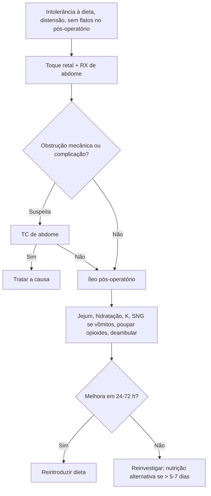

# Íleo Pós-operatório

> Resumo em palavras próprias do Whitebook (Condutas Cirúrgicas > Cirurgia Geral e do Aparelho Digestivo), sem fisiopatologia, autoria e referências. Confira detalhes e doses na fonte: https://whitebook.pebmed.com.br/conteudo/?id=22586&categoryId=207&subcategoryId=211

**Definição:** lentidão ou parada aguda da motilidade GI após estresse cirúrgico, sem obstrução mecânica. Sinônimos: íleo adinâmico, paralítico, funcional.

**Contexto:** o retorno da motilidade é heterogêneo — delgado 12–24 h, estômago 24–48 h, cólon 3–5 dias. Incidência: cirurgia colônica 10–30%; gástrica ou pancreática 8–13%. Relaciona-se ao tempo e à complexidade da cirurgia e à sepse. Aumenta morbidade, internação e custo; se prolongado ou recorrente, procurar complicação intra-abdominal.

## Quadro clínico
- Intolerância à dieta oral, náusea, vômito, dor e distensão, ausência de flatos.
- **Fatores de risco:** sexo masculino, idade avançada, cirurgia prolongada, trauma abdominal, emergência, cirurgia abdominal/ortopédica/cardíaca/pélvica, ressecção ou anastomose intestinal, estomas, manipulação excessiva, hidratação perioperatória vigorosa, opioides, infecção (intra-abdominal, pneumonia), sepse, carcinomatose, DPOC, imobilidade, distúrbios eletrolíticos (principalmente hipocalemia), perda sanguínea ou transfusão, corpo estranho, complicações cirúrgicas (fístula, abscesso), anestesia (halotano, atropina).
- **Exame:** distensão, timpanismo com ruídos reduzidos, cólica/desconforto, dispneia, náusea/vômito, sem flatos ou fezes. **Toque retal** é essencial para excluir fecaloma (principalmente em idosos).

## Diagnóstico
Clínico, apoiado em imagem para excluir obstrução mecânica e complicações. Critérios: náusea/vômito, intolerância a sólidos ou semissólidos nas últimas 24 h, ausência de flatos/evacuação em 24 h, distensão e evidência radiológica.
- **RX de abdome AP:** distensão difusa de todo o intestino incluindo o reto (níveis hidroaéreos difusos), dilatação gástrica, elevação diafragmática/atelectasia bibasal.
- **TC:** exclui obstrução mecânica; identifica abscessos, coleções, isquemia e alças fechadas.

## Classificação
- **Duração:** transitório 3–4 dias; prolongado > 3 dias após laparoscopia ou > 5 dias após laparotomia; recorrente (recidiva após melhora).
- **Causa:** primário (sem fator precipitante) ou secundário (infecção, obstrução mecânica precoce, hemorragia).
- **Tipos:** I — todo o TGI (náusea/vômito, sem flatos/fezes); II — apenas TGI superior (náusea/vômito, cólon ativo); III — sem flatos/fezes, mas tolera dieta.
- **Diferenciais:** abdome agudo perfurativo ou vascular, obstrução mecânica, complicações pós-operatórias, síndrome de Ogilvie.

## Tratamento
- Considerar nutrição alternativa se > 5–7 dias; hidratação e eletrólitos mínimos IV.
- **Sonda nasogástrica** para descompressão. Medidas citadas sem comprovação robusta: manobras vagais, inalação de éter, clorpromazina sublingual.
- Analgesia poupando opioides; corrigir eletrólitos (K); antieméticos e antiflatulentos (dimeticona); procinéticos (controversos, embora muito usados).
- Deambulação, profilaxia de atelectasia (analgesia, fisioterapia) e de broncoaspiração (cabeceira a 45°); profilaxia de TEV conforme risco.
- **Fármacos** (a maioria dos procinéticos teve pouco efeito): antagonista opioide periférico (fase neurogênica) 12 mg VO 1×/dia por 7 dias, ainda indisponível no Brasil, pode começar no pré-operatório, mais eficaz com opioides; infusão de anestésico local/bloqueador de citocinas — ataque 1,5–2 mg/kg IV e manutenção 1,5–3 mg/kg/h por até > 24 h de pós-operatório, sem consenso; outra substância com bólus de 40 mg/kg IV e infusão de 10 mg/kg no intraoperatório, com benefício em alguns ensaios e poucos efeitos colaterais; contraste oral hidrossolúvel com efeito teórico de reduzir edema de alças — não alterou o tempo de íleo, mas pode reduzir o tempo de SNG e encurtar a eliminação de gases e fezes. (Os nomes dos fármacos não vêm no texto extraído; conferir na fonte.)

## Prevenção
Manipulação cuidadosa e boa hemostasia; mobilização e fisioterapia precoces; hidratação perioperatória restrita; goma de mascar sem açúcar; cirurgia minimamente invasiva; dieta precoce em cirurgias eletivas; protocolos ERAS, *fast track*, ACERTO; peridural torácica com anestésico local; AINE para poupar opioides; analgesia multimodal; **sem SNG de rotina**; eletroacupuntura em centros com expertise (estudos recentes).

## Prognóstico
Em geral bom, com resolução em 24–72 h com suporte; sem melhora nesse prazo, investigar outras causas.

## Fluxograma (refeito, a partir do texto; o texto original não traz uma figura)

