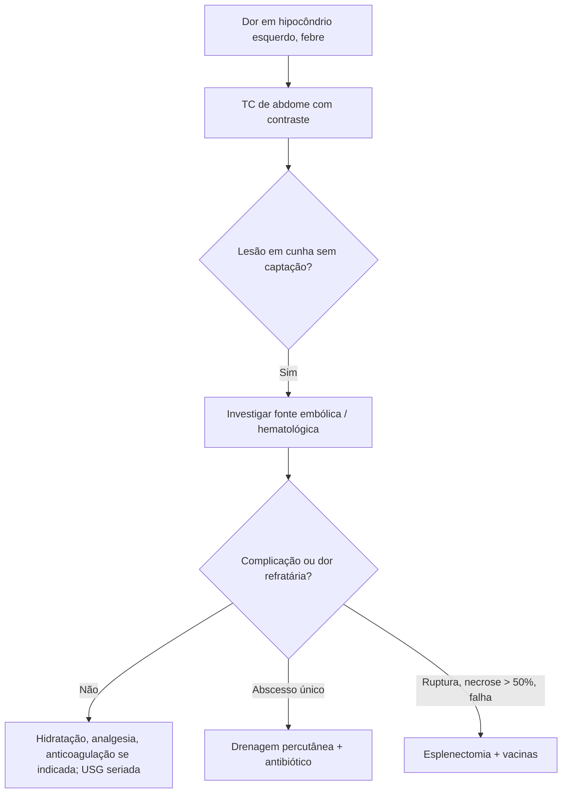

# Infarto Esplênico

> Resumo em palavras próprias do Whitebook (Condutas Cirúrgicas > Cirurgia Geral e do Aparelho Digestivo), sem fisiopatologia, autoria e referências. Confira detalhes e doses na fonte: https://whitebook.pebmed.com.br/conteudo/?id=44539&categoryId=207&subcategoryId=211

**Definição:** oclusão da artéria esplênica ou de um de seus ramos por trombo, êmbolo ou ligadura iatrogênica. Causa incomum de abdome agudo.

## Causas
- **Tromboembólicas** (idosos): fibrilação atrial, endocardite, forame oval patente, ateromatose.
- **Hematológicas** (< 40 anos): policitemia vera, neoplasias mieloproliferativas, linfomas e leucemias, anemia hemolítica, hemoglobinopatias (sobretudo falciforme).
- **Outras:** ligadura dos vasos esplênicos (técnica de Warshaw), babesiose, reversão de anticoagulação com complexo protrombínico, trombose esplênica pós-bariátrica, hipercoagulabilidade (câncer, anticorpo antifosfolípide), esplenomegalia importante (Gaucher, linfoma esplênico), trauma, torção da artéria esplênica, mononucleose.

## Clínica
Dor aguda e sensibilidade no quadrante superior esquerdo, às vezes febre, náuseas e vômitos. Febre e dor abdominal após bariátrica merecem atenção. Exame: dor no hipocôndrio esquerdo ± esplenomegalia; peritonite pode ou não existir.

## Diagnóstico
- **Laboratório:** inespecífico; DHL elevada, leucocitose; esfregaço se suspeita de babesiose (anemia hemolítica, trombocitopenia).
- **TC com contraste:** área sem captação ou hipoperfundida, em cunha.
- **Diferenciais:** abscesso, aneurisma/pseudoaneurisma da esplênica, ruptura, esplenomegalia, linfoma.

## Tratamento
- **Casos simples:** hidratação, analgesia e monitorização; resolução em 7–14 dias.
- **Intervenção** (dor refratária ou complicação): ruptura com sangramento importante e peritonite; abscesso persistente apesar de antibiótico; necrose maciça (> 50%) com dor intratável; hemorragia subcapsular progressiva em USG seriada; pseudocisto sintomático sem resposta; dor refratária a analgésicos por 2–3 semanas; liquefação progressiva com risco de ruptura; febre persistente sem resposta a antibiótico amplo; hemoperitônio com cápsula íntegra.
- **Técnicas:** esplenectomia **aberta** (instável ou peritonite difusa; incisão subcostal esquerda ou mediana supraumbilical); **laparoscópica** (estável, recuperação mais rápida; difícil se inflamação perisplênica intensa); **drenagem percutânea** (alternativa para abscesso único e bem delimitado, preserva o baço, com antibiótico e vigilância).

## Seguimento e complicações
Abscesso em 3–4% (semanas depois); ruptura tardia rara (infartos maciços); hemorragia subcapsular; pseudocisto (em geral assintomático). USG seriada nas primeiras 2 semanas; TC para caracterizar complicações e planejar cirurgia. Readmissão ~2%, com 22% indo à esplenectomia.

## Por etiologia
- **Hemoglobinopatia/altitude:** maior risco de necrose maciça; esplenectomia se necrose > 50% ou dor intratável; vacinar antes se possível.
- **Embólica/anticoagulação:** anticoagulação plena é central; cirurgia só para complicações hemorrágicas ou sépticas; investigar fonte embólica antes da alta.
- **Pós-embolização esplênica:** infartos esperados, geralmente assintomáticos; esplenectomia em 6–10%; vigiar abscesso.

## Pós-esplenectomia
Vacinas obrigatórias: pneumococo (PCV13 + PPSV23), meningococo (conjugada quadrivalente), Hib. Considerar penicilina profilática em alto risco (crianças, imunossuprimidos). Orientar sobre infecção fulminante pós-esplenectomia (OPSI) e procurar atendimento precoce se febre.

## Prognóstico
Mortalidade do infarto não complicado < 5%; das complicações cirúrgicas 8–12%; preservação esplênica > 90% sem complicações; intervenção precoce nas complicações reduz a mortalidade.

## Fluxograma (refeito, a partir do texto; o original é um atlas na fonte)

