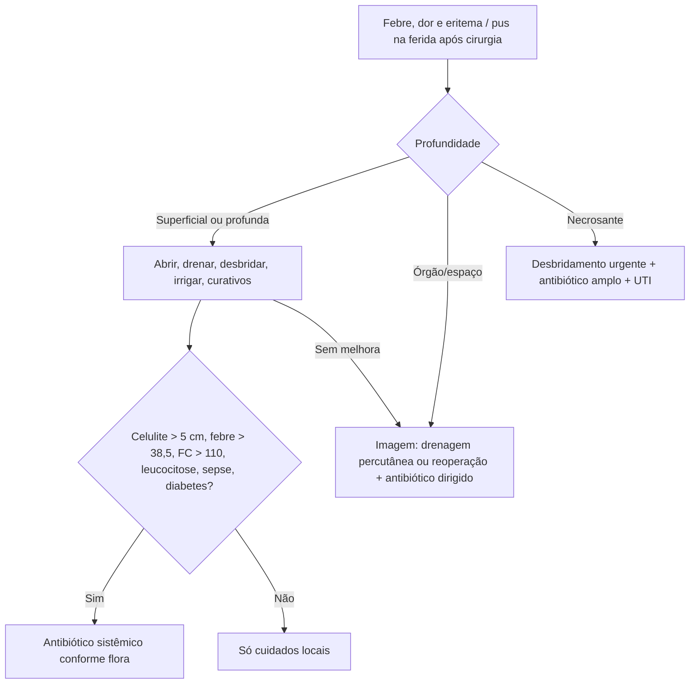

# Infecção de Sítio Cirúrgico (ISC)

> Resumo em palavras próprias do Whitebook (Condutas Cirúrgicas > Cirurgia Geral e do Aparelho Digestivo), sem fisiopatologia, autoria e referências. Confira detalhes e doses na fonte: https://whitebook.pebmed.com.br/conteudo/?id=22587&categoryId=207&subcategoryId=211

**Definição:** infecção da incisão e/ou dos tecidos e órgãos manipulados, até **30 dias** da cirurgia (sem implante) ou até **1 ano** (com implante/prótese). Sinônimos: infecção de ferida operatória, pós-cirúrgica.

## Contexto
- Principal complicação da ferida e 3ª causa de infecção hospitalar; incidência 0,5–3%; ~2/3 confinadas à incisão e 1/3 em órgão/espaço; acrescenta em média **7,3 dias** de internação; ~60% dos isolados têm padrão de resistência; fator de risco para deiscência, eventração e evisceração.
- **Origem:** endógena (flora da pele/mucosa/TGI, foco à distância) ou exógena (quebra de assepsia, ambiente, equipe, material).
- **Microbiologia:** *S. aureus* é o principal; também estafilococos coagulase-negativos, *Enterococcus*, *E. coli*, *Pseudomonas*, *Proteus*, *Klebsiella*; cada vez mais *Candida*. Cirurgia limpa (classe I): flora cutânea; demais: polimicrobiana (*E. coli*, enterobactérias). Frequentemente polimicrobiana.

## Clínica
Febre (geralmente após 48–72 h), taquicardia, calor/eritema/dor/edema, drenagem purulenta, deiscência. Enfisema subcutâneo (*Clostridium perfringens*) é mais precoce (< 48 h). Ocorre tipicamente no 5º–6º dia pós-operatório; 80–90% nos primeiros 30 dias. Em obesos mórbidos ou feridas profundas os sinais externos podem demorar. Eritema sem pus ou edema isolado pode ser só cicatrização normal.

**Fatores de risco:** do paciente (ascite, DPOC, desnutrição, obesidade, diabetes descontrolado, extremos de idade, hipoxemia, doença vascular periférica, anemia pós-operatória, radioterapia prévia, imunossupressão, corticoide, quimioterapia, infecção remota ou cutânea, colonização); ambientais (esterilização falha, antissepsia inadequada, ventilação, corpo estranho); terapêuticos (drenos, emergência, profilaxia inadequada, internação prévia, tempo cirúrgico longo); do microrganismo (toxinas, esporos, virulência, internação prolongada).

## Diagnóstico
Clínico, com apoio laboratorial (leucocitose, PCR, culturas) e imagem (USG para coleções; TC para coleções profundas e borramento).

## Classificação
**Potencial de contaminação:** limpa 1–3% (classe ID: com prótese/tela); limpa-contaminada 5–8%; contaminada 20–25%; suja/infectada 30–40%.
**Topografia:** superficial (pele/subcutâneo), profunda (fáscia/músculo), órgão/espaço (mortalidade 5–50%).
**Critérios (CDC/NNIS):** *superficial* — em 30 dias, só pele/subcutâneo, mais um de: pus, cultura asséptica positiva, diagnóstico do cirurgião, sinais flogísticos (não inclui abscesso de ponto). *Profunda* — 30 dias (ou 1 ano com implante), fáscia/músculo, mais um de: pus profundo, diagnóstico do cirurgião, febre/dor com deiscência espontânea ou aberta pelo cirurgião, abscesso por imagem ou reoperação. *Órgão/espaço* — pus por dreno, cultura, abscesso à imagem/reoperação/histologia ou diagnóstico do cirurgião (abscesso intra-abdominal, empiema, mediastinite, peritonite, infecção articular).

## Tratamento
O essencial é **controlar o foco** (drenar, corrigir o fator predisponente); o antibiótico é adjuvante; reconhecer a necessidade de reoperar é o mais importante.

**Incisional superficial/profunda:**
- Abrir a ferida (retirar pontos), avaliar digitalmente a profundidade, desbridar até tecido viável, irrigar abundantemente com SF 3–4×/dia, cicatrização por segunda intenção, curativos 2–3×/dia.
- Cultura controversa: só se deiscência de fáscia ou infecção complexa. ISC profunda sem resposta → investigar ISC de órgão/espaço. Antibióticos/antissépticos tópicos: sem indicação definida.
- **Antibiótico sistêmico se:** celulite com enduração > 5 cm; febre > 38,5 °C, FC > 110, leucócitos > 12.000; sepse; diabetes descompensado; outro foco de infecção.
- *Cirurgias sem abertura de vísceras ocas (flora cutânea):* cefalexina 500 mg VO 6/6 h 5–10 d; cefadroxila 1 g VO 12/12 h 5–10 d; cefazolina 1 g EV/IM 6/6 h 7 d; cefaclor 500 mg VO 8/8 h 7 d; cefuroxima 500 mg VO 12/12 h 7 d; cefoxitina 1 g EV/IM 6/6 h 7 d. **MRSA** (colonização, epidemiologia local, antibiótico recente): vancomicina 15 mg/kg EV 12/12 h ou SMX-TMP 160+800 mg VO 6/6 h.
- *Cirurgias do TGI/trato genital (gram-negativos e anaeróbios):* ceftriaxona 1–2 g EV/dia + metronidazol 500 mg EV 8/8 h; ciprofloxacino 400 mg EV 12/12 h + metronidazol; levofloxacino 750 mg EV/dia + metronidazol.
- (O texto agrupa também esquemas para infecções por *S. aureus*: oxacilina 2 g EV 6/6 h; cefazolina 1 g EV 8/8 h; cefalexina 500 mg VO 6/6 h; SMX-TMP 160/800 mg 6/6 h; e esquemas graves/hospitalares: meropeném 1 g EV 8/8 h; ertapeném 1 g EV/dia; piperacilina-tazobactam 4,5 g EV 8/8 h; ceftriaxona 1 g EV/dia + metronidazol; cipro ou levo + metronidazol. Confira a indicação de cada esquema na fonte.)

**Espaço/órgão:** drenagem percutânea ou reoperação, antibiótico dirigido por cultura (adjuvante) e suporte (ver Febre Pós-operatória).

**Infecções necrosantes de tecidos moles (gangrena gasosa, fascite necrosante):** graves, evoluem com sepse; acometem subcutâneo profundo, fáscias e/ou músculo; em geral polimicrobianas (estafilococos/estreptococos/anaeróbios) ou por *Clostridium* (*C. perfringens, novyi, septicum*: mionecrose com pior prognóstico e reintervenções repetidas). Pistas: sem limites precisos, necrose sem inflamação ao redor, sem abscesso desencadeante, comprometimento profundo maior que o superficial, dor, edema, bolhas, equimose, gás. Auxílio: USG (líquido subcutâneo), TC/RM (sensível, pouco específica), biópsia; escore **LRINEC** quando há dúvida; **na dúvida, explorar a ferida**. Tratamento: suporte intensivo, desbridamento precoce e repetido (24 h), às vezes amputação; antibiótico empírico amplo (incluindo MRSA): penicilina + clindamicina + aminoglicosídeo/quinolona (± vancomicina) ou monoterapia com carbapenêmico, piperacilina-tazobactam ou tigeciclina.

**ISC com material protético:** remover o dispositivo, antibiótico prolongado, trocar depois de controlar a infecção.

**Complicações:** abscessos, celulite, dor, má cicatrização, deiscência de aponeurose/hérnia incisional (ISC é o principal fator de risco), sepse, disfunção orgânica, óbito.

## Profilaxia
**Pré-operatória:** tratar focos infecciosos antes; parar de fumar ≥ 30 dias; controlar anemia e glicemia; reduzir corticoide, melhorar nutrição, perder peso; **sem tricotomia de rotina**; internação pré-operatória curta; banho pré-operatório (sabão comum ou antisséptico equivalem); não suspender imunossupressores de rotina (individualizar); considerar imunonutrição (ômega-3, glutamina, arginina, nucleotídeos) em grande cirurgia.
**Antibioticoprofilaxia:** previne ISC por agente conhecido/suspeito; uso inadequado aumenta custo, efeitos adversos e resistência; não previne ITU/pneumonia; não dispensa técnica. Dose inicial 60–120 min antes da incisão (indução), parenteral, ajustando por função renal/hepática e IMC > 30; antimicrobiano tópico na incisão não é indicado. **Repique** se perda > 1.500 mL ou cirurgia > 3 h (considerando a meia-vida). Duração: dose única, idealmente até 24 h; sem evidência para manter até retirar drenos/cateteres. **Indicações:** risco de ISC > 10% ou cirurgia classe III; classes I–II só com prótese/válvula ou com fatores (desnutrição, > 70 anos, imunossupressão, urgência, mama, hernioplastia incisional, esplenectomia em esquistossomose, doença reumática, diabetes descompensado, obesidade mórbida, hérnias multirrecidivadas, radioterapia prévia, uremia, hepatopatia/pneumopatia) ou grande morbimortalidade da ISC (cardíaca, grandes vasos, enxerto arterial, neurocirurgia, amputação vascular). Cobrir anaeróbios (*Bacteroides*) se cólon/íleo terminal; sem vancomicina de rotina; cesárea: antes da incisão; trauma: curta duração (< 24 h), aeróbios e anaeróbios.
**Decolonização de *S. aureus*:** se colonização nasal (cardiotorácica, ortopédica): mupirocina 2% 2×/dia por 5 dias ± banho com clorexidina.
**Intraoperatória:** se tricotomia, só imediatamente antes e com tricótomo atraumático; antissepsia da equipe; preparo da pele com solução alcoólica (clorexidina), exceto neonatos, mucosas, olhos; sem selantes antimicrobianos; campos e aventais descartáveis ou de tecido equivalem; técnica: tecidos delicados, hemostasia, retirar tecido desvitalizado, lavar a cavidade, preservar vascularização, poucas suturas, sem espaço morto nem tensão, fio monofilamentar; drenos só se necessários (fechados a vácuo); oxigenação adequada; normotermia (> 36 °C; especialmente > 2 h); **FiO₂ ≥ 80%** em anestesia geral e, se possível, 2–6 h depois; controle glicêmico (alvo geralmente 110–150 mg/dL, evitando hipoglicemia); não adiar transfusão; irrigação com iodopovidona aquoso antes do fechamento primário em feridas limpas ou limpas-contaminadas; sem antibiótico na ferida antes de suturar; sem curativos avançados em vez do padrão; pressão negativa sugerida em feridas de alto risco.
**Pós-operatória:** normotermia; manter o curativo estéril 24–48 h; troca asséptica e lavagem das mãos; glicemia < 200 mg/dL; dieta enteral precoce; suspender profilaxia em 24–48 h; evitar hiper-hidratação; retirar sondas e drenos cedo; alta precoce.

## Fluxograma (refeito, a partir do texto; o texto original não traz uma figura)

