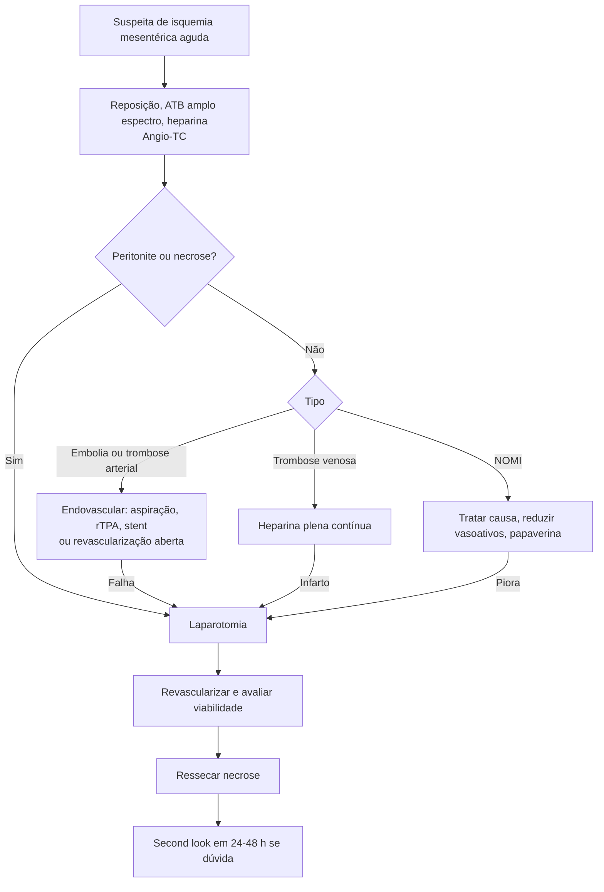

# Isquemia Mesentérica Aguda

> Resumo em palavras próprias do Whitebook (Condutas Cirúrgicas > Cirurgia Geral e do Aparelho Digestivo), sem fisiopatologia, autoria e referências. Confira detalhes e doses na fonte: https://whitebook.pebmed.com.br/conteudo/?id=38904&categoryId=207&subcategoryId=211

**Definição:** redução ou cessação súbita do fluxo mesentérico em parte ou todo o intestino, a ponto de não sustentar o metabolismo basal, levando a morte celular e necrose. Mortalidade **> 50%**; sempre secundária a doença local ou processo remoto. Diagnóstico precoce é essencial antes da necrose; quanto mais crônica a isquemia, mais colaterais e menor a chance de necrose.

## Anatomia relevante
- Intestino anterior: tronco celíaco; médio (ampola de Vater à flexura esplênica): AMS; posterior (flexura esplênica ao sigmoide distal): AMI; derivados da cloaca: ilíacas internas.
- Colaterais: arcada de Bühler (celíaco–AMS; 1–4%), Barkow (omental), Kirk, artéria marginal de Drummond (AMS–AMI), arco de Riolan-Haller (cólica média–esquerda, se desenvolve em oclusão crônica).
- Drenagem venosa: esplênica, VMS (delgado e cólon até flexura), VMI. Pontos críticos: Griffith (flexura esplênica) e Sudeck (junção retossigmoide).
- Fluxo mesentérico em repouso ≈ **20% do débito cardíaco**; pós-prandial pode subir **até 200%**.

## Etiologias
- **Embolia arterial:** mais em mulheres; AMS (ramos distais de 2ª–3ª ordem); poupa jejuno proximal; cardiopatia (IAM recente, ICC, FA) como fonte principal; também aneurisma/placa, embolia tumoral ou de colesterol.
- **Trombose arterial:** aterosclerose; AMS proximal; ~**50%** têm quadro crônico (dor pós-prandial, sitofobia, perda de peso); acomete todo o delgado e cólon direito.
- **NOMI (não oclusiva):** vasoespasmo/perda da autorregulação esplâncnica em pacientes críticos; 40% com estenose de AMS; ICC/choque cardiogênico, pós-operatório de grandes cirurgias (coarctação, revascularização visceral, dissecção aórtica, trauma, queimadura, pancreatite, AAA roto, hipertensão intra-abdominal); raramente vasopressores, cocaína, ergotaminas.
- **Trombose venosa mesentérica:** muitas vezes assintomática; congestão e infarto hemorrágico; primária (idiopática) ou secundária (hipercoagulabilidade: neoplasia, ACO, reumatológicas; estase: hipertensão portal, ICC; lesão venosa: esplenectomia, trauma, peritonite por apendicite/diverticulite); poupa o cólon.
- **COVID-19:** maior associação (coagulopatia, lesão endotelial, tromboinflamação, desregulação do SRAA).

## Quadro clínico
- Dor inespecífica, cólica, vômitos; dor visceral conforme origem embriológica (anterior: epigástrio/periumbilical; posterior: infraumbilical; cloacal: suprapúbica); início súbito e intenso, ou piora clínica inexplicada; taquicardia, oligúria, HDB, diarreia, febre.
- Angina mesentérica: dor pós-prandial, perda de peso, sitofobia.
- Fatores de risco: aterosclerose difusa, hipercoagulabilidade, hipovolemia, ACO, arritmias (FA), IAM recente, aminas, digitálicos, disfunção cardíaca, TVP prévia, câncer, hipertensão portal, trauma, processo inflamatório abdominal, embolia sincrônica.
- **Perfil por tipo** (muito presente / talvez / raro): embolia — idade > 80, FA, IAM prévio, foco emboligênico, início abrupto, dor, vômitos, embolia sincrônica; trombose arterial — AVE isquêmico, sintomas prévios de isquemia crônica, início insidioso; trombose venosa — TEV prévia, resistência à proteína C ativada, pancreatite/neoplasia pancreática, hipertensão portal/cirrose.
- **Exame:** dor desproporcional ao exame, distensão, desidratação, peritonite (tardia), choque séptico, fezes sanguinolentas ao toque.

## Diagnóstico (alto índice de suspeição)
- **Labs:** hemoconcentração, leucocitose **20.000–30.000**, amilase/lipase elevadas, CPK/LDH (sem correlação com gravidade), acidose e hiperlactatemia (tardios, inespecíficos).
- **RX:** alterações tardias: íleo, níveis, espessamento, pneumoperitônio; **gás no sistema venoso mesentérico é patognomônico**.
- **USG Doppler:** útil em casos não agudos; limitado na fase aguda pela distensão.
- **Angio-TC** (mais usada): achados diretos: êmbolos (coágulo ovalar em ramo médio/distal não calcificado da AMS), trombos (sobre placa calcificada no óstio da AMS); indiretos: edema de parede, espessamento mesentérico, impressões digitiformes; tardios: pneumatose, aeroportograma, pneumoperitônio.
- **Arteriografia:** padrão-ouro nas doenças arteriais, permite intervenção; oclusão proximal (trombose) ou distal (embolia), falha de enchimento venoso, espasmo difuso (NOMI).

## Tratamento
**Princípio:** restaurar o fluxo o mais cedo possível; depende da duração/gravidade, tipo de lesão e disponibilidade de radiologia intervencionista ou cirurgia vascular.
- **Clínico:** reposição vigorosa, antibiótico de amplo espectro (anaeróbios/gram-negativos), anticoagulação sistêmica, trombólise em trombose arterial aguda com trombo recente.
- **Cirurgia** (preferencialmente laparotomia mediana): estabelecer viabilidade, ressecar necrose, restabelecer fluxo e trânsito. Indicações: refratariedade ao clínico/endovascular, peritonite, suspeita ou iminência de infarto, perfuração. Contraindicada em conduta paliativa ou instabilidade que a inviabilize. Avaliar cor, distensão e peristalse, pulsos das arcadas (Doppler), sangramento das bordas e perfuração. Padrões: AMS abaixo da cólica média (íleo, poupa jejuno proximal); ileocólica (íleo terminal, ceco, cólon ascendente); arcadas/vasos retos (êmbolos); celíaco + AMI (raro).
- Revascularizar preferencialmente **antes** da ressecção (se não houver expertise, apenas ressecar). Dúvida sobre viabilidade → **second look em 24–48 h**, sem adiar mesmo se o paciente estiver grave.
- **Por etiologia:** embolia: arteriotomia transversa, embolectomia com Fogarty, heparina intra-arterial, reperfusão aquecida, fechamento ou reavaliação em 24–36 h. Trombose arterial: *bypass* aortomesentérico (com heparina) ou técnica endovascular. Trombose venosa: heparina não fracionada em dose plena contínua (mesmo se for operar); cirurgia se infarto. NOMI: otimizar volume, reduzir vasoativos, papaverina intra-arterial por cateter em alguns casos; laparotomia com controle de danos e reavaliação em 24 h; angiografia ajuda a excluir causas tratáveis.
- **Endovascular:** melhor para idosos frágeis; contraindicado com peritonite; aspiração de êmbolos, trombólise local (rTPA), angioplastia com stent; em trombose venosa há várias técnicas (TIPS com trombectomia, trombólise direta ou transhepática, via AMS, angioplastia).
- **Seguimento:** trombose arterial: antiplaquetário + estatina; embolia: anticoagulação prolongada; trombose venosa: anticoagulação por 6 meses ou prolongada; stent na AMS: angio-TC regular (reestenose); controlar comorbidades; risco de síndrome do intestino curto após grandes ressecções.

## Fluxograma (refeito; o original "algoritmo em oclusão da AMS" é imagem na fonte)

