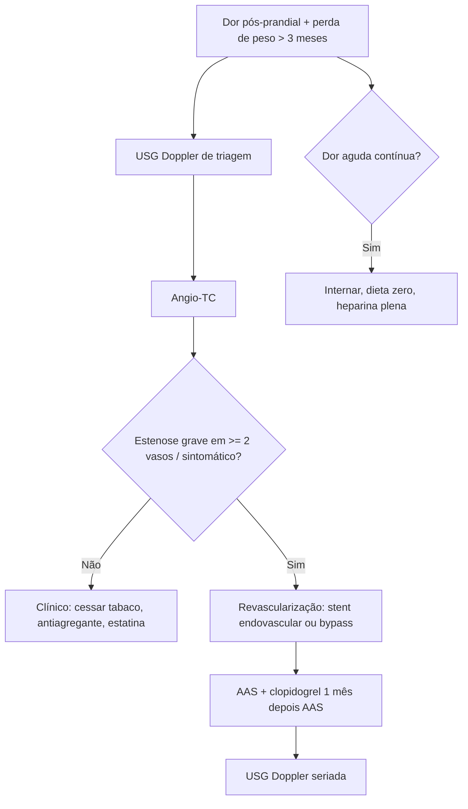

# Isquemia Mesentérica Crônica

> Resumo em palavras próprias do Whitebook (Condutas Cirúrgicas > Cirurgia Geral e do Aparelho Digestivo), sem fisiopatologia, autoria e referências. Confira detalhes e doses na fonte: https://whitebook.pebmed.com.br/conteudo/?id=44573&categoryId=207&subcategoryId=211

**Definição:** hipoperfusão do intestino delgado por estenose ou oclusão de vários vasos (angina mesentérica). A forma crônica é definida por dor abdominal pós-prandial com perda de peso não intencional por **mais de 3 meses**. O fluxo gastrintestinal sobe 100–150% após a refeição (5–6 h); a isquemia surge quando esse aumento é insuficiente. Pela rede colateral, só ficam sintomáticos os pacientes com pelo menos 2 dos 3 troncos gravemente estenosados/ocluídos.

## Etiologia e epidemiologia
- **Aterosclerose** (90%, estende-se da placa aórtica para os 2–3 cm iniciais dos ramos); síndrome do ligamento arqueado mediano (compressão do tronco celíaco); displasia fibromuscular; dissecção da aorta/mesentéricas; vasculites (poliarterite, Takayasu); fibrose retroperitoneal; trombose venosa mesentérica; endoprótese aórtica; LES.
- > 60 anos, mulheres (3:1), tabagistas, com DAC, doença cerebrovascular ou arterial periférica. Fatores de risco: tabagismo, HAS, DM, hipercolesterolemia.

## Quadro clínico
- A maioria é assintomática (colaterais). Sintomáticos têm em geral estenose **> 70%** em ≥ 2 vasos (celíaco + mesentérica superior).
- Clássico: dor epigástrica recorrente até 1 h após comer, proporcional ao tamanho e ao teor de gordura da refeição, que pode irradiar para o dorso; medo de comer (aversão alimentar) e perda de peso. Também diarreia, náusea, vômito, saciedade precoce, HDA.
- Gravidade: trombose aguda de vaso já estenosado (dor aguda por dias a semanas).
- Exame: inespecífico; sopro abdominal em 50%; desnutrição; dor desproporcional ao exame; sinais de aterosclerose em outros sítios.

## Diagnóstico
Alta suspeição + imagem mostrando estenose de ≥ 2 vasos ou oclusão total de um.
- **Escore de risco:** perda de peso (sim = 5); doença cardiovascular (sim = 2); estenose do celíaco 50–70% por doença vascular = 4, por ligamento arqueado = 4; > 70% por doença vascular = 11, por ligamento arqueado = 9; estenose da AMS 50–70% = 4, > 70% = 1. 0–5 pontos: baixo risco (19,4%); 3–18: intermediário (44,6%); > 18: alto (92,1%).
- **Laboratório:** hemograma, bioquímica, função renal e hepática, coagulograma (nutricional).
- **USG Doppler:** triagem; alto VPN se pico sistólico **< 275 cm/s na AMS e < 200 cm/s no celíaco** (< 70% de estenose); a oclusão do celíaco varia com a inspiração na síndrome do ligamento arqueado.
- **Angio-TC:** exame de escolha; estenose > 70% de vaso único é relevante; > 50% pode ser significativa na doença multivascular da AMS; essencial para planejar a cirurgia.
- **Angio-RM:** menos sensível em lesões distais; reservar para quem não pode usar contraste iodado ou sintomas duvidosos.
- **Arteriografia:** padrão-ouro, em geral no ato endovascular. EDA/colonoscopia para diferenciais.
- **Diferenciais:** neoplasias, colecistite crônica, pancreatite crônica, úlcera péptica, distúrbios funcionais, dispepsia, transtornos alimentares.

## Tratamento
- **Clínico em todos com aterosclerose grave:** parar de fumar, antiagregante e estatina por tempo indefinido; após stent, considerar AAS + clopidogrel por pelo menos 1 mês e depois AAS isolado; avaliar nutrição; anticoagular apenas na trombose aguda. Internar na forma aguda e na desnutrição refratária (suporte enteral/parenteral).
- **Revascularização:** para sintomáticos com estenose grave documentada; método conforme expectativa de vida, estado nutricional, comorbidades, número/gravidade dos vasos e acesso percutâneo. Objetivo: recuperar o estado nutricional e prevenir isquemia aguda e infarto.
  - **Endovascular (stent):** mortalidade 5,6%, morbidade 11%, reestenose 34%.
  - **Cirurgia aberta (bypass):** mortalidade 4,4%, morbidade 16%, reestenose 7%.
  - (Os rótulos foram inferidos pela ordem e pela taxa de reestenose; confira na fonte.)
  - AMS é o alvo principal; angioplastia do celíaco e da AMI tem alta reestenose. Lesões ostiais: stent balão-expansível não revestido (5–8 mm), com 1–2 mm dentro da aorta e balonamento proximal (técnica Flair). Complicações: reestenose, embolização, perfuração, dissecção, trombose.
- **Seguimento:** USG Doppler a cada 3–6 meses após stent ou anual após bypass; a Sociedade de Cirurgia Vascular sugere 1 mês, depois a cada 6 meses por 2 anos, depois anual; velocidade de pico aumentando ou perto de 500 cm/s: confirmar com angio-TC/RM. Principal causa de óbito: doença cardiovascular, depois neoplasias.
- **Isquemia aguda:** internar, dieta zero, heparina plena, tratar em 24–48 h.

## Fluxograma (refeito, a partir do texto; o texto original não traz uma figura)

