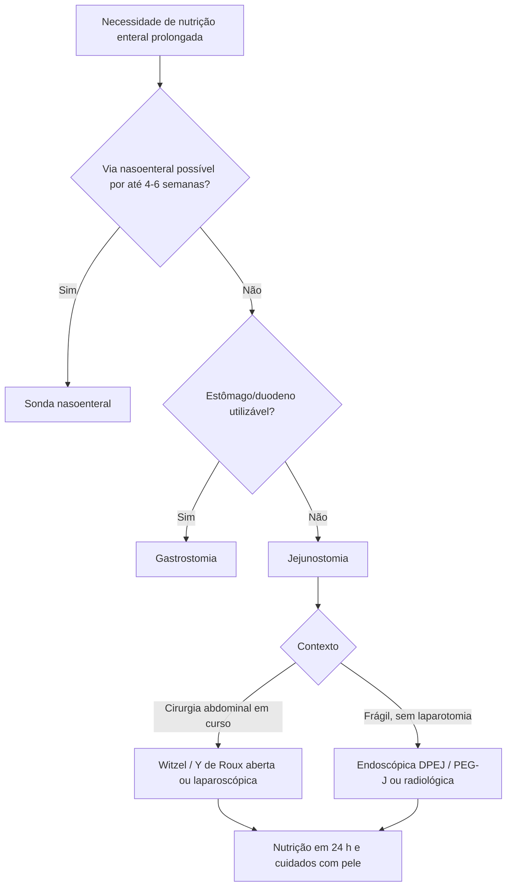

# Jejunostomia

> Resumo em palavras próprias do Whitebook (Condutas Cirúrgicas > Cirurgia Geral e do Aparelho Digestivo), sem fisiopatologia, autoria e referências. Confira detalhes e doses na fonte: https://whitebook.pebmed.com.br/conteudo/?id=23711&categoryId=207&subcategoryId=211

**Definição:** procedimento cirúrgico, endoscópico ou radiológico que introduz um cateter no jejuno proximal para criar uma via alternativa ao trato digestivo. Sinônimos: estoma jejunal, enterostomia jejunal.

**Objetivos:** nutrição enteral quando estômago/duodeno não funcionam ou não são acessíveis; via de medicamentos; aspiração em íleo/distensão; reduzir aspiração pulmonar em gastroparesia ou refluxo grave.

## Indicações
- Vias nasoenterais esgotadas; permanência prevista > 4–6 semanas.
- Planejamento de cirurgia do TGI superior com jejum prolongado e risco de complicações (esofagectomia, gastrectomia total, duodenopancreatectomia: atonia gástrica, pancreatite, disfunção anastomótica, fístula, sepse).
- Doença neurológica, disfagia, rebaixamento, gastroparesia ou disfunção do esvaziamento gástrico; desnutridos que não conseguem comer (neoplasia de cabeça e pescoço, idosos); refluxo grave com pneumonia aspirativa recorrente.
- **Seletiva, não rotineira** (por exemplo após esofagectomia): centros com uso racional têm menos complicações sem prejuízo nutricional.

## Contraindicações
Peritonite, obstrução distal sem alívio, necrose intestinal, ausência de alça viável; instabilidade hemodinâmica, ascite, coagulopatia, derivação ventriculoperitoneal; maior risco de infecção em imunodeprimidos ou com derrame peritoneal.

## Técnicas
- **Cirúrgica aberta (Witzel, Y de Roux):** consolidada, segura e barata; túnel de Witzel (3–5 cm seromuscular) reduz extravasamento e infecção; mais dor e recuperação mais longa; indicada em cirurgias de grande porte; pode ser feita com ou sem túnel.
- **Laparoscópica:** menos dor e infecção de ferida, mesma eficácia; Witzel laparoscópico puro: menos complicações, menos opioide, alta precoce; exige sutura intracorpórea.
- **Endoscópica (DPEJ ou PEG-J):** pouco trauma, ideal para frágeis; sucesso técnico 92–100%; DPEJ mais difícil sem estômago ou com muitas alças; indicada se a via gástrica é impossível ou há risco de aspiração.
- **Radiológica:** guiada por fluoroscopia ou TC; sucesso > 90%, baixo risco de complicações maiores; alternativa em críticos, pós-gastrectomia ou com contraindicação anestésica.

## Complicações
Gastrointestinais 40% (cólica, diarreia ou constipação, distensão, náusea/vômito); cutâneas 20% (dermatite por secreção); infecciosas 5–20% (pneumonia aspirativa, contaminação da dieta); obstrução da sonda até 15%; mecânicas 10–15% (obstrução, extravasamento, abscesso, pneumatose, perfuração colônica, sangramento gástrico); ileíte/obstrução tardia 2–5% (tração, torção); metabólicas 1–3% (hipocalemia, hiperglicemia, distúrbios ácido-base).

## Cuidados com a sonda e a pele
- Na alta: orientar limpeza, fixação, irrigação diária e retorno imediato se dor, febre ou extravasamento.
- Higiene diária com SF, gaze estéril e creme de barreira; rodar levemente a sonda após 7 dias (se segura); trocar conforme o material (silicone ~6 meses; poliuretano ~3 meses); evitar tração/oclusão (necrose); vigiar vazamento, eritema, secreção.
- **Profilaxia da dermatite entérica:** lavar 1–2×/dia com SF 0,9% ou água filtrada e sabão neutro; evitar álcool, éter ou iodo diretos; secar sem friccionar; barreira (óxido de zinco, dimeticona, película não alcoólica), evitando pomadas muito oleosas; fixar com fita de algodão, hidrocoloide ou fixador de silicone, com folga de 1 cm; vazamento persistente sugere túnel alargado ou mau posicionamento; lesão de pele: suspender barreiras irritantes e avaliar antibiótico tópico.

## Nutrição enteral
Iniciar nas primeiras 24 h se estável; fórmula polimérica no início, depois isosmótica/específica conforme tolerância; cabeceira a 30–45° na infusão; checar eletrólitos, glicemia e balanço diário (síndrome de realimentação); progredir para via oral conforme a recuperação.

## Fluxograma (refeito, a partir do texto; o original é uma ilustração das técnicas)

