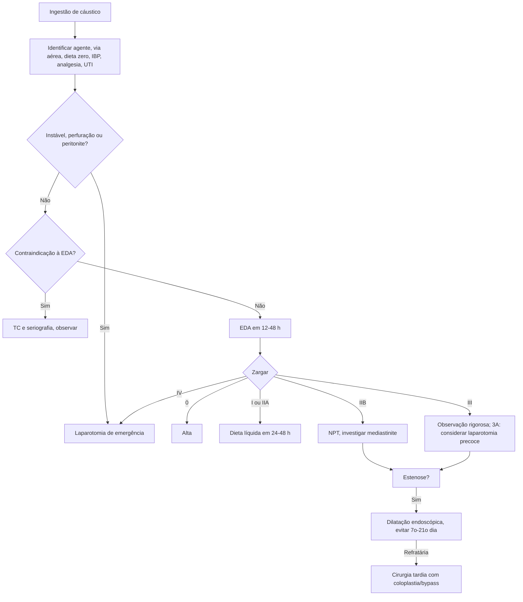

# Lesão Cáustica do TGI Superior

> Resumo em palavras próprias do Whitebook (Condutas Cirúrgicas > Cirurgia Geral e do Aparelho Digestivo), sem fisiopatologia, autoria e referências. Confira detalhes e doses na fonte: https://whitebook.pebmed.com.br/conteudo/?id=39161&categoryId=207&subcategoryId=211

## Epidemiologia e agentes
- **Crianças (80%):** acidentes domésticos. **Adultos jovens (20%):** tentativa de suicídio, transtornos psiquiátricos (depressão maior, esquizofrenia, personalidade, ajustamento), etilismo.
- **Álcalis (pH > 11):** hidróxido de sódio e de potássio (desinfetantes, baterias discoides). Lesão esofágica mais intensa, profunda e transmural, com mais perfuração; maior tempo de contato; grandes volumes.
- **Ácidos (pH < 2):** clorídrico, sulfúrico, fosfórico (removedores, bateria de carro). Lesão gastroduodenal mais intensa, em geral superficial; dor muito intensa; menores volumes; pior prognóstico segundo o texto.
- A gravidade depende da substância, volume, concentração, estado físico e tempo de contato. Perfuração = lesão que atravessa a muscular. Lesões em dois tempos: aguda precoce e tardia (> 7 dias).
- Locais de lesão: crianças — terço proximal do esôfago; adultos — constrição broncoaórtica (terço médio) e cárdia. Reparo começa após 10 dias; reepitelização em 1 mês; força tênsil em 3 semanas; estenoses de 3 semanas a anos.

## Quadro clínico
- Anamnese: substância, estado, volume, tempo desde a ingestão. **Nenhum sinal ou sintoma prediz o grau da lesão esofágica.**
- Dor retroesternal, epigastralgia, dor torácica, dispneia, vômito/hematêmese, sibilos, rouquidão e estridor (laringe/epiglote), disfagia/odinofagia, sialorreia.
- Exame: lesões orofaríngeas, sialorreia, febre, arritmias, choque.

## Diagnóstico
- **Laboratório:** leucocitose > 20.000, PCR alta, distúrbios hidreletrolíticos. Preditores de lesão grave: pH < 7,2, déficit de base -12, transaminases elevadas, plaquetopenia. Servem mais para monitorar do que para estimar mortalidade.
- **RX de tórax/abdome:** pneumomediastino, pneumoperitônio. **Seriografia com contraste solúvel:** confirma perfuração.
- **TC (graus):** 1 sem edema de parede; 2 espessamento sem envolver tecidos periesofágicos; 3 espessamento com envolvimento periesofágico e interface demarcada; 4 espessamento com borramento da interface ou coleção periesofágica/aórtica. Avalia profundidade e prediz estenose tardia, mas não complicações precoces.
- **EDA:** 10–30% das ingestões não têm lesão; indicação absoluta em adultos pós-tentativa de suicídio; crianças assintomáticas com agente de baixo potencial dispensam. **Quando:** 12–48 h (seguro até 96 h). **Contraindicações:** suspeita radiológica de perfuração, queimadura epiglótica/supraglótica com edema, queimadura de 3º grau na hipofaringe, instabilidade hemodinâmica, insuficiência respiratória aguda. Dilatação e nova EDA com cautela entre 5 e 15 dias; não é obrigatório interromper o exame diante de lesão circunferencial 2º/3º grau.
- **Classificação de Zargar:** 0 normal; I edema e eritema; II ulceração de mucosa/submucosa (IIA superficiais, erosões, exsudato; IIB circunferenciais ou profundas); III ulceração transmural com necrose (IIIA focal, IIIB extensa); IV perfuração. I e IIA: bom prognóstico; **70–100%** dos IIB e IIIB evoluem com estenose.

## Evolução e complicações
Prognóstico depende do grau da lesão e da condição de base; óbitos por mediastinite e peritonite. Complicações: dor intratável, síndrome de obstrução pilórica, dismotilidade (autovagotomia), refluxo, espasmo esofágico difuso, acloridria tardia, enteropatia perdedora de proteínas, fístulas, metaplasia, carcinoma epidermoide (risco 1.000–3.000× maior, em geral em estenoses).

## Tratamento inicial (em geral conservador)
- Identificar a substância (pH, concentração, rótulo) e acionar toxicologia (Ceatox); registrar modalidade, volume e vômitos espontâneos.
- **Via aérea:** se precisar intubar, preferir fibroscópio (evitar às cegas); considerar traqueostomia precoce se laringe/epiglote muito comprometidas.
- Dieta zero (exceto grau 0), estabilização, analgesia, imagem/EDA se indicadas, UTI. SNG para evitar vômito: controverso e arriscado.
- **IBP IV:** pantoprazol 80 mg 12/12 h nas primeiras 48 h, depois 40 mg 12/12 h; omeprazol 40 mg 12/12 h; esomeprazol 40 mg 12/12 h.
- **Corticoide** (visto no texto como opção em alguns protocolos): dexametasona 1 mg/kg/dia EV pela manhã (máx. 24 mg) por 3 dias, ou prednisolona 2 mg/kg/dia (máx. 60 mg) por 3 dias. Na prevenção de estenose, corticoide sistêmico não é indicado.
- **Antibiótico** de amplo espectro (cefalosporina de 3ª geração) se pulmão acometido ou alguns casos grau 3/4.
- **Evitar:** água (sem benefício comprovado), leite e carvão ativado (pioram EDA), neutralizantes (reação exotérmica), induzir vômito.

## Cirurgia precoce
- Decidida por critérios clínicos mais que radiológicos; na dúvida, preferir operar. Critérios laboratoriais (IRA, CIVD, acidose) costumam ser tardios. Lesões 3A endoscópicas têm menor morbimortalidade com laparotomia precoce.
- Via preferencial: **laparotomia exploradora** (laparoscopia só excepcionalmente, em mãos experientes ou para avaliar estômago); gastrotomia melhora a avaliação. Ressecar todos os órgãos lesados, se possível no primeiro tempo. Opções: esofagectomia com coloplastia/gastroplastia, esofagostomia cervical, gastrectomia parcial/total, jejunostomia.
- Esofagectomia de emergência é preditor negativo de sobrevida. Ressecção mínima com second look planejado em geral não é indicada; reexplorar se houver dúvida de piora. Em crianças a cirurgia é excepcional (preservar o esôfago).

## Acompanhamento
- Grau 0: alta sem orientações. Grau 1/2A: dieta líquida após 24–48 h e progressão. Grau ≥ 2B: nutrição parenteral e investigar mediastinite. Grau 3: observar de perto (perfuração em 1–2 semanas).
- Acompanhamento nutricional; supressão ácida prolongada; **EDA anual** a partir de 20 anos de lesão/ou em > 20 anos pelo risco de carcinoma epidermoide.

## Manejo de estenose
- **Dilatação endoscópica:** evitar entre o 7º e o 21º dia; em geral 3–4 sessões com intervalo de 1–3 semanas.
- Prevenção: corticoide sistêmico, antibioticoprofilaxia e cateter nasogástrico não indicados; mitomicina C 0,4 mg/mL (injetável ou tópica) com resultados positivos; stent intraluminal (silicone, Polyflex); experimentais: 5-FU intraperitoneal, antioxidantes, fosfatidilcolina, octreotida, interferon alfa-2b.
- **Cirurgia tardia:** estenose esofágica refratária (em geral após ~6 meses): esofagectomia com coloplastia/gastroplastia, ou manter esôfago nativo com bypass (gástrico retroesternal ou cólon direito); esofagocoloplastia se lesão gástrica associada. Estenose gástrica (após ~3 meses): piloroplastia (moderadas), gastrojejunostomia (duodeno comprometido, más condições, aderências), gastrectomia parcial (profilaxia de malignização).

## Fluxograma (refeito, a partir do texto; o texto original não traz uma figura única)

