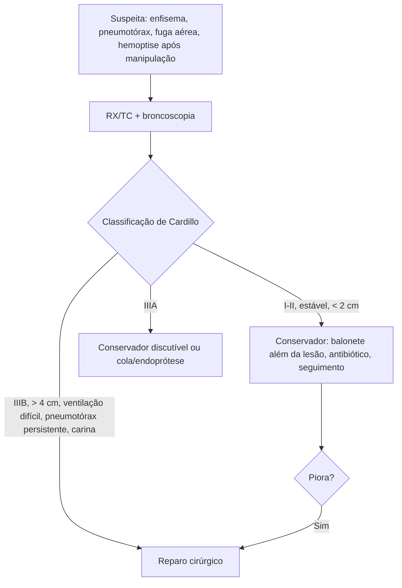

# Lesão Traqueobrônquica Iatrogênica

> Resumo em palavras próprias do Whitebook (Condutas Cirúrgicas > Cirurgia Torácica), sem autoria e referências. Confira detalhes e doses na fonte: https://whitebook.pebmed.com.br/conteudo/?id=48376&categoryId=207&subcategoryId=215

**Definição:** lesão da traqueia e/ou brônquios (sobretudo perfurações e lacerações) por procedimento médico invasivo ou cirúrgico. Rara em procedimentos eletivos; até 15% nos de urgência; o óbito costuma decorrer das comorbidades.

**Causas:** intubação (simples ou duplo lúmen: guia mal posicionado, tubo desproporcional), manejo inadequado de tubo/cânula (hiperinsuflação ou tração do balonete insuflado), traqueostomia percutânea ou cirúrgica, broncoscopia, cirurgias (mediastinoscopia, esofagectomia, tireoidectomia), barotrauma, dilatação endoscópica. Lacerações geralmente longitudinais, na porção membranácea, junto à transição membranácea-cartilaginosa, à direita, podendo chegar ao brônquio principal direito, nos terços médio e distal. Tardiamente: granulomas, estenose, depressão da parede, traqueomalácia.

## Clínica
Exige alta suspeição (manipulação difícil ou traumática); apresentação aguda, subaguda ou tardia; diagnóstico em média em 3–72 h; 25–68% não são diagnosticados. Sinais: hemoptise, vazamento de ar no ventilador e dificuldade de ventilar, enfisema subcutâneo progressivo, pneumotórax uni/bilateral com grande fuga persistente e má expansão, visão direta da lesão, sinal de Hamman, alteração da voz. Tardios: infecções de repetição, estridor/sibilância (estenose, após ~4 semanas), dispneia progressiva, destruição pulmonar, intolerância à oclusão da cânula.
- **Fatores relacionados ao procedimento:** inexperiência, emergência, múltiplas tentativas, tubo de duplo lúmen, uso inadequado de guias metálicos, sedação insuficiente, movimentação do paciente. **Do paciente:** anormalidades traqueais, fraqueza da membranácea, DPOC, doenças do tecido conjuntivo, corticoide prolongado, brevilíneo, IMC alto, sexo feminino (6:1), idade 50–70 anos.

## Diagnóstico
- **RX:** baixa sensibilidade; enfisema subcutâneo, pneumomediastino, pneumotórax, tubo deslocado, balonete hiperdistendido. **TC:** reconstruções melhoram; normal não exclui; depende da estabilidade; ar peribrônquico, descontinuidade da parede, hematoma mediastinal.
- **Broncoscopia (padrão-ouro):** diagnostica, classifica e pode tratar; única que exclui lesão (avaliar toda a traqueia até a subglote, inclusive retraindo o tubo); risco de obstrução por edema, sobretudo em lesões tardias. Esofagograma/EDA se fístula ou lesão esofágica.
- **Classificação de Cardillo (2010):** I — mucosa e submucosa, sem enfisema mediastinal nem lesão esofágica; II — atinge a muscular, com enfisema subcutâneo/mediastinal, sem lesão esofágica ou mediastinite; IIIA — laceração transmural completa com herniação esofágica ou de tecido mediastinal, sem lesão esofágica nem mediastinite; IIIB — qualquer lesão traqueal com lesão esofágica ou mediastinite.
- **Complicações:** fístula traqueoinominada e traqueoesofágica, estenose, infecções e bronquiectasias, empiema, atelectasia, abscesso, mediastinite, pneumotórax, insuficiência respiratória, óbito.

## Tratamento
- **Conservador** (Cardillo I e II; IIIA discutível; geralmente < 2 cm; paciente estável, sem mediastinite/lesão esofágica, ventilação adequada, pneumotórax controlado, enfisema não progressivo): balonete do tubo (IOT ou traqueostomia) abaixo da lesão; PEEP e volume corrente adequados; pneumotórax drenado; seguimento clínico e broncoscópico; antibiótico de amplo espectro preemptivo (ex.: piperacilina-tazobactam); antitussígenos; suporte nutricional; compensar comorbidades. Contraindicado se piora ventilatória, infecção ou perda da via aérea.
- **Broncoscópico** (associado ao conservador): cola de fibrina por broncoscopia flexível (Cardillo II e IIIA); endopróteses de silicone em Y acopladas à cânula.
- **Cirúrgico:** dificuldade de ventilação, prolapso esofágico na luz traqueal, lesão > 4 cm, progressão em ventilação mecânica, pneumotórax persistente, lesão próxima à carina, mediastinite/lesão esofágica (IIIB), lesão identificada no intraoperatório; pode usar ECMO; mortalidade ~25–42%. *Convencional:* cervicotomia ± esternotomia (traqueia acima do arco aórtico); toracotomia posterolateral direita (traqueia distal, carina, brônquio principal direito ou esquerdo proximal) ou esquerda (brônquio esquerdo distal); técnicas: reparo simples, ressecção e anastomose, broncoplastia, ressecção pulmonar; com lesão esofágica, reparar o esôfago em dois planos, depois a traqueia, e interpor retalho vascularizado. *Minimamente invasivo* (relatos): sutura com fio absorvível com ventilação intermitente/a jato; via transoral (broncoscopia rígida, porta-agulha, Hopkins 12°) ou transtraqueal com vídeo; até traqueia distal sem passar dos brônquios principais.
- **Tardio:** dilatação com broncoscopia rígida (paliativa enquanto há inflamação), endopróteses, laser; traqueoplastia é o tratamento de escolha depois; lesões brônquicas: broncoplastia ou ressecção anatômica.

## Fluxograma (refeito, a partir do texto; o original não traz algoritmo)

