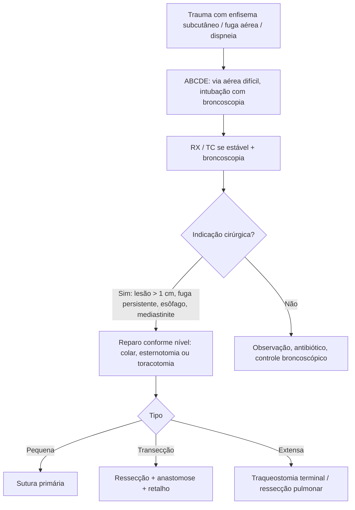

# Lesão Traqueobrônquica Traumática

> Resumo em palavras próprias do Whitebook (Condutas Cirúrgicas > Cirurgia Torácica), sem autoria e referências. Confira detalhes e doses na fonte: https://whitebook.pebmed.com.br/conteudo/?id=47799&categoryId=207&subcategoryId=215

**Definição:** lesão da árvore traqueobrônquica por transmissão de energia traumática. Infrequente (0,5–2% dos politraumatizados); mortalidade pré-hospitalar até 80% no trauma fechado (obstrução da via aérea ou lesões associadas); evento de alta energia; pode envolver laringe, traqueia cervical, traqueia torácica e brônquios.

## Mecanismos e clínica
- Compressão anteroposterior do tórax, súbito aumento da pressão intratorácica com glote fechada, aceleração-desaceleração, hiperextensão cervical, impacto/compressão direta (síndrome do painel de controle), perfuração (arma branca ou de fogo; cavitação), lesões iatrogênicas por intubação/traqueostomia.
- **Sinais:** dispneia (principal), taquipneia, disfonia/afonia ("voz de Mickey Mouse"), hemoptise, hematoma cervical, insuficiência respiratória, cianose, **enfisema subcutâneo (o mais comum)**, sinal de Hamman, **equimose do cinto de segurança** cervical, ferida cervical penetrante com fuga aérea (patognomônico). Suspeitar de lesão brônquica com fuga aérea importante e persistente após drenagem, deterioração ventilatória com a aspiração do sistema, pulmão que não expande apesar de dreno adequado, dificuldade de passar o tubo ou vazamento apesar do balonete hiperinsuflado.

## Diagnóstico
- **RX:** 10–20% sem sinais; enfisema subcutâneo, pneumotórax uni/bilateral, pneumomediastino, expansão incompleta mesmo com dreno, deformidade do contorno traqueal, tubo deslocado/balonete distendido, elevação do hioide no perfil cervical, sinal do "pulmão caído" (Kumpe; raro, específico).
- **TC:** detecta a lesão em 71–85%; boa para laringe, grandes vasos e mediastino; reconstruções ajudam; normal não exclui; contraindicada se instabilidade hemodinâmica/ventilatória; ar peribrônquico, parede descontínua, hematoma mediastinal.
- **Broncoscopia (padrão-ouro):** flexível (mais usada) ou rígida (exige extensão cervical, mas ventila); única que exclui lesão; avaliar toda a traqueia até a subglote; localização, tipo, extensão e profundidade; guia a intubação; risco de obstrução por edema (lesões tardias). Esofagografia/esofagoscopia e angiografia de vasos cervicais/arco aórtico se suspeita de lesão associada.
- **Classificação:** contuso (traqueia torácica, carina, brônquios principais — acidentes, queda, esmagamento); penetrante (laringe e traqueia cervical); inalatório (térmico/químico); transversa, longitudinal, complexa; precoce ou tardia.

## Tratamento
- **Manejo inicial (ABCDE do ATLS):** via aérea sempre difícil; intubação idealmente guiada por broncoscopia, balonete distal à lesão, sedação leve em ventilação espontânea, sem extensão cervical; **evitar manobra de Sellick e BURP**; em ferida penetrante com traqueia exposta, intubar por ela; em disjunção, buscar o coto distal retraído no mediastino com pinça; se não intubar: cricotireoidostomia ou traqueostomia. Pneumotórax: dreno; ECMO veno-venoso periférico como ponte se ventilação impossível. Controlar sangramento, repor volume e procurar outras lesões graves.
- **Definitivo:** estabilizar e definir lesões graves associadas antes do reparo. Casos sem cirurgia: observação e antibiótico. **Indicações cirúrgicas:** lesão esofágica associada, enfisema/pneumomediastino progressivo, insuficiência respiratória com necessidade de IOT, dificuldade de ventilação, pneumotórax residual, fístula aérea persistente, lesão traqueal aberta > 1 cm, mediastinite.
- **Princípios:** cooperação cirurgião-anestesista; fechar o defeito, garantir ventilação, prevenir mediastinite e complicações tardias (fonação), evitar desvascularização e lesão dos laríngeos recorrentes; tratar primeiro lesões vasculares/esofágicas.
- **Acessos:** traqueia cervical — cervicotomia em colar ou lateral esquerda; traqueia intratorácica acima do arco — cervicotomia + esternotomia parcial; carina, brônquio principal direito e esquerdo proximal — toracotomia posterolateral direita; brônquio esquerdo distal — toracotomia posterolateral esquerda; opções: esternotomia, bitoracotomia (*clamshell*).
- **Técnica:** pequenas lacerações — sutura primária (poliglactina ou PDS 3-0/4-0); transecção parcial ou completa — desbridamento, ressecção com anastomose terminoterminal sem tensão, retalho de proteção (muscular), liberação de tensão, traqueostomia de proteção; penetrantes (< 50% da traqueia e/ou > 2 anéis) — traqueostomia pela lesão; extensas e complexas — traqueostomia terminal; brônquicas extensas, lesão pulmonar associada ou destruição irreversível — ressecção pulmonar ± broncoplastia (evitar pneumonectomia); com lesão esofágica — fechar o esôfago em 2 planos, reparar a traqueia, interpor retalho vascularizado, considerar gastro/jejunostomia; considerar drenagem.
- **Pós-operatório:** material de via aérea à beira-leito; evitar hiperextensão cervical por 7 dias após anastomose; fisioterapia; **não ignorar nenhum sangramento pela traqueostomia** (fístula traqueoinominada); enfisema novo ou progressivo sugere deiscência; controle radiológico/infeccioso e broncoscopia das anastomoses.
- **Apresentação tardia** (não identificada, paciente crítico ou pós-correção; em média 6 meses, 2 semanas–20 anos): estridor, dispneia, sibilância, pneumonias recorrentes; estenose, bronquiectasia, destruição pulmonar, opacidade lobar/pulmonar. Tratamento: laser, endopróteses, reavivamento das bordas e anastomose, broncoplastia, ressecção pulmonar anatômica.
- **Complicações:** fístula traqueoinominada ou traqueoesofágica, estenose, infecções e bronquiectasias, empiema, atelectasia, abscesso, óbito.

## Fluxograma (refeito, a partir do texto; o original não traz algoritmo)

