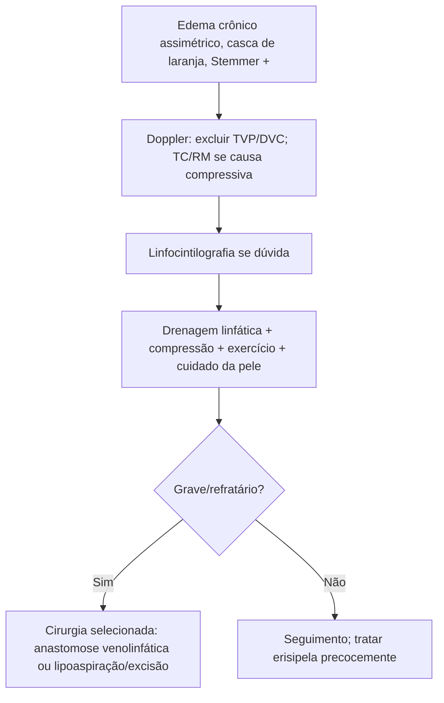

# Linfedema

> Resumo em palavras próprias do Whitebook (Condutas Cirúrgicas > Cirurgia Vascular), sem fisiopatologia detalhada, autoria e referências. Confira detalhes e doses na fonte: https://whitebook.pebmed.com.br/conteudo/?id=64201&categoryId=207&subcategoryId=238

**Definição:** doença crônica e progressiva por acúmulo de líquido rico em proteínas no terceiro espaço, por dano ao sistema linfático, com alterações tróficas e fibrose subcutânea. O meio rico em proteína e fibrose favorece infecções de repetição (erisipela).

## Classificação
- **Primário:** anomalias do sistema linfático.
- **Secundário (mais comum):** filariose, cirurgia (linfadenectomia oncológica), radioterapia, trauma, queimadura, obstrução por massas.
- Mecanismos: dinâmico (sobrecarga de linfáticos sadios) ou mecânico (destruição/lesão com queda do transporte).

## Clínica
Sensação de peso, limitação de mobilidade, espessamento e pele em "casca de laranja", fissuras, celulite/erisipela de repetição; pesquisar desencadeantes (cirurgia, radioterapia, trauma, infecção, história familiar). Exame: edema assimétrico, hiperceratose, medir circunferências; **sinal de Stemmer** (impossível pinçar a pele dorsal da base dos artelhos) sugere linfedema verdadeiro, já nas fases iniciais.

## Diagnóstico
Essencialmente clínico. USG Doppler para afastar TVP/DVC; **linfocintilografia** padrão-ouro (pouco usada); TC/RM se suspeita de causa compressiva. **Diferencial:** TVP, doença venosa crônica, lipedema.

## Tratamento
Sem cura, sobretudo com destruição linfática; objetivos: frear a progressão, reduzir o edema, prevenir infecção, melhorar a qualidade de vida.
- Drenagem linfática manual seriada, bandagens inelásticas graduadas, meias/mangas de compressão, exercícios que estimulam a bomba linfática; **cuidado rigoroso da pele**.
- **Cirurgia (exceção):** anastomoses venolinfáticas (experimentais, pouco usadas); lipoaspiração e excisão de tecido fibrogorduroso em elefantíase grave selecionada.

## Fluxograma (refeito, a partir do texto; o original não traz algoritmo)

