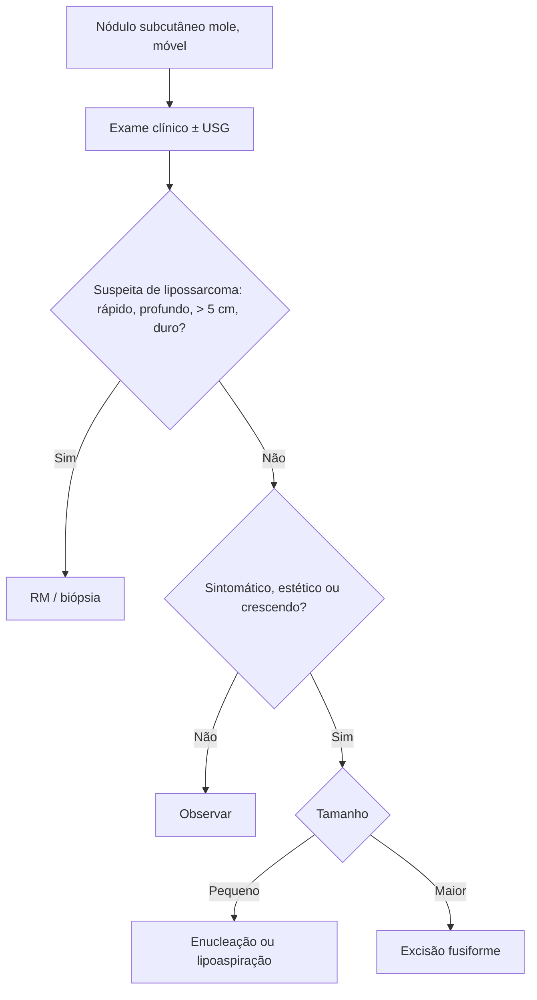

# Lipoma

> Resumo em palavras próprias do Whitebook (Condutas Cirúrgicas > Cirurgia Geral e do Aparelho Digestivo), sem fisiopatologia, autoria e referências. Confira detalhes e doses na fonte: https://whitebook.pebmed.com.br/conteudo/?id=39164&categoryId=207&subcategoryId=211

**Definição:** neoplasia benigna do tecido adiposo; é o tumor mesenquimal mais comum. Adipócitos maduros, em geral com fina cápsula fibrosa.

## Aspectos gerais
- Surge em geral entre 40 e 60 anos (em crianças, origem congênita); crescimento lento; sem predomínio de sexo. Em geral solitário; ~5% têm lipomas múltiplos. Lipomatose (múltiplos) é mais comum em homens com predisposição genética: síndrome de Gardner, doença de Madelung (lipomatose simétrica benigna de cabeça, pescoço, ombros e MMSS), lipomatose familiar, síndromes de Proteus e Bannayan-Riley-Ruvalcaba.
- Variantes por idade: hibernomas (~30 anos); lipoblastomas e lipomatose difusa (crianças > 3 anos).
- **Local:** tecido subcutâneo da metade superior do corpo; também intermuscular, vísceras abdominais, boca, tórax. **Tamanho:** em geral até 2 cm; gigante > 10 cm (≥ 1.000 g).
- **Patologia:** desequilíbrio entre adipogênese aumentada e apoptose reduzida; trauma pode desencadear lipomas pós-traumáticos; sem invasão ou metástase; malignização (sarcomatosa) é muito rara e de crescimento rápido. Lipoma verdadeiro (encapsulado) × falso (não encapsulado, após hematoma).
- **Variantes:** angiolipoma, lipoma pleomórfico, de células estreladas, adenolipoma; linfoma infiltrativo (invade músculo) é diferencial.

## Quadro clínico e diagnóstico
- Tumoração geralmente indolor, oval, de consistência amolecida, mais palpável que visível; grandes podem comprimir ou obstruir órgãos vizinhos. Lipomas dolorosos e irregulares: doença de Dercum (mulheres de meia-idade, astenia, transtornos psíquicos).
- Diagnóstico **clínico** (massa arredondada, móvel, pele normal); cisto sebáceo é mais firme e tem poro. **USG** de partes moles (diferencia de cisto/calcificação), TC e RM para caracterizar. Histologia é indistinguível de gordura madura; correlacionar com a clínica.
- **Diferenciais:** cisto epidermoide, tumores subcutâneos, angiolipoma, síndromes lipomatosas, fascite nodular, **lipossarcoma**, metástase, eritema nodoso, necrose gordurosa, paniculite de Weber-Christian, vasculite nodular, nódulos reumáticos, sarcoidose, hematoma, infecções (loíase, oncocercose).

## Tratamento
- Pequenos e assintomáticos: sem tratamento. Indicações de remoção: estética, efeito compressivo, dor, excluir lipossarcoma.
- **Não excisional:** corticoide intralesional (não recomendado em humanos); lipoaspiração (jelco 16 e seringa sob anestesia local, evita cicatrizes).
- **Excisional (padrão-ouro):** enucleação (pequenos) ou excisão com incisão fusiforme (maiores); pressão digital lateral à incisão ajuda a extruir a lesão. Complicações: equimose, hematoma, infecção, parestesia, lesão vascular, seroma, embolia gordurosa, periostite/osteomielite, lesão muscular, cicatriz ruim, deformidade, recorrência.

## Fluxograma (refeito, a partir do texto; o texto original não traz uma figura)

