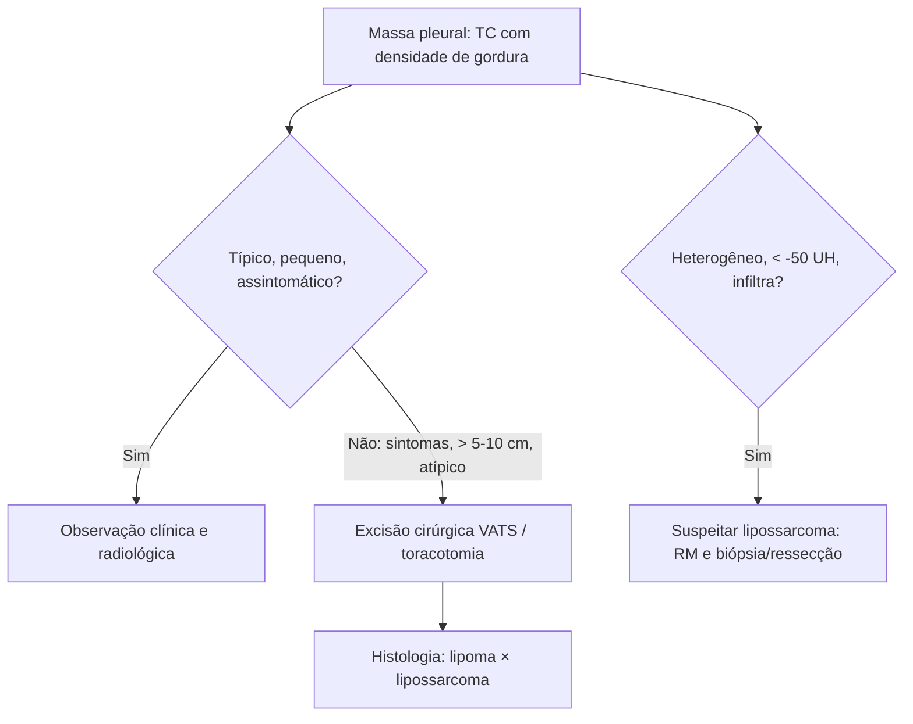

# Lipoma Pleural

> Resumo em palavras próprias do Whitebook (Condutas Cirúrgicas > Cirurgia Torácica), sem fisiopatologia detalhada, autoria e referências. Confira detalhes e doses na fonte: https://whitebook.pebmed.com.br/conteudo/?id=39163&categoryId=207&subcategoryId=215

**Definição:** neoplasia benigna de tecido adiposo da pleura (sinônimos: tumor adiposo pleural, lipomatose pleural localizada). Origem nos adipócitos da camada submesotelial da pleura parietal; etiologia desconhecida; crescimento lento.

## Epidemiologia
- Rara (~8% dos tumores benignos da pleura); detecção crescente pela TC. Adultos, mais em obesos.
- Geralmente lesão isolada, sésssil ou pediculada, de pleura visceral/parietal, torácica ou mediastinal; extensão pleural, subpleural ou extrapleural.
- Pode ter comportamento agressivo quando infiltra a parede torácica ou é muito grande; transformação em lipossarcoma é controversa.

## Clínica
- Mais comum: assintomático, achado de imagem.
- Raros sintomas compressivos quando volumoso (tosse, dor, dispneia), sobretudo peridiafragmático. Pode causar lise costal, síndromes compressivas/restritivas, hemorragia intratumoral (febre e dor). Em ~11% integra a síndrome de Pierre-Marie (osteoartropatia hipertrófica).

## Diagnóstico
- **TC (melhor exame):** origem pleural (ângulos obtusos com a parede, desloca o pulmão); encapsulado, margens definidas, homogêneo, densidade de gordura (**−5 a −150 UH**), sem calcificação e sem realce pelo contraste; lesões estáveis, de crescimento lento; pode erodir osso, reação periosteal, hiperostose.
- **Suspeitar de lipossarcoma:** arquitetura heterogênea, densidade < −50 UH, infiltração de tecidos vizinhos.
- **RX:** lesões arredondadas/nodulares. **USG transtorácica:** auxilia em lipomas parietais e avalia invasão de parede. **RM:** em dúvida da TC; relação com a parede e heterogeneidade (com contraste).
- **PAAF:** frequentemente inconclusiva. **Core biopsy:** mais precisa, mas distinguir lipoma de lipossarcoma bem diferenciado é difícil; a excisão costuma ser preferida. **Diagnóstico definitivo:** histologia da peça (lóbulos de adipócitos maduros sem atipia, cápsula fibrosa).
- **Classificação:** em ampulheta (dumbbell, através do estreito torácico/espaço intercostal) × puramente intratorácico.
- **Diferenciais:** adenolipoma, angiolipoma, lipoma cardíaco, disembrioma, hibernoma subpleural, tumor fibroso solitário, metástases pleurais, hérnia diafragmática, lipossarcoma bem diferenciado.

## Tratamento
- **Pequenos, assintomáticos, típicos** (densidade de gordura homogênea), sobretudo idosos/comorbidades: observação clínica e radiológica. Cirurgia também pode ser oferecida por ansiedade do paciente (ex.: medo de metástases de neoplasia prévia).
- **Excisão cirúrgica** (tratamento de escolha) se: sintomas compressivos; tamanho grande (> 5 a 10 cm em algumas séries); apresentação atípica ou dúvida com lipossarcoma desdiferenciado. Via toracoscópica (VATS) ou toracotomia em tumores muito grandes. Objetivos: confirmar o diagnóstico, controlar sintomas, limitar compressão.
- **Prognóstico:** excelente após ressecção completa, recidiva baixíssima.

## Fluxograma (refeito, a partir do texto; o original não traz algoritmo)

