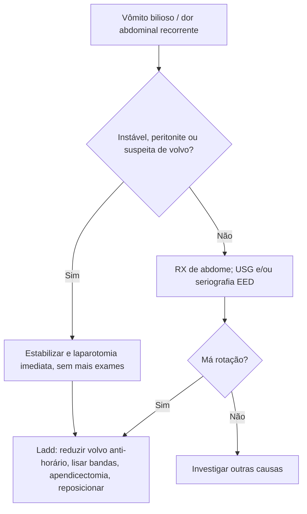

# Má Rotação Intestinal em Pediatria

> Resumo em palavras próprias do Whitebook (Condutas Cirúrgicas > Cirurgia Pediátrica), sem fisiopatologia detalhada, autoria e referências. Confira detalhes e doses na fonte: https://whitebook.pebmed.com.br/conteudo/?id=47540&categoryId=207&subcategoryId=826

**Definição:** rotação e fixação incompletas ou anormais do intestino e do mesentério em torno da artéria mesentérica superior (AMS). Normalmente o ângulo de Treitz fica à esquerda da coluna, o ceco no quadrante inferior direito e a base do mesentério é ampla. Na má rotação o mesentério é estreito (risco de **volvo**) e há bandas de Ladd que obstruem o duodeno.

## Epidemiologia
- Alterações assintomáticas até 1:500; sintomáticas ~1:6.000; leve predomínio masculino.
- Entre os sintomáticos, 60–75% manifestam-se no 1º mês e ~90% antes de 1 ano; alguns só na vida adulta.
- Em até 30% das atresias/estenoses duodenais. Associações: gastrosquise, onfalocele, hérnia diafragmática, Hirschsprung, invaginação, DRGE, veia porta pré-duodenal, volvo gástrico, Meckel. **Heterotaxia:** rastrear com seriografia mesmo sem sintomas.

## Clínica
- **Agudo (volvo do intestino médio):** vômito bilioso súbito (geralmente no 1º ano), distensão, irritabilidade, recusa alimentar; dor intensa e desproporcional ao exame, hematoquezia/melena/hematêmese, instabilidade hemodinâmica, sepse, acidose; má perfusão, hipotensão, lactato alto, peritonite.
- **Crônico/intermitente:** dor abdominal recorrente, vômitos intermitentes, baixo ganho de peso, refluxo, má absorção, diarreia alternando com constipação, intolerância a sólidos, icterícia obstrutiva; achados dependem de haver volvo no momento do exame.
- **Obstrução duodenal por bandas de Ladd:** vômito bilioso, distensão superior, ondas gástricas; volvo distal pode causar peritonite/choque.
- **Hérnia mesenterioparietal esquerda:** obstrução venosa (hematoquezia, hemorroidas, veias abdominais dilatadas).

## Diagnóstico
- **Laboratório:** hemograma (leuco/trombocitopenia, anemia), gasometria (acidose = isquemia), bioquímica, urina/urocultura, coagulograma se sepse/cirurgia.
- **RX de abdome:** distensão gástrica e duodenal, pouco gás distal, dupla bolha; útil para perfuração.
- **Seriografia esôfago-estômago-duodeno (padrão):** Treitz na linha média ou à direita, jejuno proximal à direita, duodeno em bico de pássaro ou cone (2ª/3ª porção), espiral/saca-rolha.
- **Enema contrastado:** posição do ceco quando a seriografia é duvidosa; posição medial isolada não indica volvo (mais torções = ceco mais alto).
- **USG:** veia mesentérica superior à esquerda ou anterior à AMS e **sinal do redemoinho**.
- **TC:** crianças maiores e casos crônicos atípicos.
- **Volvo, peritonite, perfuração ou choque: operar o mais rápido possível, sem outros exames.**
- **Diferencial:** obstrução intestinal, intussuscepção, banda congênita, enterocolite necrosante, atresia duodenal, sepse, DRGE, alergia alimentar.

## Tratamento
Má rotação sintomática tem indicação cirúrgica (laparotomia — instabilidade, suspeita de necrose, volvo grave — ou videolaparoscopia).
- **Pré-operatório:** estabilização, dieta zero, SNG se vômito bilioso, correção hidroeletrolítica (evitar/corrigir choque), cirurgia pediátrica urgente se suspeita de volvo.
- **Procedimento de Ladd:** reduzir o volvo **no sentido anti-horário**, desfazer aderências, lisar bandas de Ladd, tratar obstrução duodenal intrínseca, apendicectomia, posicionar o ceco à esquerda e o delgado à direita.
- **Complicações:** necrose, choque séptico, perfuração, síndrome compartimental; tardias: aderências, obstrução, recorrência do volvo (muito rara), intestino curto.
- **Prognóstico:** depende do tempo até o diagnóstico e da extensão da necrose; excelente sem necrose significativa.

## Fluxograma (refeito, a partir do texto; o original não traz algoritmo)

