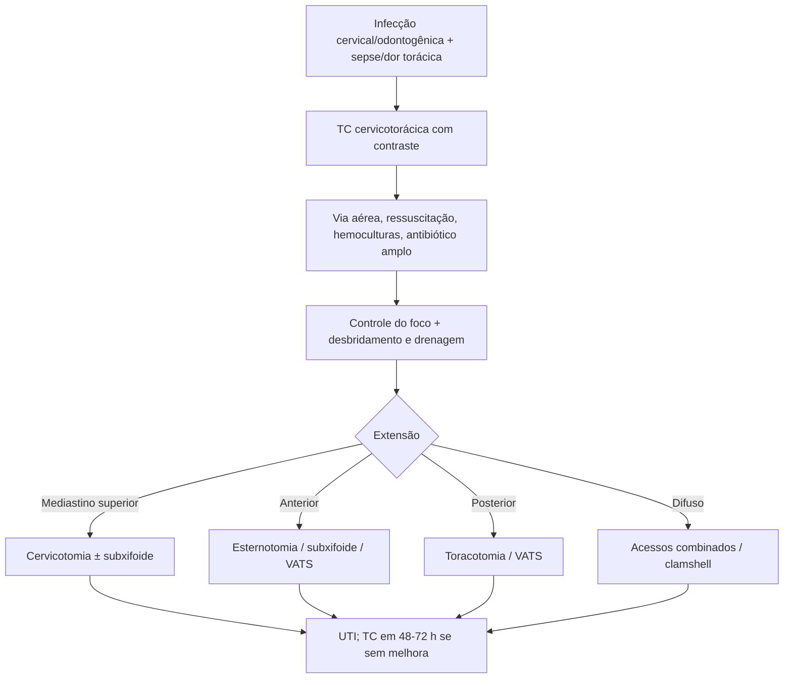

# Mediastinite Necrotizante Descendente

> Resumo em palavras próprias do Whitebook (Condutas Cirúrgicas > Cirurgia Torácica), sem fisiopatologia, autoria e referências. Confira detalhes e doses na fonte: https://whitebook.pebmed.com.br/conteudo/?id=39167&categoryId=207&subcategoryId=215

**Definição:** infecção grave do tecido conjuntivo do mediastino, originada em foco cervicofacial/odontogênico ou trauma cervical, que desce pelos planos fasciais cervicais (70% pelo espaço pré-vertebral), com abscessos, necrose, celulite e sepse.

## Etiologia e microbiologia
- Infecção odontogênica (2º/3º molares; a mais comum); abscessos peritonsilar/retrofaríngeo; perfuração faríngea; angina de Ludwig; trauma cervical; epiglotite, sinusite, parotidite; linfadenite; pós-operatório de cabeça/pescoço, coluna ou grandes vasos; extensão de infecção pulmonar/vertebral/costal (TB, HIV); punção venosa central e uso de drogas IV.
- Microbiologia polimicrobiana: estreptococo β-hemolítico do grupo A (mais comum), *Peptostreptococcus*, *Fusobacterium*, *Bacteroides*, *S. aureus*, *Haemophilus*; anaeróbios (culturas negativas, foco dentário, gás em imagem).

## Clínica
- Rara e das mais graves mediastinites; mortalidade 50–60% mesmo com tratamento (pouca sintomatologia inicial, atraso, drenagem inadequada); diabetes em > 1/3; prognóstico depende da etiologia e do tempo até o tratamento.
- Início 12 h–2 semanas após a infecção: febre, queda do estado geral, dor retroesternal/interescapular/cervical; história de infecção dentária/orofaringe, manipulação, corpo estranho, ferimento.
- Exame: enfisema subcutâneo, crepitação, edema cervical/torácico anterior, abaulamento cervical flogístico, trismo, estridor, odinofagia, disfagia, dispneia, paralisia de pares cranianos, sinal de Hamman, taquicardia, hipotensão/choque, livedo. Possível obstrução de via aérea e edema laríngeo; empiema, tamponamento.

## Diagnóstico
- Laboratório: leucocitose com desvio, inflamatórios, sinais de sepse.
- **RX cervical:** alargamento do espaço retrofaríngeo com ar/nível, anteriorização da coluna aérea traqueal, retificação da lordose. **RX de tórax:** alargamento mediastinal superior, pneumomediastino, derrame pleural, aumento da silhueta cardíaca. **TC:** edema do tecido mediastinal, gás, perda dos planos gordurosos, coleções com/sem bolhas, derrames pleural e pericárdico, miosite, adenopatias, trombose vascular, consolidações.
- **Critérios de Estrera (1983):** infecção grave clínica; achado radiológico compatível; infecção necrotizante comprovada na cirurgia ou post mortem; relação causal com infecção orofaríngea/cervical.
- **Classificação radiológica:** tipo I — localizada, acima da carina; IIA — difusa até o mediastino anterior inferior; IIB — difusa até o mediastino inferior, anterior e posterior.

## Tratamento
Emergencial, como sepse.
- **Clínico:** via aérea garantida (traqueostomia precoce se necessário), monitorização, acesso calibroso, volume, analgesia, hemoculturas e culturas de secreções/abscessos; controle do foco (extração dentária, corpo estranho, drenagem de abscesso retrofaríngeo). **Antibióticos:** cefalosporina de 2ª/3ª geração + clindamicina; ou piperacilina-tazobactam + vancomicina; ou quinolona + clindamicina; ou meropeném + metronidazol ou clindamicina.
- **Cirúrgico:** desbridamento amplo com drenagem das coleções, necrosectomia, comunicação entre compartimentos e irrigação (mediastinal, cervical, pleural), cateter de irrigação contínua possível; coleta para bacteriologia. Acessos: cervicotomia (mediastino superior), toracotomia (posterior), esternotomia (anterior; risco de osteomielite/deiscência), *clamshell* (mesmos riscos + lesão frênica), VATS (menos invasivo, preferencial), subxifoide (anterior); muitas vezes combinados. Feridas: fechamento primário, segunda ou terceira intenção (curativos diários e irrigação; pressão negativa; relatos de hiperbárica). Supuração só do mediastino superior (até a 4ª vértebra torácica): drenagem cervicomediastinal + subxifóidea anterior + traqueostomia de proteção pode curar em selecionados. Drenagem guiada por TC isolada não é indicada (precisa de desbridamento).
- **Seguimento:** UTI na fase aguda; febre, leucocitose ou piora → coleções ocultas; repetir TC se sem melhora em 48–72 h; ajustar antibiótico pela cultura; dieta enteral precoce; reintervenções podem ser necessárias; sintomas abdominais sugerem progressão além do tórax.
- **Complicações:** empiema bilateral, pericardite purulenta/tamponamento, obstrução de via aérea, fístula pleuromediastinal ou pleuroesofágica, pneumonia, sepse/choque, SDRA, trombose de jugular interna/braquiocefálica, síndrome de Lemierre, pseudoaneurisma de carótida, erosão de grandes vasos, extensão peritoneal/retroperitoneal.

## Fluxograma (refeito, a partir do texto; o original não traz algoritmo)

