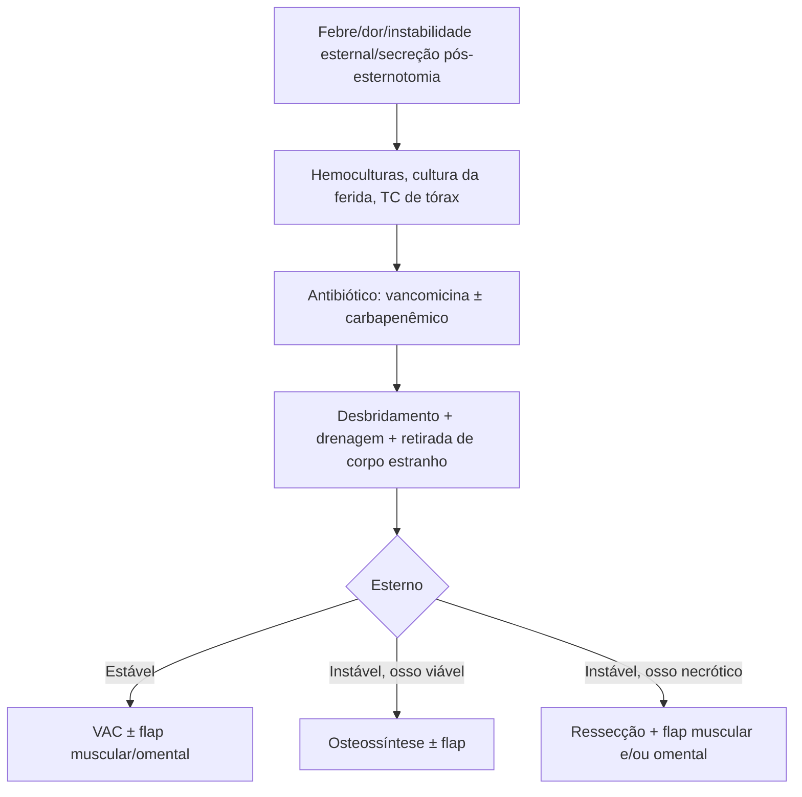

# Mediastinite Pós-esternotomia

> Resumo em palavras próprias do Whitebook (Condutas Cirúrgicas > Cirurgia Torácica), sem fisiopatologia, autoria e referências. Confira detalhes e doses na fonte: https://whitebook.pebmed.com.br/conteudo/?id=39170&categoryId=207&subcategoryId=215

## Definição (critérios diagnósticos — pelo menos um)
- Microrganismo isolado em cultura de tecido ou secreção mediastinal/retroesternal (cirurgia ou aspiração com agulha).
- Evidência macroscópica de mediastinite na cirurgia ou na histopatologia.
- Ao menos um sinal (febre > 38 °C, dor torácica, instabilidade esternal) mais drenagem purulenta mediastinal, ou hemocultura/secreção mediastinal espontânea com crescimento de microrganismo.
- Evidência radiológica de infecção mediastinal.
Origem: osteomielite localizada com disseminação, ou instabilidade esternal permitindo a progressão bacteriana; biofilme dificulta o tratamento. Agentes: *S. epidermidis* (SCoN) e *S. aureus* (70–80%); infecções mistas gram + e gram − (40%); eventualmente fungos.

## Clínica
Incidência 0,4–2,4% das esternotomias (em geral cirurgia cardíaca); morbimortalidade 10–47%. Sintomas em geral nos primeiros 30 dias: febre, taquicardia, dor torácica, instabilidade esternal, sinais flogísticos e secreção purulenta na ferida, bacteremia; leucocitose e inflamatórios elevados.
- **Fatores de risco:** do paciente (diabetes, DPOC, IC, NYHA alta, baixa FE, obesidade, imunossupressão, idade avançada, insuficiência renal); técnicos (enxertos mamários bilaterais, reoperação, cirurgia prolongada, uso excessivo de eletrocautério, esternotomia não mediana, estabilização inadequada, urgência/emergência, cera de osso); perioperatórios (ventilação prolongada, transfusões, UTI > 2 dias).

## Diagnóstico
História, exame, laboratório com hemoculturas e culturas de secreção; cultura do eletrodo de marca-passo provisório se removível; aspiração subxifóidea de coleções. **TC de tórax (mais relevante):** pneumomediastino, coleções (com ou sem gás), alargamento mediastinal, desnivelamento das bordas esternais.

## Tratamento
- Suporte; antibiótico amplo de início, guiado por cultura (cirúrgica, hemoculturas, secreções, esponja do VAC); germes frequentemente resistentes. **Empírico:** vancomicina ± carbapenêmico; duração variável, no mínimo 4–6 semanas.
- **Cirurgia:** desbridamento, remover corpos estranhos (fios de aço, cera de osso), drenar todos os espaços, lavar com SF 0,9%, culturas teciduais e fechar o espaço esternal: fechamento primário ou tardio; ferida aberta com curativos seriados ou VAC; fechamento com ou sem irrigação fechada com antibiótico diluído (não mais iodopovidona); ressecção esternal com reconstrução por tecidos vascularizados (omento, peitorais maiores, grande dorsal, retos abdominais) em grandes defeitos (contraindicada se infecção persistente ou espaços não drenados).
- **Terapia por pressão negativa (VAC):** 1ª linha ou 2ª linha associada a flap; sempre tentar se for esperado fechamento esternal tardio; drenagem aberta, estabilização da parede, granulação, ↑ perfusão; pressão contínua ou intermitente de −125 mmHg; facilita mobilização/fisioterapia e permite reestabilizar o esterno depois.
- **Classificação de Amsterdam (van Wingerden, 2014)** — conduta por estabilidade esternal e viabilidade óssea: esterno estável/viabilidade razoável → pressão negativa (tipo mais leve), flap muscular local ou flap omental/muscular (tipos subsequentes); esterno instável com osso viável → osteossíntese com fio, com ou sem flaps muscular/omental; esterno instável com osso necrótico/insuficiente → flap muscular, omental, ou ambos. (O texto não traz os números dos tipos; conferir na fonte.)

## Prevenção
- **Pré-operatório:** HbA1c > 7,5 / glicemia > 200 mg/dL a controlar; parar de fumar; nutrição; tratar infecção extratorácica; descolonização nasal com mupirocina por 5 dias (sem resultado negativo para estafilococo); banho com clorexidina; preparo antisséptico da pele.
- **Profilaxia antibiótica:** β-lactâmico (cefazolina ou cefuroxima) 60 min antes da incisão; vancomicina + gentamicina se alergia à penicilina ou risco de MRSA; repique se cirurgia > 4 h; suspender até 48 h.
- **Intraoperatório:** esternotomia mediana, dissecção cuidadosa, hemostasia rigorosa, evitar cera de osso (usar vancomicina tópica nas bordas), fechamento esternal em "8" em alto risco, placas se disponível. **Pós-operatório:** suporte esternal, controle glicêmico, extubação precoce, retirar precocemente sonda vesical e cateter central.

## Fluxograma (refeito, a partir do texto; o original não traz algoritmo)

