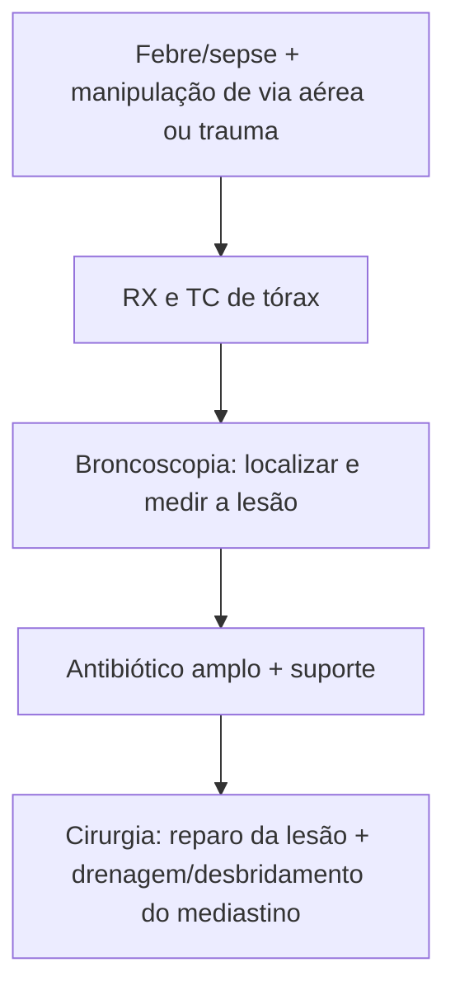

# Mediastinite por Lesão de Vias Aéreas

> Resumo em palavras próprias do Whitebook (Condutas Cirúrgicas > Cirurgia Torácica), sem fisiopatologia, autoria e referências. Confira detalhes e doses na fonte: https://whitebook.pebmed.com.br/conteudo/?id=39169&categoryId=207&subcategoryId=215

**Definição:** processo inflamatório/infeccioso do tecido conjuntivo mediastinal por perfuração traqueobrônquica iatrogênica ou traumática (extravasamento de secreções para o mediastino).

**Causas:** intubação orotraqueal, broncoscopia rígida ou flexível, dilatações traqueobrônquicas, retirada de corpo estranho, erosão por endoprótese, trauma perfurante, manobras cirúrgicas (ex.: esofagectomia).

## Clínica
Inespecífica: febre, queda do estado geral, sepse. Relacionada à lesão: hemoptise, dispneia, rouquidão, enfisema subcutâneo, pneumotórax, pneumomediastino.

## Diagnóstico
- História focada em manipulação prévia da via aérea; laboratório infeccioso/inflamatório.
- **RX:** pneumomediastino, pneumotórax. **TC:** coleções mediastinais; sinais diretos (solução de continuidade da via aérea) ou indiretos (pneumotórax, pneumomediastino, enfisema subcutâneo).
- **Exame invasivo (broncoscopia):** padrão-ouro; define presença, tamanho e localização da lesão.

## Tratamento
Cuidados gerais; antibiótico de amplo espectro com descalonamento pelas culturas; cirurgia para corrigir a lesão (conforme manejo específico) e controlar o foco infeccioso. **A presença de mediastinite contraindica qualquer tentativa de tratamento conservador da lesão traqueobrônquica.**

## Fluxograma (refeito, a partir do texto; o original não traz algoritmo)

