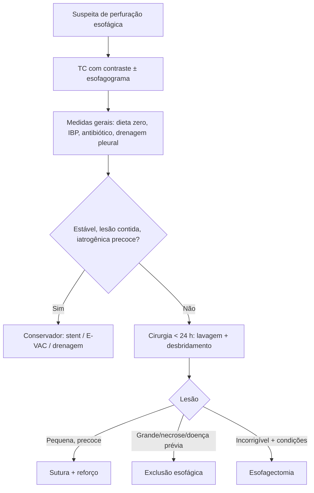

# Mediastinite por Perfuração Esofágica

> Resumo em palavras próprias do Whitebook (Condutas Cirúrgicas > Cirurgia Torácica), sem fisiopatologia, autoria e referências. Confira detalhes e doses na fonte: https://whitebook.pebmed.com.br/conteudo/?id=39168&categoryId=207&subcategoryId=215

**Definição:** inflamação/infecção do mediastino por extravasamento de secreções contaminadas (saliva, suco gástrico, bile) após ruptura ou perfuração do esôfago. Locais frequentes: estreitamentos fisiológicos (cricofaríngeo, junção esofagogástrica). Infecção polimicrobiana (gram-positivos, gram-negativos, anaeróbios).

**Causas:** procedimentos endoscópicos, síndrome de Boerhaave, trauma cervicotorácico, corpo estranho, tumores, cáusticos, esofagite grave, lesão por medicamentos, intubação difícil.

## Clínica
Causa mais comum de mediastinite aguda; mortalidade até 68%; mais associada a procedimentos esofágicos invasivos; atraso pode causar destruição tecidual extensa em < 24 h. Oligossintomático a sepse grave; dor cervical, torácica ou abdominal; dispneia. História: endoscopia, corpo estranho, cáusticos, vômitos copiosos (Boerhaave), etilismo, úlcera péptica, emagrecimento, disfagia prévia (tumor). Exame: hipotensão, enfisema subcutâneo, sinal de Hamman, derrame pleural.

## Diagnóstico
Leucocitose com desvio, anemia variável. Toracocentese: restos alimentares, exsudato citrino semiturvo fétido, amilase elevada. Teste com corante (azul de metileno) positivo no dreno. RX: enfisema subcutâneo/cervical profundo, pneumotórax, pneumomediastino, níveis hidroaéreos, derrame, infiltrado (bário pode localizar a perfuração). **TC cervicotorácica com contraste (método de eleição):** ar periesofágico, coleções, abscessos (contraste oral ajuda). EDA: avaliar corpo estranho (pouca insuflação).

## Tratamento
- **Gerais:** via aérea, volume, dieta zero, nutrição parenteral, IBP, antibiótico de amplo espectro (antifúngico em casos selecionados — imunossupressão, antibiótico amplo recente), drenagem pleural fechada.
- **Conservador** (somente lesões iatrogênicas, raramente traumáticas precoces; sobretudo esôfago cervical com mínima contaminação): estabilidade clínica, sem crepitação/pneumotórax/pneumoperitônio/extravasamento intraperitoneal; ruptura bem contida no mediastino ou numa loculação pleural; perfuração instrumental precoce sem ingestão oral; perfuração tardia bem tolerada. Opções: *stent* endoscópico (≥ 4 cm maior que a lesão), E-VAC (vácuo endoscópico) ou apenas drenagem cirúrgica.
- **Cirúrgico** (emergência, ideal < 24 h): Boerhaave; contaminação mediastinal; doença esofágica prévia (câncer, acalasia); perfuração intra-abdominal; pneumotórax, corpo estranho retido, instabilidade/sepse. Tática depende do tempo, local, gravidade, viabilidade do órgão, reserva fisiológica, estabilidade e extensão. Sempre: lavagem exaustiva do mediastino e pleura, desbridamento (± decorticação); VATS possível; cervicotomia supraesternal para o plano pré-traqueal se necessário.
  - **Sutura primária** com reforço (músculo intercostal, gordura pericárdica, omento, músculos cervicais) — lesões pequenas e abordadas em < 24 h; contraindicada em esôfago cervical mal visualizado, necrose mediastinal, grande lesão, neoplasia, acalasia, instabilidade.
  - **Exclusão esofágica** (esofagostomia cervical + gastro/jejunostomia) sem sutura.
  - **Esofagectomia** (lesão incorrigível ou doença grave — estenose, necrose extensa, neoplasia distal) em paciente com condições; geralmente em segundo tempo.
- **Pós-operatório:** dieta oral zero ≥ 5 dias; nutrição enteral por jejunostomia em 48–72 h; antibiótico 7–10 dias; esofagograma contrastado no 7º dia (se normal, retirar SNG e iniciar dieta oral); TC de seguimento; reconstrução do trânsito em 6–12 meses (muitas vezes coloplastia retroesternal).

## Fluxograma (refeito, a partir do texto; o original não traz algoritmo)

