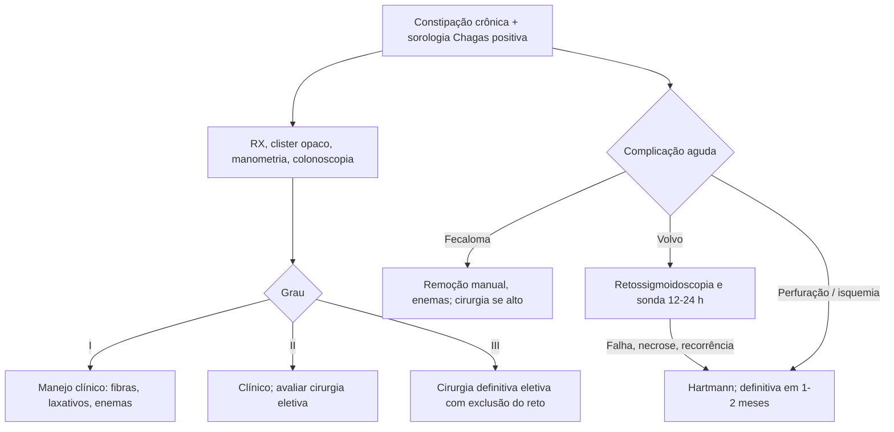

# Megacólon Chagásico

> Resumo em palavras próprias do Whitebook (Condutas Cirúrgicas > Cirurgia Geral e do Aparelho Digestivo), sem fisiopatologia, autoria e referências. Confira detalhes e doses na fonte: https://whitebook.pebmed.com.br/conteudo/?id=23248&categoryId=207&subcategoryId=211

**Definição:** complicação da forma digestiva crônica da doença de Chagas (*Trypanosoma cruzi*): dilatação irreversível e alongamento do intestino grosso por destruição dos plexos de Auerbach e Meissner. Critérios de dilatação: ceco > 12 cm; cólon ascendente > 8 cm; descendente/sigmoide > 7 cm.

## Epidemiologia
Chagas: prevalência 4,2% (60% na zona rural). 10–40% evoluem para forma crônica (cardíaca é a mais comum); 10–15% dos crônicos têm forma digestiva. Centro-Oeste, Sudeste e Nordeste; 40–60 anos; sigmoide e reto são os segmentos mais atingidos. ~30% têm algum procedimento de urgência; complicações exigem cirurgia em 30–40%.

## Diagnóstico
Clínico, epidemiológico e sorológico.
- **História:** área endêmica, vetor, infecção aguda na infância (rara), familiares com Chagas.
- **Clínica:** constipação de décadas, progressiva, com laxativos cada vez mais fortes; distensão abdominal.
- **Exame:** distensão assimétrica (fossa ilíaca e flanco esquerdos), desnutrição, cólon repleto de fezes, **sinal de Gersuny** (depressão do conteúdo à digitopressão e descolamento da parede), **sinal de von Wahl** (distensão assimétrica), toque retal com ampola dilatada e fezes.
- **Complicações:** fecaloma (~65%), volvo de sigmoide (~30%; isquemia), perfuração colônica (colite isquêmica, peritonite fecal). Associados: megaesôfago e cardiopatia chagásica.
- **Exames:** sorologia anti-*T. cruzi* por duas técnicas (HAI, IFI, ELISA); hemocultura, PCR, xenodiagnóstico; **RX de abdome** (ectasia do sigmoide, gás, fecaloma); **clister opaco** (indispensável: grau e segmento); **TC** (complicações; volvo com imagem em bico de pássaro/grão de café, “U” invertido); **manometria anorretal** (perda do reflexo inibitório retoanal, hipossensibilidade retal); **colonoscopia** (exclui neoplasia e causas mecânicas).
- **Classificação funcional:** I — dilatação discreta, trânsito lento → clínico; II — constipação grave, fecalomas recorrentes → avaliar cirurgia eletiva; III — dilatação grave, volvo ou complicações → cirurgia definitiva.

## Tratamento
**Clínico (graus I–II):** fibras 30–40 g/dia e líquidos; laxativos (emolientes e enterocinéticos); enemas/lavagem conforme necessidade. Fecaloma: remoção manual, enemas de glicerina e/ou fosfosoda; se alto, raquianestesia e remoção cirúrgica. Benznidazol só beneficia formas precoces, sem efeito no megacólon estabelecido.

**Volvo de sigmoide:** ~70–80% resolvidos por retossigmoidoscopia rígida com esvaziamento de gás e fezes e sonda retal por 12–24 h (também avalia a viabilidade da mucosa). Cirurgia se necrose ou falha endoscópica.

**Cirurgia de urgência:**
- Falha clínica com obstrução e distensão importante (25%) e/ou megacólon > 10 cm: colostomia em alça ou Hartmann.
- Falha endoscópica no volvo, sofrimento de alça ou volvos repetidos: Hartmann; cirurgia definitiva eletiva após 1–2 meses.
- Perfuração/isquemia: sempre cirurgia; **Hartmann**; qualquer anastomose primária é contraindicada (alto risco de fístula).

**Cirurgia eletiva** (sintomas graves, após custo/benefício; baseada na exclusão do reto e não só na ressecção do cólon dilatado; nenhuma técnica é superior):
- **Retossigmoidectomia abdominal simples** (um dos primeiros): fácil, alta recidiva.
- **Retossigmoidectomia com anorretomiomectomia (Rezende/…):** ressecção do reto 5 cm abaixo da reflexão peritoneal, miectomia interna do ânus (1–2 cm de largura, 6–8 cm de extensão) e anastomose colorretal; não excluir o reto mantém o obstáculo funcional e causa recidiva.
- **Operação de Rezende-like com alça ileal interposta (descrita no texto):** sigmoidectomia, reto cortado a 2 cm da reflexão, alça de íleo de 12–15 cm (a 25 cm da válvula ileocecal) interposta com anastomoses coloileal e ileorretal; a alça ileal funciona como bomba propulsora; baixa morbimortalidade e recidiva.
- **Operação de Soave/Turnbull (abaixamento endorretal):** ressecção do cólon dilatado e do reto até os elevadores, eversão do reto, abaixamento endorretal e anastomose coloanal retardada ± mucosectomia; risco de lesão esfincteriana/urogenital; pouco usada no Brasil.
- **Duhamel-Haddad:** tempo abdominal — ressecar a alça dilatada, dividir o reto na reflexão, dissecção romba retrorretal do promontório ao aparelho esfincteriano, abaixar o cólon; tempo perineal — incisão transversa da parede posterior do canal acima da linha pectínea, abaixar e fixar o cólon, colostomia perineal; após 7–10 dias, reconstrução com ressecção do segmento distal. **Modificação de Habr-Gama:** anastomose mecânica terminolateral com grampeador circular curvo entre o cólon abaixado e a parede posterior do reto próximo à linha pectínea; tempo abdominal pode ser por videocirurgia. Boa evolução, mas pode haver recidiva após anos; melhores resultados com anastomose baixa (confirmada no toque) e colectomia ampla com mobilização da flexura esplênica.
- (Os nomes das técnicas sem título no texto extraído foram inferidos pelas descrições; confira na fonte.)

**Peroperatório:** avaliar cardiopatia chagásica (ECG, eco); megaesôfago e cardiopatia pedem equipe multidisciplinar; evitar preparo agressivo; vigiar infecção pélvica e deiscência; reabilitação intestinal.

## Fluxograma (refeito, a partir do texto; o texto original traz uma tabela de graus, reproduzida acima)

