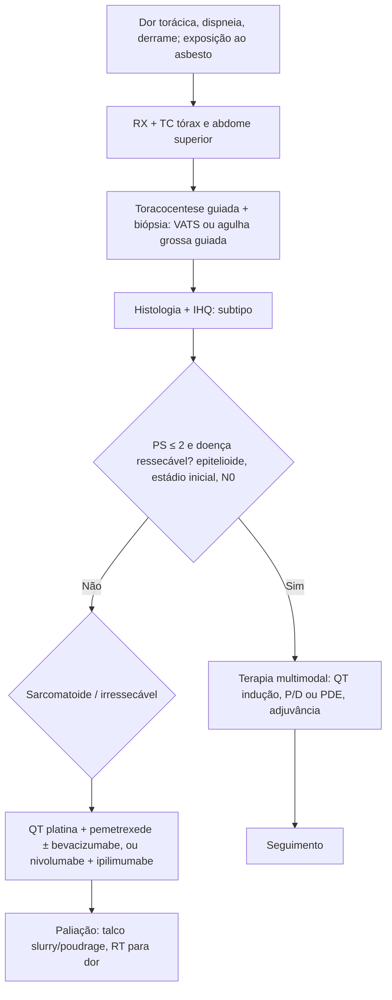

# Mesotelioma Pleural Maligno

> Resumo em palavras próprias do Whitebook (Condutas Cirúrgicas > Cirurgia Torácica), sem fisiopatologia detalhada, autoria e referências. Confira detalhes e doses na fonte: https://whitebook.pebmed.com.br/conteudo/?id=39172&categoryId=207&subcategoryId=215

## Epidemiologia
- Neoplasia rara, na maior parte prevenível; diagnóstico geralmente tardio. Mais comum em homens (exposição ocupacional); idade média ~70–72 anos. Unilateral em 97% (mais à direita). ~80% dos mesoteliomas são pleurais (outros: peritônio, pericárdio, túnica vaginal).
- ~70% associados ao **asbesto** (anfibólios mais que crisotila). Ocupações: mineração, isolamento térmico, cimento-amianto, materiais de fricção, graxetas, têxteis resistentes ao fogo, encanamento, construção, demolição, eletricistas. Exposição não ocupacional: ambiental, familiares/parceiros, moradia próxima a fábricas. **Latência 30–50 anos.**
- Raros casos familiares (mutação em **BAP1**); outros fatores: radiação prévia, erionite. Tabagismo não é fator de risco (mas soma-se ao asbesto no câncer de pulmão). Sem rastreamento recomendado em expostos. Brasil, Rússia, China e Canadá estão entre os maiores produtores de asbesto.
- **Biologia:** NF-kB desregulada; perda de BAP1 (40–60% dos esporádicos) é evento inicial e chave.
- **Histologia:** epitelioide (60–70%; melhor prognóstico), sarcomatoide (10–20%; pior), bifásico (10–20%; prognóstico conforme a fração sarcomatoide), raros (desmoplásico, deciduoide).
- **Imuno-histoquímica:** positivos para mesotélio — calretinina, citoqueratina 5/6, vimentina, D2-40, WT-1, EMA, GLUT-1, HMBE-1, p53; positivos para adenocarcinoma (negativos para mesotélio) — CEA, TTF-1, PGE4?, CD15, MOC-31, Leu-1, B72.3. Menor acurácia no sarcomatoide. Exige invasão tecidual, ≥ 2 marcadores positivos para mesotélio e ≥ 2 negativos para adenocarcinoma, e subtipo definido; sequenciamento ainda não indicado.
- **Metástases:** fígado, pulmão contralateral, próstata, cérebro, tireoide.

## Clínica
Em geral sintomático e inespecífico, às vezes achado incidental: dor torácica e dispneia (principais), perda de peso, febre, sudorese noturna, fadiga, derrame pleural (mais à direita), tosse, disfagia, disfonia, pneumotórax espontâneo, massa torácica, síndrome de veia cava superior, Horner, paralisia diafragmática. Baqueteamento e tabagismo sugerem mais câncer de pulmão.

## Diagnóstico
- **História ocupacional** ao longo da vida (inclusive de familiares/parceiros).
- **Biomarcadores** (mesotelina solúvel/SMRP, osteopontina): não usar para diagnóstico, prognóstico ou triagem (S e E < 90%); úteis para monitorar resposta (SMRP acompanha a carga tumoral); considerar em citologia suspeita sem condição para procedimento invasivo.
- **RX:** primeiro exame; derrame unilateral, espessamento/nódulos pleurais, placas (marcadores de exposição); insuficiente para estadiar.
- **TC de tórax e abdome superior (mais acurada, com contraste):** espessamento pleural difuso ou nodular (> 1 cm), nodular em pleura mediastinal ou fissuras, derrame (pode ocultar), lesão na base, adenomegalia, geralmente sem acometimento pulmonar; limitada em T4 e N2/N3. TC de abdome e pelve se suspeita de doença abdominal.
- **RM:** não rotineira; útil em invasão de diafragma/mediastino/parede (T3); hipersinal em T2 e em T1 pós-contraste, difusão; S 60–100%, E 73–95%.
- **PET-TC:** não rotineira (exceto ASCO 2018); considerar quando excluir metástase mudaria a conduta (candidato à ressecção); SUV máx > 2 distingue maligno (S 88–100%, E 88–92%). Falso-negativo: tumores pequenos, epitelioides precoces; falso-positivo: pleurite, TB, parapneumônicos, pleurodese prévia com talco.
- **Procedimentos:** o diagnóstico depende de tecido.
  - *Toracocentese guiada por USG:* sempre (diagnóstica e terapêutica); exsudato linfocítico. **Citologia** pouco útil (S 16–73%; só epitelioide; pouca atipia); sempre pedir IHQ; não definir diagnóstico só por ela, salvo se biópsia inviável/desnecessária por vontade do paciente ou PS ruim.
  - *Biópsia guiada por TC/USG* (agulha grossa Tru-Cut): áreas focais de pleura anormal, não candidatos à toracoscopia; sem guia e agulha fina não recomendadas.
  - *Cirúrgica (melhor método):* pleuroscopia sob anestesia local ou **VATS (preferencial)**; ou biópsia aberta mínima se sem derrame/cavidade não patente; 1–2 incisões nos locais do futuro tratamento cirúrgico (evitar implantes na parede); **congelação não define diagnóstico** (IHQ essencial).
  - *Linfonodos mediastinais* (mais que hilares): EBUS, USG endoscópica, mediastinoscopia ou VATS; para candidatos à citorredução máxima (rotina em alguns centros).
  - *Laparoscopia:* suspeita de doença abdominal ou invasão transdiafragmática, seletiva.
- **Diferenciais:** adenocarcinoma pulmonar (MPM é TTF-1 e napsina A negativos), sarcoma, metástases pleurais (inclusive timoma), derrame benigno por asbesto, pleurite crônica/fibrose.

## Estadiamento AJCC/UICC 8ª ed. (2018)
- **T1a** sem pleura visceral; **T1b** com pleura visceral; **T2** diafragma ou parênquima pulmonar; **T3** fáscia endotorácica, gordura mediastinal, foco solitário ressecável na parede, pericárdio sem invasão transmural; **T4** parede difusa/multifocal ± costelas, transdiafragmática para peritônio, pleura contralateral, órgãos mediastinais, coluna, superfície interna do pericárdio ± derrame/miocárdio.
- **N1** hilares/broncopulmonares ipsolaterais; **N2** subcarinais, mediastinais ipsolaterais, mamários internos e peridiafragmáticos ipsolaterais; **N3** mediastinais contralaterais, mamário interno contralateral, supraclaviculares. **M1** à distância.
- **Estágios:** IA T1a N0; IB T1b N0; II T2 N0; III T1–2 N1–2 ou T3 N0–2; IV T4, ou N3, ou M1.

## Tratamento
(ASCO 2018: assintomáticos epitelioides com doença pleural mínima e não cirúrgicos podem ser observados antes da QT. ASCO 2023: conduta multidisciplinar e individualizada; maioria recebe terapia sistêmica.)
- **Quimioterapia:** melhora sobrevida e sintomas; PS ≤ 2; inoperáveis, recusa de cirurgia, sarcomatoide/bifásico ou parte do tratamento multimodal (neo/adjuvante em I–III). Platina + antifolato: carboplatina alternativa à cisplatina (idosos), raltitrexede alternativa ao pemetrexede, gencitabina/cisplatina alternativa; 4–6 ciclos; sem manutenção. Efeitos: náusea, vômito, leucopenia, neutropenia, perfuração intestinal.
  - **+ Bevacizumabe** (selecionados): ↑ sobrevida livre de doença e global; contraindicado se PS ≥ 2, doença cardiovascular importante, HAS não controlada, > 75 anos, risco hemorrágico; mais toxicidade (hipertensão, trombose, epistaxe).
  - **Imunoterapia:** nivolumabe + ipilimumabe (anti-PD-1 + anti-CTLA-4), novo padrão de 1ª linha para inelegíveis à platina e opção para todos os histotipos (principalmente sarcomatoide).
- **Cirurgia:** paliação de derrame, diagnóstico/estadiamento, parte do tratamento multimodal (citorredução macroscópica completa; geralmente só no subtipo epitelioide). Tipos: pleurectomia parcial (paliativa, deixa tumor); **P/D** (pleurectomia/decorticação sem ressecar diafragma/pericárdio); **PDE** (estendida, com diafragma/pericárdio); **PPE** (pleuropneumonectomia extrapleural: pleura parietal, pericárdio, diafragma, pulmão e pleura visceral em bloco).
  - *Manejo do derrame sintomático* (PS ≥ 2 sem cirurgia citorredutora): nenhuma técnica (pleurectomia, talco por VATS, talc slurry, cateter de longa permanência) é superior; pleurodese funciona menos no mesotelioma; pleurectomia por VATS é mais cara, com mais complicações e internação; preferir **talco slurry ou poudrage**.
  - *Citorredução:* estágios precoces, epitelioide, sem doença extratorácica, reserva cardiopulmonar adequada, elegível à terapia multimodal. Contra: PS ruim, comorbidades, sarcomatoide/misto, N2 confirmado, impossibilidade de ressecção macroscópica completa. R0 é praticamente impossível; insuficiente isolada. **Preferir P/D ou PDE** à PPE (menor morbimortalidade, sobrevida comparável); PPE em selecionados (permite RT hemitorácica). Amostragem de ≥ 3 estações linfonodais. Centros de alto volume.
  - *Quimioterapia hipertérmica intratorácica (HITHOC):* técnica emergente, em validação.
- **Radioterapia:** paliativa para dor localizada e dispneia (doses não definidas; RT hemitorácica sem impacto consistente); **profilática de portais** (toracoscopia/drenos) sem benefício de rotina (talvez no epitelioide); radical/adjuvante controversa, mais benefício após PPE, toxicidade (pneumonite 0–46%), não indicada pela BTS 2018 como neo/adjuvante nem RT radical isolada; não costuma ser usada após cirurgias poupadoras de pulmão.
- **Multimodal:** indução com QT → reavaliação → citorredução máxima → RT/QT/quimiorradioterapia adjuvante. Seleção: bom estado funcional, < 55 anos, estágios Ia, Ib, II, epitelioide, sem linfonodos mediastinais. Sobrevida média de 20–29 meses para quem completa. Interferon + cisplatina/doxorrubicina sem benefício e mais tóxico.

## Prognóstico
- Reservado: sobrevida mediana 12–18 meses; 10% em 5 anos; cura rara.
- **Mau prognóstico:** > 65 anos, sexo masculino, PS ≥ 2, estágio III–IV, sarcomatoide/bifásico, LDH alto, anemia, trombocitose.
- **Escores:** LENT (LDH > 1.500 U/L, ECOG, relação neutrófilo/linfócito, tipo tumoral — em derrame pleural); árvore de decisão (perda de peso, hemoglobina, PS, albumina, histologia).

## Fluxograma (refeito, a partir do texto; o original não traz algoritmo)

