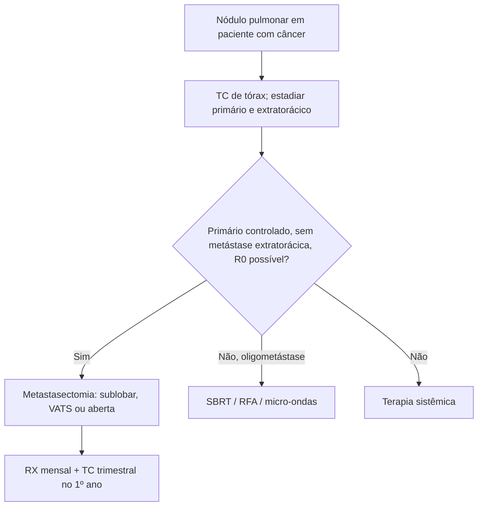

# Metástases Pulmonares

> Resumo em palavras próprias do Whitebook (Condutas Cirúrgicas > Cirurgia Oncológica), sem fisiopatologia, autoria e referências. Confira detalhes e doses na fonte: https://whitebook.pebmed.com.br/conteudo/?id=44558&categoryId=207&subcategoryId=212

**Definição e epidemiologia:** lesões malignas pulmonares por disseminação de tumores de outros órgãos. 25–54% dos pacientes com neoplasia extratorácica têm metástase pulmonar na autópsia. Primários mais comuns: mama, cólon, rim, útero, cabeça e pescoço; menos: coriocarcinoma, osteossarcoma, testículo, melanoma, tireoide; próstata, linfoma, leucemia, pâncreas e estômago raramente dão metástase pulmonar isolada. Marcador de mau prognóstico; ~30% dos tumores sólidos novos já têm metástase (qualquer sítio); 30–40% têm doença intratorácica; > 75% dos que têm metástase pulmonar terão extratorácica. Vias: hematogênica, linfática, endobrônquica, endovascular. “Latência” é o tempo entre a infiltração e a detecção clínica.

## Clínica
Maioria assintomática (achada no estadiamento ou seguimento). Dispneia (linfangite, lesão endobrônquica ou compressiva), hemoptise, síndrome consumptiva.

## Diagnóstico
- **RX de tórax:** base para comparação; baixa sensibilidade. **TC de tórax:** mais sensível; ~80% dos nódulos são benignos, difíceis de classificar se subpleurais ou < 10 mm; < 8 mm geralmente benignos (4–5 mm principalmente). Sinal de vaso dilatado e tortuoso no nódulo hipervascular (mass-vessel sign; comum em sarcoma); malignidade: bordas espiculadas, irregulares, centrais, não calcificados. Avalia linfonodos, parede, endobrônquico, invasão vascular; guia biópsia e planejamento; em ~25% a TC não identifica adequadamente.
- **PET-CT:** não é a primeira escolha para pulmão (útil em extrapulmonar e mediastino); falha em nódulos < 1 cm (~7 mm); falso-positivo em inflamação/infecção/granuloma; sensibilidade 96,8%, especificidade 77,8% para malignos.
- Outros: broncoscopia (lavado, biópsia), EBUS, biópsia transtorácica, mediastinoscopia. Diagnóstico final: histologia + imuno-histoquímica.

## Padrões
- **Múltiplos nódulos:** mais comum; margens espiculadas, tamanhos variados, periféricos, lobos inferiores. *Miliar* (1–3 mm): tireoide, rim, adenocarcinoma, sarcoma. *Bala de canhão* (≥ 50 mm, poucos): testículo, rim, cólon.
- **Solitário:** melanoma, sarcoma, testículo; pode ser inflamatório ou outro primário; costuma ter nódulos menores não vistos.
- **Cavitados:** necrose; escamoso, sarcoma, transição, adenocarcinoma; vários cavitados nos lobos superiores sugerem malignidade; parede fina — adenocarcinoma/sarcoma; pneumotórax em osteossarcoma (5–7%).
- **Calcificados:** geralmente granulomas; osteossarcoma/condrossarcoma (matriz óssea); distróficas em tireoide, sarcoma sinovial, coriocarcinoma tratado; mucinosas em adenocarcinomas de mama, ovário, TGI.
- **Vidro fosco** (hemorragia alveolar): condrossarcoma, angiossarcoma, coriocarcinoma; diferencial — aspergilose invasiva, candidíase, granulomatose com poliangeíte, adenocarcinoma lepídico, linfoma.
- **Endobrônquica** (rara, em geral com outras metástases torácicas): mais carcinoma renal; melanoma, linfoma, mama, cólon; padrão em “dedo de luva”, atelectasia.
- **Embolia tumoral:** sarcoma, renal, hepatoma, mama, melanoma; só na autópsia; achados indiretos (vasos dilatados, cardiomegalia, defeitos de enchimento, infartos); cintilografia V/Q (contraindicada na hipertensão pulmonar).
- **Linfangite carcinomatosa:** 6–8% das metástases intratorácicas; homens e jovens; adenocarcinoma de pulmão, estômago, mama, cólon, próstata; septos espessados, reticulonodular, derrame, adenopatia; suspeitar se focal, unilateral, assimétrica; diferenciais: edema, pneumonia intersticial, sarcoidose, linfoma; mau prognóstico (óbito em 3–12 meses).
- **Diferenciais gerais:** neoplasia primária de pulmão, abscesso, tuberculoma/aspergiloma, granulomatoses, sarcoidose, nódulos reumatoides, pneumoconiose, fibrose, linfoma, edema.

## Metastasectomia
- Objetivo curativo (ou diagnóstico/avaliação de residual); poucos são curados; sem benefício se o primário não está controlado. Só 15–25% são candidatos. Poupar pulmão, mas o paciente deve tolerar ressecções maiores.
- **Avaliação:** história (sintomas, status funcional, outros sítios, comorbidades, anticoagulantes, tabagismo — parar ≥ 2–3 semanas antes, etilismo); prova de função com DLCO (ppoVEF1 e ppoDLCO preditores; se < 40% → teste de exercício); TC (20–25% dos nódulos só são achados à palpação no ato). Avaliar o primário: colorretal — colonoscopia, TC abdome/pelve, CEA; mama — mamografia; cabeça e pescoço — endoscopia + TC; rim — TC/RM; melanoma — dermatologia; sarcoma — TC/RM/cintilografia; germinativos — β-hCG, LDH, AFP, USG; RM de crânio se sintomas neurológicos; PET conforme o primário. Linfonodos hilares/mediastinais: ao menos uma imagem; EBUS/mediastinoscopia se suspeita (pior prognóstico, mas não contraindicação absoluta).
- **Critérios:** primário controlado/controlável; sem metástase extratorácica descontrolada (exceto hepática colorretal); ressecção completa com reserva pulmonar adequada; sem alternativa menos mórbida (mama, germinativo não seminomatoso); condição clínica adequada. **Contraindicações:** primário irressecável; extratorácicas (salvo colorretal com fígado ressecável); R0 impossível; acometimento mediastinal grosseiro.
- **Técnica:** toracotomia (central, lobo inferior esquerdo posterior, linfonodos; bilateral ou sequencial), esternotomia (periféricas, bilaterais, menos dor), clamshell/hemiclamshell, VATS (controversa por falta de palpação, mas sem impacto na sobrevida para < 3 cm; ideal em periféricas/únicas). Bilateral: um tempo ou estágios, sem pior sobrevida; intervalo de 3–6 semanas entre ressecções. Maioria sublobar (cunha ou nodulectomia com margem ≥ 1 cm); segmentectomia/lobectomia para múltiplas ou centrais; pneumonectomia excepcional; bloco com órgãos adjacentes piora sobrevida; linfonodos só se suspeita.
- **Resultados:** morbidade 0–2%; curativa em menos de 1/3; recorrência média 53% em 10 meses (maior em sarcoma, melanoma, epiteliais e germinativos), com possível resgate. Prognóstico: R0 (mais importante), intervalo livre, número (> 4 pior), histologia (indolente e quimiossensível), linfonodos, CEA alto. Seguimento: 1º ano RX mensal + TC trimestral; até 3 anos, RX a cada 3 meses (+ TC semestral em sarcoma).
- **Intenção por primário:** sarcoma — cura, sistemática; teratoma — confirmar ressecção/residual, sistemática; colorretal — cura ± fígado, seletiva; renal — cura ocasional, muito seletiva; melanoma — lesão única; mama — receptores hormonais/novo primário, lesão única.

## Ablação
Menos invasiva, menor morbidade e custo, possivelmente sem internação. Indicações: oligometástase, sem condição ou desejo de terapia sistêmica, sem condição cirúrgica, oligoprogressão.
- **SBRT:** altas doses focais (~100 Gy), resultados semelhantes à metastasectomia; nenhum tipo histológico resistente; toxicidade: fibrose focal, pneumonite, fratura costal, dor crônica, dermatite, plexopatia braquial (apicais); 46–77% desenvolvem novas metástases (muitas vezes combina-se QT).
- **Radiofrequência** (400–500 kHz, 12–15 min, guiada por TC sob sedação ou aberta): ablação incompleta em 40%, pior se > 2–3 cm e junto a vasos; pneumotórax; recorrência maior que a da SBRT; útil em pacientes já irradiados.
- **Micro-ondas** (915 MHz–2,45 GHz, 2–5 min): resultados parecem semelhantes aos da RFA; pneumotórax; mais estudos necessários.

## Sistêmico
QT de indução eficaz em osteossarcoma e testículo (pode evitar cirurgia nos germinativos); adjuvância em mama e colorretal (exceto se feita antes) ou muitas metástases ressecadas. Imunoterapia adjuvante: em estudo.

## Linfangite carcinomatosa: tratamento
Sem tratamento efetivo. Prednisona 60–100 mg/dia ou dexametasona 4–8 mg 2×/dia, teste de 1 semana (suspender se não houver resposta), menor dose eficaz; tratar o primário se possível; manter até melhora ou enquanto houver benefício. Sintomas: oxigênio, morfina VO 2 mg a cada 4 h, ansiolíticos, corticoides; tosse — codeína ou morfina; secreções — nebulização com soro.

## Fluxograma (refeito, a partir do texto; o original não traz algoritmo)

