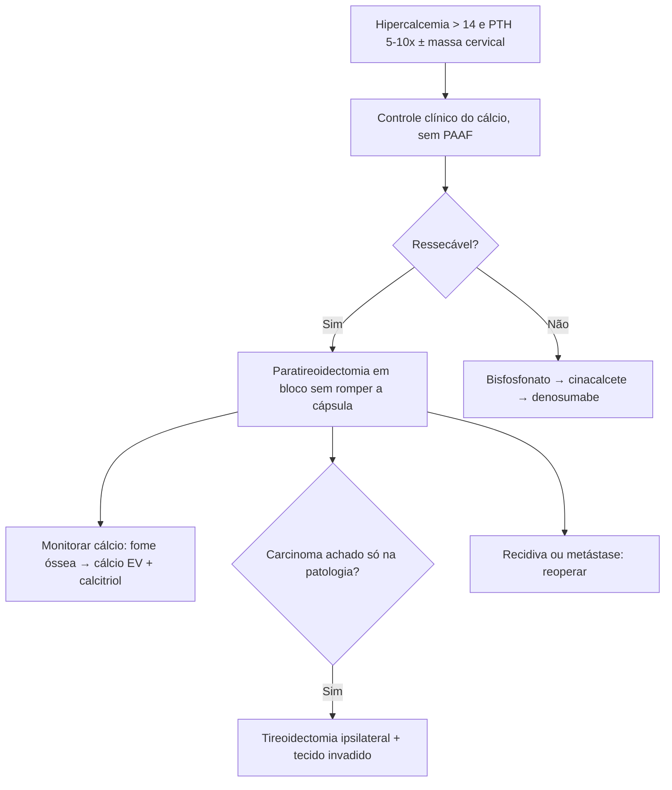

# Neoplasia Maligna da Paratireoide

> Resumo em palavras próprias do Whitebook (Condutas Cirúrgicas > Cirurgia Oncológica), sem fisiopatologia, autoria e referências. Confira detalhes e doses na fonte: https://whitebook.pebmed.com.br/conteudo/?id=38906&categoryId=207&subcategoryId=212

**Definição:** causa rara de hiperparatireoidismo primário (em geral causado por adenoma, às vezes hiperplasia, cisto ou secreção ectópica). Mutação do gene HRPT2/CDC73 tem papel central.

## Clínica
- Idade média 44–54 anos, igual em homens e mulheres. Cálcio > 14 mg/dL; PTH em média 5–10× o limite superior. Crise paratireóidea 12%; massa cervical 34–52%; doença óssea 34–73%; doença renal 32–70%; pancreatite 0–15%; assintomáticos 2–7%. Multiglandular extremamente rara. ~1/3 com metástase linfonodal e ~1/3 com metástase a distância (fígado e osso) ao diagnóstico.
- **Benigno × maligno:** benigno — mulheres 3:1 homens, poucos sintomas, menores, menos doença renal/óssea, hipercalcemia e PTH pouco elevados; maligno — 1:1, sintomático, maior, mais doença renal e óssea, hipercalcemia acentuada e PTH 5–10×. Há sobreposição. PTH < 4× o limite e tumor < 1,9 g praticamente excluem câncer. Alguns são normocalcêmicos e se apresentam com massa cervical; os não funcionantes morrem pela massa, não pela hipercalcemia.

## Diagnóstico
Hipercalcemia acentuada e PTH muito alto, com ou sem massa cervical; invasão além da cápsula com invasão vascular é o melhor correlato histológico. **Não fazer PAAF** (baixa acurácia e risco de ruptura da cápsula e disseminação). Às vezes não se distingue adenoma de carcinoma na cirurgia: adenoma atípico; recidiva local ou metástase definem depois. Teste germinativo de HRPT2 na maioria dos esporádicos, sobretudo se houver familiares que se beneficiem. Estadiamento TNM (AJCC/UICC) existe, mas os dados são limitados e propor sistema seria prematuro.

## Tratamento
- Cirurgia é o tratamento primário (inicial, recidiva e metástase). Irressecável: controle da hipercalcemia (bisfosfonatos, calcimiméticos, denosumabe); QT e RT controversas.
- **Suspeita pré-operatória:** paratireoidectomia/ressecção em bloco da massa e tecidos invadidos (lobo tireoidiano, tecido linfático paratraqueal, timo, músculos cervicais, até o laríngeo recorrente), **sem romper a cápsula**. **Diagnóstico pós-operatório:** tireoidectomia ipsilateral e ressecção do tecido adjacente se houver invasão. Metástases a distância (osso, pulmão): ressecar sempre que possível. Recidiva (a maioria no pescoço): reoperar; ressecar pescoço, pulmão ou fígado alivia a hipercalcemia, mas com alta morbidade.
- **Pré-operatório:** baixar o cálcio e corrigir distúrbios metabólicos como em qualquer hipercalcemia aguda.
- **Pós-operatório:** cálcio sérico rigoroso; cálcio muito alto no pré pode causar **síndrome da fome óssea** → cálcio EV em doses altas + calcitriol VO.
- **Irressecável:** prognóstico ruim; morbimortalidade vem da hipercalcemia grave. Ácido zoledrônico EV ou pamidronato (preferidos, doses como em outras hipercalcemias); cinacalcete se refratário (aumenta a sensibilidade do receptor de cálcio e reduz o PTH); denosumabe se refratário a ambos.

## Fluxograma (refeito, a partir do texto; o original não traz algoritmo)

