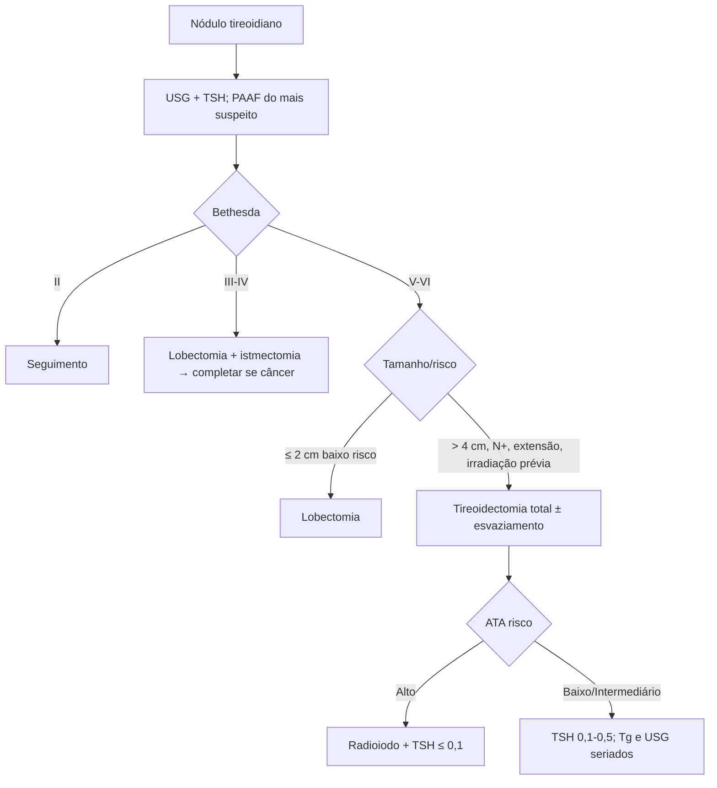

# Neoplasia de Tireoide

> Resumo em palavras próprias do Whitebook (Condutas Cirúrgicas > Cirurgia Oncológica), sem fisiopatologia, autoria e referências. Confira detalhes e doses na fonte: https://whitebook.pebmed.com.br/conteudo/?id=22618&categoryId=207&subcategoryId=212

## Classificação
Diferenciado (células foliculares: papilífero e folicular); “moderadamente diferenciado” de células parafoliculares/C (carcinoma medular, CMT — assim chamado no texto); indiferenciado/anaplásico (folicular, muito agressivo); outros: linfoma, metástases (rim, pulmão, intestino, mama). Para medular e anaplásico, o Whitebook tem tópicos próprios.

## Epidemiologia e anamnese
7º câncer mais incidente no Brasil (sem pele não melanoma), 9º no mundo; INCA 2023–2025: 7,68/100.000 (homens 2,33; mulheres 12,79). Perguntar: idade/sexo, sintomas compressivos (rouquidão, disfagia, dispneia), tempo de crescimento, deficiência de iodo, radiação na infância, antecedente familiar de câncer tireoidiano ou NEM, história pessoal, Hashimoto (risco de linfoma). Apresenta-se como nódulo no USG, nódulo palpável ou massa cervical.

## Exame
Inspeção e palpação da tireoide (localização, tamanho, consistência, limites, mobilidade à deglutição; endurecido, irregular, fixo = suspeito); cadeias cervicais (número, consistência, mobilidade); paralisia de prega vocal ipsilateral; sinais de invasão (disfagia, comprometimento ventilatório, hemoptise, alteração da voz, fixação).

## Diagnóstico
- Malignidade não altera T3, T4L ou TSH (apenas mostra o estado funcional). **Tireoglobulina** não serve na avaliação do nódulo (só no seguimento). **CMT:** calcitonina sérica (> 100 pg/mL), CEA no pós-operatório; ácido vanilmandélico, metanefrinas, catecolaminas, PTH, fosfato e cálcio para NEM.
- **USG:** número e organização dos nódulos, nódulo dominante, cístico/sólido/misto; seleciona PAAF; avalia cadeias. Suspeita: sólido ou sólido-cístico, hipoecogênico, margem irregular, microcalcificação, ausência de halo, Chammas IV–V (vascularização central).
- **PAAF:** teste mais acurado; 3–6 aspirações do nódulo mais suspeito; amostra satisfatória ≈ ≥ 6 grupos de células foliculares com ≥ 10 células cada. **Cintilografia** (123I/131I): lesão fria = suspeita.
- **Bethesda 2023 (ROM médio):** I não diagnóstica 13% (5–20); II benigna 4% (2–7); III AUS 22% (13–30); IV neoplasia folicular 30% (23–34); V suspeita 74% (67–83); VI maligna 97% (97–100).

## Tratamento — carcinoma diferenciado localizado
- **Cirurgia** é a modalidade primária; planejar com USG (cadeias centrais e laterais), TC/RM e laringoscopia conforme necessário.
  - **cT1N0M0 (≤ 2 cm, sem extensão extratireoidiana):** preferir lobectomia; tireoidectomia total se nódulo contralateral, planejar radioiodo, irradiação cervical prévia, história familiar de câncer não medular, idade > 45, preferência do paciente ou perfil molecular de alto risco.
  - **cT2N0M0 (> 2–4 cm, unilateral, baixo risco):** lobectomia pode ser preferida (menos complicações); total se nódulos contralaterais suspeitos, RT cervical prévia, câncer familiar ou priorizar seguimento com Tg.
  - **≥ 4 cm, extensão nodal/extratireoidiana, metástases, ou irradiação cabeça/pescoço na infância:** tireoidectomia total.
  - **Microcarcinoma papilar multifocal:** < 5 focos — lobectomia + istmectomia; > 5 focos — total.
  - **Nódulo suspeito/indeterminado:** lobectomia + istmectomia; se confirmar câncer, completar total.
- **Linfonodos:** esvaziamento se suspeita clínica/imagem (sobretudo papilífero e Hürthle); avaliar e biopsiar durante a cirurgia. Central (nível VI): linfadenectomia central; lateral (II, III, IV): linfadenectomia lateral ao longo da jugular/carótida (radical raramente). **Profilático central** para tumores > 4 cm (com ou sem invasão extraglandular), N lateral clínico, ou se mudar a conduta; raro em folicular/papilífero não invasivo; alguns indicam com BRAF mutado. Níveis: I submentonianos/submandibulares; II–IV jugular superior/médio/inferior; V triângulo posterior; VI central; VII mediastino superior.
- **Radioiodo (RAI):** elimina tecido remanescente, trata micrometástases, reduz recorrência e mortalidade, melhora a especificidade da Tg. Indicação: ATA alto risco, recidiva, ressecção incompleta, metástases; controverso em baixo risco, < 2 cm intratireoidiano. Preparo: TSH > 30 mUI/L (3–4 semanas sem levotiroxina) ou TSH recombinante; dieta pobre em iodo, evitar amiodarona, contrastes, xaropes, tinturas, esmalte. Contraindicado na gestação e amamentação. Complicações: alterações gonadais, sialoadenite, conjuntivite, risco de nova neoplasia.
- **Supressão de TSH:** individualizada — ATA alto risco TSH ≤ 0,1 mUI/L; baixo/intermediário 0,1–0,5 mUI/L.
- **CMT:** reposição de T4 no pós-operatório apenas para eutireoidismo; sem supressão (células C não respondem ao TSH).
- **Doença avançada diferenciada:** terapia-alvo; progressão com BRAF V600E → terapia-alvo específica; RT paliativa (sintomas, oligoprogressão); QT citotóxica pouco eficaz.

## Complicações cirúrgicas
- **Seroma/hematoma de ferida, infecção:** abaulamento e dor (seroma: drenagem/aspiração, calor úmido, cabeceira elevada); infecção — calor, rubor, secreção: drenagem + antibiótico (cefalosporinas de 1ª/2ª geração).
- **Hematoma cervical compressivo (emergência):** abaulamento, secreção sanguinolenta, rouquidão, disfagia, dispneia, estridor, dor, IRA por obstrução; ligado à pressão venosa (tosse, espirro, aspiração), recuperação anestésica ou 6–8 h do evento, ou desprendimento de ligadura. Conduta: **abrir a incisão e a rafe mediana imediatamente** (não esperar o cirurgião), intubação com tubo fino, traqueostomia, cabeceira elevada. Prevenir: material de traqueostomia à mão.
- **Traqueomalácia** (bócios antigos): IRA após exérese; fixar anéis aos músculos pré-tireoidianos e reintubar.
- **Neuropraxia + edema laríngeo:** agitação, cianose, sufocação após extubação → vapor morno + corticoide 48–72 h, depois extubar.
- **Nervo laríngeo recorrente:** unilateral (sem lesão do ramo externo do superior): prega paramediana, voz pode normalizar; unilateral + superior: prega intermediária (cadavérica), rouquidão, tosse ineficaz, pode recuperar; bilateral com superiores íntegros: pregas paramedianas → obstrução (reintubação/corticoide não ajudam; traqueostomia); bilateral + superiores: pregas intermediárias, voz sussurrada — melhora vocal posterior sinaliza obstrução iminente → traqueostomia.
- **Laríngeo superior:** ramo externo (motor) — voz fraca, perda de agudos, fadiga vocal; ramo interno (sensorial) — não sente corpo estranho, risco de broncoaspiração.
- **Hipoparatireoidismo:** irrigação por tireóideas inferiores, ramos acessórios das superiores e esofágicas; trauma, ligadura ou extirpação. Hipocalcemia: ansiedade, parestesia perioral, Chvostek, Trousseau, espasmo carpopedal, estridor, convulsão; precoce (24 h) ou tardia (48 h–7 dias). Alguns repõem cálcio profilaticamente; agudo: 10 mL de gluconato de cálcio a 10% em 5 min + 30 mL a 10% em 500 mL SF 0,9% contínuo; depois cálcio e vitamina D VO; permanente (↓ PTH, ↓ Ca, ↑ fosfato): reposição vitalícia.
- **Hipotireoidismo:** ↑TSH, ↓T4L; reposição (na neoplasia, supressiva).
- **Crise tireotóxica** (hipertireoideos, no intra ou pós-operatório): idealmente eutireoideo antes (Lugol, antitireoidianos, betabloqueador; manter betabloqueador até o 10º dia). Quadro: agitação, sudorese, hipertermia, arritmia, confusão, vômitos, hipertensão grave. Manejo: hidratação; propiltiouracil 1.000 mg ataque + 600 mg a cada 8 h; Lugol 20 gotas 3×/dia ou contraste oral (ipodato/iopanoato) 1 g 2×/dia; dexametasona EV 2 g (sic) a cada 6 h ou hidrocortisona 200 mg EV a cada 8 h; propranolol EV 6 mg e depois 80 mg VO a cada 6 h; bolsas de gelo. (Conferir doses na fonte.)

## Seguimento (diferenciado)
Detectar persistência/recorrência no 1º ano por USG, TSH, Tg e anti-Tg; tratar recorrência com cirurgia, radioiodo, QT ou RT externa.
- **Baixo risco:** Tg em 4–6 semanas, 3–6 e 9–12 meses; USG de pescoço em 6–12 meses; TSH alvo 0,1–0,5 se Tg não estimulada detectável, 0,5–2 se indetectável.
- **Risco intermediário:** Tg não estimulada nos mesmos tempos; USG em 6–12 meses; cintilografia com 131I conforme o caso; TSH 0,1–0,5.
- **Alto risco:** Tg nos mesmos tempos; USG a cada 6–12 meses; cintilografia 131I conforme o caso; TC/RM se Tg elevada ou suspeita clínica; PET-FDG se Tg > 10 ng/mL; TSH < 0,1.

## Fluxograma (refeito, a partir do texto; o original não traz algoritmo)

