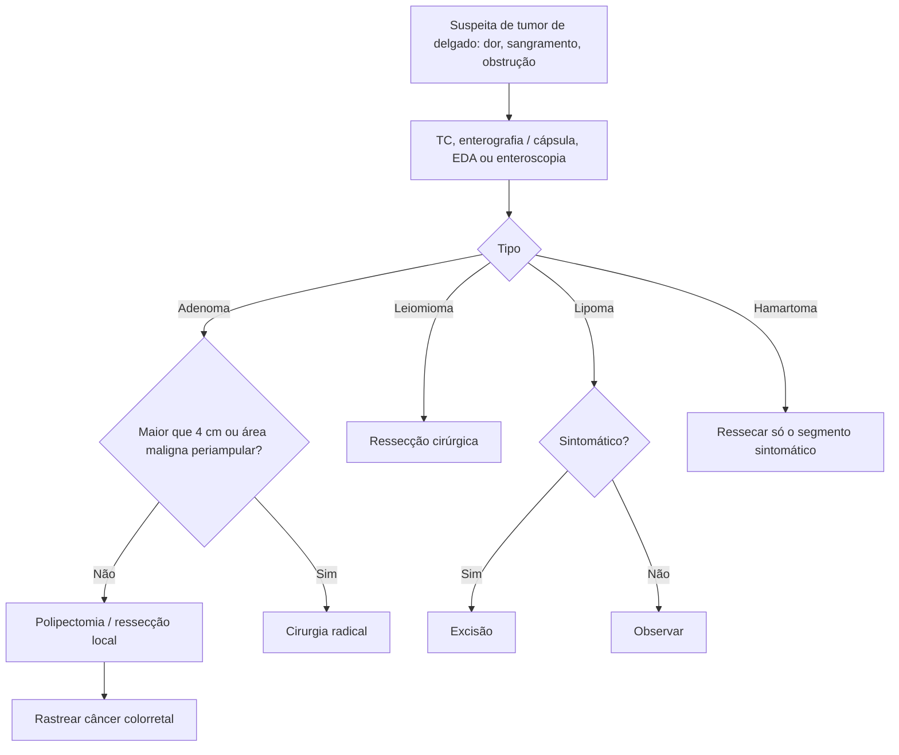

# Neoplasias Benignas do Intestino Delgado

> Resumo em palavras próprias do Whitebook (Condutas Cirúrgicas > Cirurgia Geral e do Aparelho Digestivo), sem fisiopatologia, autoria e referências. Confira detalhes e doses na fonte: https://whitebook.pebmed.com.br/conteudo/?id=45396&categoryId=207&subcategoryId=211

**Definição:** lesões raras, de sinais e sintomas inespecíficos. Tipos: adenomas, hamartomas, leiomiomas, fibromas e lipomas. A frequência aumenta do duodeno para o íleo. Sinônimos: tumores benignos do intestino delgado.

## Quadro clínico
- Em geral assintomáticos. Quando há sintomas: dor abdominal em cólica intermitente, perda de peso, náusea, vômito, sangramento digestivo. Obstrução é mais comum que perfuração.

## Principais tipos
- **Adenomas** (vilosos, tubulares e da glândula de Brunner): vilosos têm considerável potencial de malignização; tubulares, menor. Esporádicos ou ligados a PAF, Peutz-Jeghers, Cowden, polipose juvenil e Lynch. A biópsia pode mostrar área benigna superficial com adenocarcinoma em profundidade. Mais comuns no duodeno, em geral assintomáticos, podendo causar sangramento ou obstrução intestinal/biliar. Quem tem adenoma duodenal esporádico deve ser rastreado para câncer colorretal.
- **Leiomiomas/fibromas:** massa única, firme, bem definida, na submucosa; crescem para fora do lúmen e só são detectados quando o suprimento sanguíneo é ultrapassado (necrose, ulceração, sangramento); se intraluminais, a obstrução pode ser o sintoma inicial.
- **Lipomas:** 2º tipo benigno mais comum; íleo e duodeno; do tecido adiposo submucoso ou subseroso; obstrução, sangramento ou achado incidental; crescimento intra ou extraluminal (massa palpável); comuns na PAF.
- **Hemangiomas:** raros, sangramento.
- **Hamartomas:** ligados a síndromes genéticas (Peutz-Jeghers); proliferação desorganizada de tecidos normais.

## Diagnóstico
Tardio, por sintomas inespecíficos; exige alta suspeição. Base: história, exame físico, sangue oculto nas fezes e imagem.
- **Radiografia simples/contrastada:** valor limitado; obstrução, massa, defeito de mucosa, intussuscepção.
- **TC:** lesão primária, metástases, linfonodos; pode sugerir histologia.
- **Angiografia e cintilografia com radiotraçadores:** localizam o sangramento.
- **Enteróclise/enterografia** (bário e metilcelulose por SNG; associável a TC/RM). **PET/PET-TC:** diagnóstico, estadiamento, resposta e recorrência.
- **EDA:** alcança o duodeno. **Cápsula endoscópica:** todo o delgado, sem biópsia e contraindicada na obstrução. **Enteroscopia** (duplo-balão ou intraoperatória): biópsia e terapêutica.
- **Exploração cirúrgica** (laparoscopia pode obter material): sangramento oculto, perda de peso inexplicada ou dor vaga com avaliação inconclusiva.
- **Diferenciais:** neoplasia maligna, bridas, hérnia interna, DII, endometriose, esplenose, apendicite, diverticulite.

## Tratamento
- **Adenomas** (vilosos e de Brunner, baixo potencial maligno): polipectomia endoscópica, ressecção local ou submucosa. Lesões periampulares com área maligna (in situ ou invasiva): cirurgia radical (pancreatoduodenectomia). Ressecção endoscópica **não** recomendada para lesões **> 4 cm**.
- **Leiomiomas:** ressecção cirúrgica; como é difícil diferenciar leiomiossarcoma, o índice mitótico define a extensão.
- **Lipomas:** excisão se sintomáticos; achados incidentais não se abordam.
- **Hamartomas / Peutz-Jeghers:** cirurgia limitada ao segmento responsável pelos sintomas.

## Fluxograma (refeito, a partir do texto; o texto original não traz um algoritmo)

