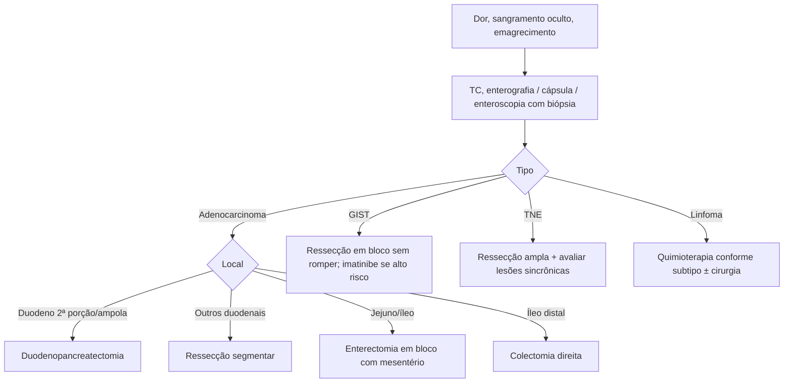

# Neoplasias Malignas do Intestino Delgado

> Resumo em palavras próprias do Whitebook (Condutas Cirúrgicas > Cirurgia Oncológica), sem fisiopatologia, autoria e referências. Confira detalhes e doses na fonte: https://whitebook.pebmed.com.br/conteudo/?id=45397&categoryId=207&subcategoryId=212

**Definição:** lesões raras e inespecíficas. O delgado tem 80% do comprimento do trato e 90% da superfície absortiva, mas só 3% das neoplasias GI malignas. Tipos: adenocarcinoma (mais no duodeno), tumor neuroendócrino (íleo), linfoma e sarcoma.

## Clínica
Malignos são mais sintomáticos que os benignos: dor em cólica intermitente com perda de peso, náusea, vômito; sangramento; obstrução mais comum que perfuração. Diagnóstico tardio (linfonodos e metástases).

## Tipos
- **Adenocarcinoma:** 25–40%; mais duodenal; discreto predomínio masculino; sequência adenoma-carcinoma como no cólon; maior risco em quem já teve câncer de cólon; 50–70 anos ou antes se predisposição (Crohn). Risco: câncer colorretal hereditário não polipoide, Peutz-Jeghers, polipose adenomatosa familiar, Crohn, doença celíaca.
- **Neuroendócrino:** aminas bioativas e síndromes; > 90% das síndromes carcinoides têm metástase hepática; gastrinoma duodenal → Zollinger-Ellison; somatostatinoma e paraganglioma também ocorrem no duodeno; carcinoides são TNE bem diferenciados, indolentes, ~40% das malignas primárias do delgado, pico aos 60 anos; sintomas de síndrome carcinoide (diarreia, rubor, broncoespasmo, palpitações); risco: NEM1, von Hippel-Lindau, neurofibromatose 1.
- **Linfoma:** forma extranodal mais comum (estômago e delgado); pico na 7ª década, 60% homens; íleo mais afetado (agregados linfoides); predisponentes: autoimunes, imunodeficiências (AIDS), imunossupressão longa (pós-transplante), Crohn, radioterapia, hiperplasia linfoide nodular. **Critérios de linfoma GI primário:** sem linfadenopatia periférica ou mediastinal; leucograma normal; doença predominantemente GI; sem envolvimento esplênico ou hepático.
- **Sarcoma:** ~10%; jejuno, íleo e Meckel; GIST ~85%; crescimento extraluminal, obstrução rara e tardia.
- **Metástases:** mais comuns que os primários; carcinomatose peritoneal; hematogênica (melanoma — o delgado é o sítio mais frequente de metástase do melanoma —, sarcoma, pulmão, mama, colo uterino, cólon).

## Diagnóstico
Alto índice de suspeição; história, exame, sangue oculto nas fezes e imagem.
- RX simples (obstrução; contraste oral pode mostrar massa, defeito de mucosa, intussuscepção); **TC** (primário, metástases, linfonodos); angiografia/radiomarcadores (sangramento); enteróclise/enterografia (bário + metilcelulose por sonda; versões com TC e RM); PET/PET-CT (diagnóstico, estadiamento, resposta, recidiva).
- EDA (só duodeno); **cápsula endoscópica** (todo o delgado, não invasiva; contraindicada em obstrução; sem biópsia); **enteroscopia** (duplo balão ou intraoperatória; biópsia e terapêutica).
- Marcadores: CEA no adenocarcinoma (útil só em doença avançada, não sensível nem específico); LDH e β2-microglobulina no linfoma; cromogranina A sérica e 5-HIAA urinário de 24 h no TNE.
- Considerar investigação com sangramento oculto, perda de peso inexplicada ou dor vaga com avaliação inconclusiva; laparoscopia para tecido (linfoma). **Não biopsiar** (percutânea, incisional, laparoscópica ou aberta) lesão suspeita de GIST que viole a integridade (disseminação).
- **Diferenciais:** neoplasias benignas, bridas, hérnia interna, DII, endometriose, esplenose, apendicite, diverticulite.

## Tratamento
- **Adenocarcinoma:** duodeno 2ª porção, ampola e pâncreas → duodenopancreatectomia com linfadenectomia; 1ª, 3ª e 4ª porções → ressecção segmentar com margens negativas; jejuno e íleo → enterectomia segmentar em bloco com mesentério (linfadenectomia regional); íleo distal → colectomia direita. QT pós-operatória com linfonodos positivos; QRT se alto risco de recidiva local (linfonodos duodenais +, ressecção incompleta, T4); QT paliativa em irressecável ou metastático; metastasectomia hepática se ressecável, primário controlado, sem doença extra-hepática.
- **Sarcoma/GIST:** ressecção em bloco com margens livres, cautela para não romper a cápsula; linfadenectomia sistemática desnecessária (~5% de linfonodo). GIST de difícil ressecção, com biópsia: considerar imatinibe neoadjuvante; alto risco de recorrência: imatinibe adjuvante por 3 anos.
- **TNE:** ampla ressecção em bloco com mesentério e linfonodos; 30–40% têm lesões sincrônicas — avaliar todo o delgado e o cólon antes e durante a cirurgia.
- **Linfoma:** tratar conforme o subtipo nodal; se ressecção for necessária (obstrução, perfuração), somar quimioterapia.

## Fluxograma (refeito, a partir do texto; o original não traz algoritmo)

