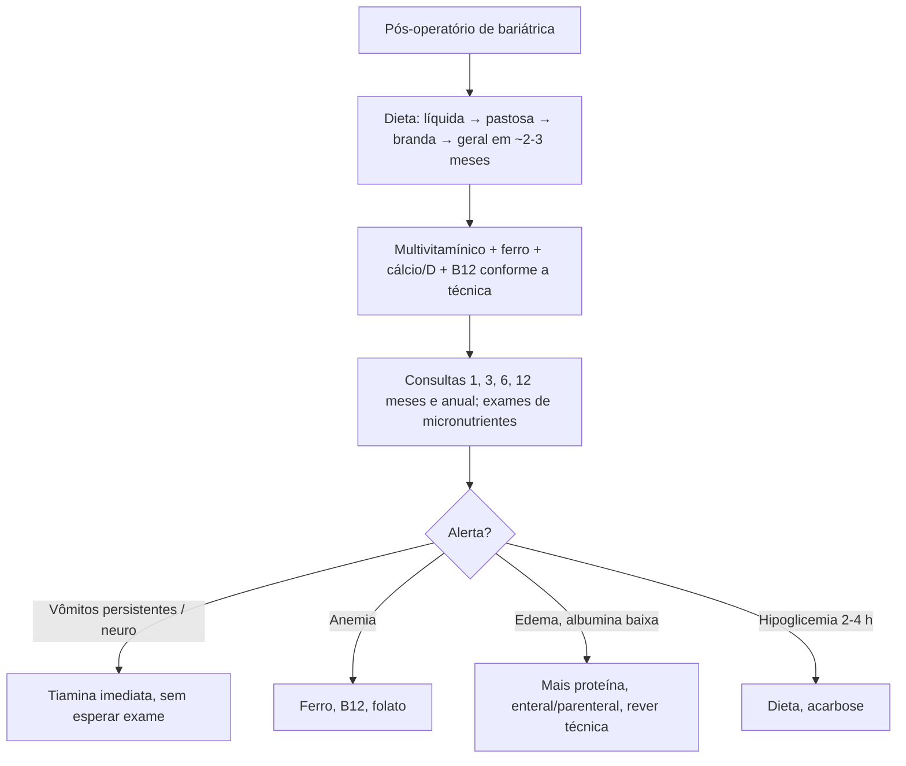

# Nutrologia e Cirurgia Bariátrica: Pós-operatório

> Resumo em palavras próprias do Whitebook (Condutas Cirúrgicas > Cirurgia Geral e do Aparelho Digestivo), sem fisiopatologia, autoria e referências. Confira detalhes e doses na fonte: https://whitebook.pebmed.com.br/conteudo/?id=63011&categoryId=207&subcategoryId=211

**Contexto:** acompanhamento multiprofissional, periódico e vitalício. O risco de deficiência é maior nas técnicas com componente disabsortivo. Causas: pouca ingestão, intolerâncias, vômitos persistentes, má adesão à suplementação, menos acidez gástrica, exclusão de segmentos intestinais, má-absorção, perda rápida de peso, seguimento inadequado. Deficiências prévias devem ser corrigidas.

## Dieta no pós-operatório
- Ao acordar: líquida restrita, 30–50 mL a cada 30 min. Primeiros dias: líquida fracionada, ~1.000 kcal/dia, por ~15 dias.
- Semanas 2–3: líquida mais completa (sucos, sopa, leite), máximo 150 mL/refeição. Semana 4: pastosa (purê), 150–200 mL, ~1.000 kcal/dia, por ~30 dias; depois branda por mais 30 dias; então geral fracionada em 6–7 refeições. Progressão lenta; sem álcool nem gaseificados; comer devagar, mastigar bem e parar ao primeiro sinal de saciedade.
- Proteína: suplementar se não atingir ~80–120 g/dia.
- **Orientações:** pequenas refeições, não misturar sólidos e líquidos, 30 min entre refeições e líquidos, evitar açúcares concentrados (sobretudo bypass, pelo dumping), > 1,5 L/dia de líquidos (meta ~1.800 mL/dia). Náusea, vômito, disfagia ou dificuldade de progressão: investigar estenose, úlcera anastomótica, obstrução mecânica, intolerância ou complicação técnica.
- **Reposição proteica:** meta mínima 60 g/dia ou 1,5 g/kg de peso ideal/dia (até 2,1 g/kg individualizado; mais nas disabsortivas); priorizar alimentos, suplemento só se a dieta não atinge; suplemento isolado não preservou a massa magra de forma consistente — associar exercício de força. Nutrição enteral em alto risco que não atinge a meta por via oral; parenteral se necessidades não atendidas por 5–7 dias (3–7 em crítico) ou desnutrição proteica grave/hipoalbuminemia refratária. Em perda grave de peso: monitorar fósforo, magnésio e potássio e dar tiamina (risco de realimentação).

## Suplementação preventiva
- Multivitamínico/mineral: banda — 1/dia; sleeve, bypass em Y de Roux e DBP/duodenal switch — 2/dia (preferir mastigável no início), contendo ferro, ácido fólico, tiamina, zinco, cobre.
- O texto extraído perdeu os títulos das listas seguintes; pelo conteúdo correspondem a: **tiamina** ≥ 12 mg/dia (ASMBS: 50 mg 1–2×/dia em complexo B/multivitamínico potente); **B12** 350–500 µg/dia oral/sublingual ou 1.000 µg/mês IM/SC; **ácido fólico** 400–800 µg/dia (mulheres férteis 800–1.000); **ferro** ≥ 18 mg/dia (homens sem anemia/baixo risco), 45–60 mg de ferro elementar em mulheres que menstruam e em sleeve/bypass/DBP, doses divididas, longe de cálcio, antiácidos e fitatos/polifenóis; **cálcio** (preferir citrato) 1.200–1.500 mg/dia (banda, sleeve, bypass) ou 1.800–2.400 mg (DBP), divididos; carbonato com as refeições; **vitamina D3** 3.000 U/dia (manter 25-OH-D > 30 ng/mL); **A/K** — banda: A 5.000 U e K 90–120 µg; sleeve e bypass: A 5.000–10.000 U, K 90–120 µg; DBP: A 10.000 U, K 300 µg; **vitamina E** 15 mg/dia; **zinco** 8–11 mg (banda/sleeve), 8–22 mg (bypass), 16–22 mg (DBP); **cobre** 1 mg (banda/sleeve), 2 mg (bypass/DBP); proporção 8–15 mg de zinco para 1 mg de cobre. Confira os títulos na fonte.

## Orientação na alta
Dieta líquida completa pobre em açúcar; proteína líquida; líquidos devagar, até ~1.800 mL/dia, nunca com as refeições; 30 min de intervalo; não avançar sem tolerância. Procurar atendimento se vômitos persistentes, incapacidade de ingerir líquidos, disfagia progressiva, regurgitação, pouca urina, confusão, nistagmo, alteração da marcha, parestesias, fraqueza, edema, perda de peso muito rápida, sangramento, dor persistente; sem suplementos extras sem orientação.

## Acompanhamento
Primeira consulta ~1 mês; depois regular e anual por toda a vida. Avaliar peso (perda/reganho), ingestão, proteína, hidratação, tolerância, vômito/disfagia, adesão, sinais de deficiência, atividade física, complicações. Intervalos: banda — 1 mês, depois a cada 1–2 meses durante ajustes, anual quando estável; sleeve — 1, 3, 6, 12 meses; bypass — 1, 3, 6–12 meses; DBP — 1, 3, 6 meses.
- **Exames:** ferro (nos primeiros 3 meses, a cada 3–6 meses até 12, depois anual: hemograma, ferro, ferritina, CTLF, saturação); B12 (basal e anual; a cada 3 meses no 1º ano em risco; ácido metilmalônico e homocisteína se inconclusivo ou neuropatia); folato (± eritrocitário e homocisteína); metabolismo ósseo (Ca, P, FA, 25-OH-D, PTH, densitometria ~2 anos); tiamina se sinais/risco; vitamina A no 1º ano após bypass e DBP ou desnutrição; E e K se clínica; zinco e cobre ao menos anual após bypass/DBP; selênio sem rastreio universal (considerar em anemia inexplicada, fadiga, diarreia persistente, cardiomiopatia, doença óssea).

## Complicações nutrológicas
Desidratação, intolerância, vômitos persistentes, desnutrição proteico-calórica, perda de massa magra, anemia ferropriva, deficiência de B12/folato, tiamina (Wernicke), hiperparatireoidismo secundário, deficiência de A/D/E/K, zinco, cobre, selênio, dumping, hipoglicemia pós-bariátrica, realimentação, nefrolitíase por oxalato.
- **Desnutrição proteico-calórica:** precoce ou tardia; fatores — pouca proteína, má-absorção, vômitos, intolerância, estenose, banda apertada, técnica disabsortiva/revisional, falta de seguimento. Alertas: edema (pode mascarar a perda), perda de peso/massa excessiva, fraqueza, baixa ingestão, cicatrização ruim, hipoalbuminemia (albumina < 3,5 e pré-albumina < 20 — unidades como no texto). Conduta: investigar causas anatômicas/clínicas, excluir edema cardíaco/hepático/renal, mais calorias e proteína, suplemento, enteral, parenteral nos graves, encaminhar ao centro bariátrico, considerar revisão/reversão se grave e persistente.
- **Ferro:** ferritina < 15 µg/L confirma anemia ferropriva (BOMSS); ferritina sobe na inflamação. Sinais: fadiga, palpitações, glossite, disfagia, coiloníquia, anemia microcítica. Tratar com ferro elementar oral 150–200 mg/dia (até 300 mg 2–3×/dia em casos selecionados) em doses divididas, separado de cálcio e antiácido, ± vitamina C; EV se intolerância, resposta insuficiente ou má-absorção importante; investigar perdas.
- **B12:** sérica pode não detectar; usar ácido metilmalônico/homocisteína. Anemia megaloblástica, glossite, parestesias, ataxia, cognição, psicose/demência. Tratar com 1.000 µg/dia até normalizar e manter; parenteral se oral falhar; neurológico = tratar já; não dar folato isolado antes de tratar B12.
- **Tiamina:** suspeitar com vômitos persistentes, baixa ingestão, perda rápida, intolerância a suplementos, álcool, NPT, neuropatia/encefalopatia; **não esperar o exame**; surge geralmente 6 meses–1 ano depois. Beribéri e Wernicke (náusea, fraqueza, parestesia, ataxia, edema, taquicardia, confusão, nistagmo, oftalmoplegia, memória). Tratar: VO 100 mg 2–3×/dia; EV 200 mg 3×/dia ou 500 mg 1–2×/dia por 3–5 dias, depois 250 mg/dia por 3–5 dias; IM 250 mg/dia por 3–5 dias ou 100–250 mg/mês; corrigir Mg, K, P.
- **Folato:** anemia megaloblástica e defeitos do tubo neural. ASMBS: 1.000 µg/dia até normalizar, sem passar de 1 mg/dia (mascara B12); BOMSS: após excluir B12, 5 mg/dia por ≥ 4 meses.
- **Cálcio/vitamina D:** avaliar Ca corrigido ou iônico, P, FA, 25-OH-D, PTH, densitometria. Vitamina D: insuficiência 20–30; deficiência < 20 ng/mL. Cãibras, parestesias, tetania, fraqueza, osteopenia/osteoporose. Tratar: cálcio 1.200–1.500 mg/dia dividido (citrato), D3 3.000–6.000 U/dia (ou D2 50.000 U 1–3×/semana), alvo > 30 ng/mL; calcitriol se refratário.
- **Demais (títulos perdidos; deduzidos pelo conteúdo):** *vitamina A* — cegueira noturna, manchas de Bitot, xerose, hiperqueratose; sem lesão corneana 10.000–25.000 U/dia; *vitamina E* — hiporreflexia, marcha, fraqueza, nistagmo, oftalmoplegia, hemólise; 15 mg/dia preventiva; *vitamina K* — equimoses, petéquias, sangramento gengival, epistaxe, menorragia; má-absorção aguda 10 mg parenteral; *zinco* — paladar, alopecia, dermatite, diarreia, anorexia, cicatrização, hipogonadismo; repor até normalizar com 1 mg de cobre para cada 8–15 mg de zinco; *cobre* — anemia, neutropenia, pancitopenia, hipopigmentação, neuropatia, mielopatia, marcha; leve/moderada 3–8 mg/dia VO, grave 2–4 mg/dia EV por 6 dias ou até melhorar; monitorar a cada 3 meses.
- **Hipoglicemia pós-bariátrica:** 2–4 h após a refeição, glicemia < 54 mg/dL, resolução com correção, excluindo outras causas. Dieta: pequenas refeições, < 30 g de carboidrato por refeição, baixo índice glicêmico, proteína, sem líquidos 30 min antes e depois. Crise: 10–15 g de dextrose, reavaliar em 15 min, repetir, depois lanche de baixo IG; evitar sacarose se em uso de acarbose. **Acarbose** é o fármaco de primeira linha.

## Fluxograma (refeito, a partir do texto; o original não traz algoritmo)

