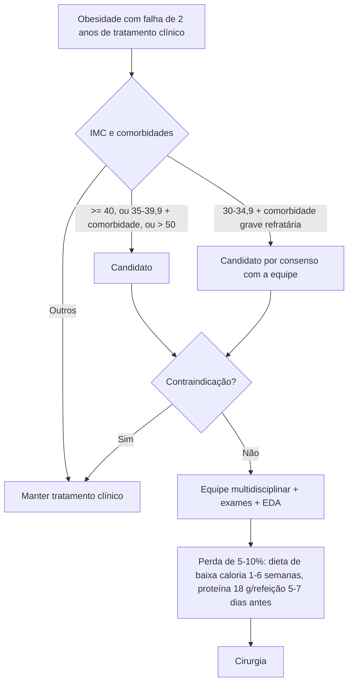

# Nutrologia e Cirurgia Bariátrica: Pré-operatório

> Resumo em palavras próprias do Whitebook (Condutas Cirúrgicas > Cirurgia Geral e do Aparelho Digestivo), sem fisiopatologia, autoria e referências. Confira detalhes e doses na fonte: https://whitebook.pebmed.com.br/conteudo/?id=47675&categoryId=207&subcategoryId=211

**Contexto:** a obesidade é doença crônica, multifatorial e progressiva, com alterações metabólicas, inflamatórias e hormonais que elevam o risco cardiovascular. Objetivos da cirurgia: perda de peso sustentada, melhora/remissão de comorbidades (em especial DM2) e qualidade de vida. O sucesso depende de preparo pré-operatório e otimização nutricional.

## Indicações
- IMC ≥ 40 kg/m² independentemente de comorbidades, sem resposta a ao menos **2 anos** de tratamento conservador adequado.
- IMC 35–39,9 com comorbidades agravadas pela obesidade, sem resposta a 2 anos de tratamento.
- Sugerida também com IMC > 50 mesmo sem tratamento prévio e IMC 30–34,9 com comorbidade grave e falha do tratamento, por consenso entre equipe e paciente (SBCBM).
- **> 65 anos:** avaliação específica (risco, comorbidades, expectativa de vida; objetivo principal: qualidade de vida). **16–17 anos:** possível sob as mesmas condições, com concordância dos responsáveis, pediatra na equipe, epífises de punhos consolidadas e análise criteriosa de risco-benefício.
- Documentar falha do acompanhamento regular por ≥ 2 anos (dieta, psicoterapia, fármacos, atividade física).
- **Comorbidades:** DM2, apneia do sono, dislipidemia, HAS, doença cardiovascular (DAC, IAM, angina, IC, AVC, FA, cardiomiopatia dilatada, cor pulmonale, hipoventilação), asma grave não controlada, hérnia discal, osteoartrose, DRGE com indicação cirúrgica, colelitíase, incontinência urinária de esforço, pancreatite aguda recorrente, infertilidade, disfunção erétil, SOP, varizes e hemorroidas, hipertensão intracraniana idiopática, DHGNA, estigma social e depressão.

## Contraindicações
Limitação intelectual que impeça compreender o tratamento (sobretudo sem suporte familiar); transtorno psiquiátrico não controlado (álcool/drogas ilícitas; tentativa de suicídio nos últimos 2 anos — quadros graves controlados não contraindicam obrigatoriamente); insuficiência orgânica grave descompensada (cardiopulmonar, renal, hepática); hipertensão portal com varizes, doenças imunológicas/inflamatórias do TGI superior com risco de sangramento; causas endócrinas tratáveis (Cushing, tumores endócrinos); doença neoplásica, infecciosa ou inflamatória ativa; ASA IV.

## Cirurgias mais comuns
Banda gástrica ajustável (cada vez menos usada: complicações e reganho), gastrectomia vertical (sleeve), predominantemente restritiva — Y de Roux (Fobi-Capella) —, predominantemente disabsortivas — Scopinaro e variante Marceau-Hess.

## Abordagem pré-operatória
Equipe multidisciplinar para detectar complicações clínicas e nutricionais, iniciar mudanças comportamentais, estimular emagrecimento (**5–10%** do peso até a cirurgia) e informar sobre benefícios e riscos. Benefícios: melhor controle metabólico, menos complicações e melhor adesão no pós-operatório.
- **Avaliação:** histórico da obesidade, tratamentos prévios, hábitos alimentares, atividade física, antecedentes, medicamentos que ganham peso, tabagismo, etilismo, dependências; comorbidades orgânicas e psiquiátricas; avaliação de saúde mental; antropometria (IMC, circunferência abdominal) e risco cardiometabólico.
- **Exames** (variam conforme o centro): hemograma, coagulograma, ferro, ferritina, CLLF, B12, folato, 25(OH) vitamina D; lipidograma, proteínas, ureia, creatinina, ácido úrico, glicemia, HbA1c, insulina; AST, ALT, FA, GGT, Na/K, TSH ± T3/T4, cálcio total e iônico, fósforo, magnésio, zinco, cobre, tipagem; urina I, parasitológico, gasometria, hepatites B e C, HIV, sífilis, PCR, β-hCG em mulheres férteis; ECG e outros cardiológicos, RX de tórax, EDA, espirometria se quadro respiratório, Doppler venoso de MMII se risco de TEV, USG abdominal e sorologias se transaminases 2–3× o normal, densitometria e composição corporal.
- **Perda de peso pré-operatória** (sobretudo superobesos, IMC > 50): melhora risco cardiovascular e tromboembólico e glicemia, pode encurtar cirurgia e internação; pode incluir tratamento clínico, fármacos e, às vezes, balão intragástrico. Iniciar reeducação alimentar e atividade física já no pré-operatório.
- **Dietas pré-operatórias** (1–6 semanas antes): LCD (baixa caloria) ≈ −5,5 kg; VLCD (muito baixa) ≈ −7 kg; VLCKD (cetogênica) ≈ −8,6 kg. Efeitos: redução do volume hepático (até 80% em 2 semanas) e melhor sensibilidade insulínica.
- **Terapia nutrológica** 5–7 dias antes: proteína 18 g/refeição (3–4 refeições/dia); glicemia 70–180 mg/dL, pós-prandial 140–180.
- **Orientações:** não beber água durante as refeições; mastigar bem e comer devagar; evitar bebidas açucaradas, gaseificadas e alcoólicas; parar ao saciar; carnes magras; sem frituras; preferir integrais; evitar doces.
- O texto cita um *Decision Track* (fluxograma) na fonte.

## Fluxograma (refeito, a partir do texto; o original é um Decision Track)

