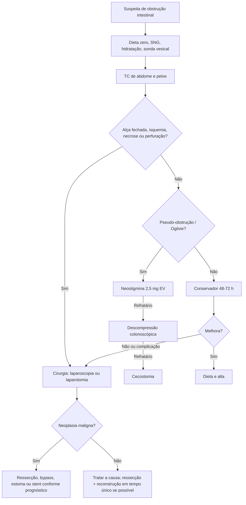

# Obstrução Intestinal

> Resumo em palavras próprias do Whitebook (Condutas Cirúrgicas > Cirurgia Geral e do Aparelho Digestivo), sem fisiopatologia, autoria e referências. Confira detalhes e doses na fonte: https://whitebook.pebmed.com.br/conteudo/?id=22594&categoryId=207&subcategoryId=211

**Definição:** interrupção do trânsito intestinal, funcional (ex.: Hirschsprung, distúrbio hidreletrolítico) ou mecânica (estenose, compressão extraluminal, corpo estranho). Existe a **obstrução em alça fechada** (bloqueio em dois pontos), com risco de isquemia e ruptura por pressão intraluminal extrema.

## Etiologia
- **Intestino delgado:** bridas, neoplasias, hérnias estranguladas; outras: intussuscepção, endometriose, íleo biliar, síndrome de Bouveret, bezoar, abscesso, Crohn, tuberculose, congênitas (atresia, má rotação).
- **Cólon:** neoplasia, volvo, doença diverticular (rara); outras: fecaloma, Crohn, abscesso, corpo estranho, hérnia, brida.
- **Funcional:** ausência de causa mecânica, com ruídos hidroaéreos diminuídos ou ausentes. Fármacos (anticolinérgicos, opioides, bloqueadores de cálcio, tricíclicos) e distúrbios hidreletrolíticos (sobretudo hipocalemia).
- **Epidemiologia:** 90% acometem o delgado (aderências, hérnias, neoplasias); no cólon, neoplasia (60%), volvo e doença diverticular.

## Quadro clínico
- **Anamnese:** tempo sem flatos/evacuação (diarreia paradoxal na obstrução parcial), hábito prévio, cirurgias abdominais, história familiar. Dor em cólica, podendo evoluir para dor contínua intensa e desproporcional ao exame (isquemia). Perda ponderal e sangramento digestivo prévios. Delgado: vômito precoce, distensão epigástrica; cólon: vômito tardio, às vezes fecaloide, grande distensão.
- **Exame:** taquicardia, taquipneia, febre, desidratação, distensão, peristalse de luta (ruídos metálicos, ondas visíveis) ou ausência de peristalse, irritação peritoneal, cicatrizes, hérnias, toque retal (ausência de fezes, sangue, massas).

## Diagnóstico
- Clínica + laboratório + **TC de abdome e pelve** (método preferencial; diferencia obstrução completa, isquemia e sofrimento vascular, orientando a cirurgia). Principal fator de risco: cirurgia prévia. A radiografia tem sensibilidade ~70%.
- **Laboratório:** hemoconcentração e IRA pré-renal; alcalose metabólica hipoclorêmica/hipocalêmica por vômitos; fase de estrangulamento: leucocitose com desvio, acidose láctica, DHL e amilase elevadas.
- **Imagem:** delgado — alças centrais distendidas, empilhamento de moedas, níveis em escada; cólon — alças periféricas com haustrações, ceco distendido; perfuração — pneumoperitônio; íleo paralítico — distensão difusa com gás e fezes no reto; Ogilvie — distensão colônica, sobretudo ceco. Contraste hidrossolúvel oral (após descompressão gástrica) ou retal auxilia nos quadros alto e baixo.
- **USG:** delgado dilatado se alças proximais > 2,5 cm com peristalse reduzida/ausente; considerar em gestantes.
- **TC (achados):** obstrução com ponto de transição, intussuscepção, volvo, trombose; isquemia (mesentério espessado, hemorragia, gás portal, ascite, falha de realce, pneumatose, espessamento parietal); ar retroperitoneal indica perfuração duodenal/cólon retroperitoneal. Indicação: quando o diagnóstico etiológico muda a conduta ou há dúvida; contraste IV aumenta a acurácia; auxilia em neoplasia (estadiamento, fístula, perfuração).
- **RM:** menos radiação (gestantes, crianças); limitada pelo tempo e pelo estado clínico.
- **Colonoscopia:** sobretudo terapêutica; primeira escolha no volvo de sigmoide; stent metálico em tumor de reto/sigmoide evita a urgência.

## Classificação
- Mecânica (peristalse de luta) × funcional (ruídos reduzidos).
- Delgado × cólon (quanto mais proximal, mais precoce o vômito, bilioso; quanto mais distal, mais tardio, fecaloide, com maior distensão).
- **Completa** (parada de gases e fezes, distensão importante) × **parcial/suboclusão** (alguma eliminação de gases; forma mais frequente nas emergências).
- Não complicada × complicada (perfuração, necrose).
- **Alça fechada** (volvo, hérnia encarcerada): acúmulo rápido de gases e líquidos, mais propensão à ruptura → intervenção precoce.

## Diferenciais e complicações
- **Diferenciais:** obstrução colônica (neoplasia, volvo, diverticular, fecaloma), obstrução alta, íleo adinâmico, pseudo-obstrução (Ogilvie).
- **Complicações:** desidratação, desnutrição, instabilidade hemodinâmica, distúrbios hidreletrolíticos, translocação bacteriana, sepse abdominal, estrangulamento com necrose e ruptura, abscessos, peritonite fecal, fístulas, óbito.

## Tratamento
### Conservador
Sempre iniciar na suspeita (mesmo em casos cirúrgicos); sucesso em **65–80%** após excluir complicações; observação por **48–72 h** (ajustável).
- Dieta zero, sonda nasogástrica em sifonagem, hidratação e correção hidreletrolítica, sonda vesical (débito urinário), antibiótico com cobertura de gram-negativos entéricos e anaeróbios se houver translocação.
- Resposta: retorno do trânsito, menor distensão, flatos/fezes, menor débito pela sonda e aceitação de dieta.
- **Pseudo-obstrução (Ogilvie):** dieta zero + SNG + hidratação + correção + tratar a causa; **neostigmina 2,5 mg EV**; se refratário, descompressão colonoscópica; se persistir, cecostomia percutânea ou cirúrgica.

### Cirúrgico
- **Indicações:** alça fechada; isquemia, necrose ou perfuração; falha do conservador ou complicação (não há prazo fixo: de horas até no máximo 48 h).
- ~25% terão indicação cirúrgica; hérnias encarceradas causam a maioria das complicações; o conservador na obstrução maligna tem muita falha e mortalidade. Hoje a **laparoscopia** é preferível à laparotomia (menos bridas novas, recuperação e alta mais rápidas).
- **Critérios para ressecção** (≥ 3 dão 90% de especificidade): dor > 4 dias; defesa abdominal; PCR > 7,5 mg/dL; leucocitose > 10.000; > 500 mL de líquido livre; menor realce parietal na TC.
- **Princípios:** sem preparo intestinal; sempre que possível, procedimento curativo em tempo único (ressecção + reconstrução), sem comprometer o desfecho oncológico (a ausência de preparo não impede anastomose colônica); anastomose ileorretal desencorajada em incontinência ou disfunção do assoalho pélvico; estomas em alça descomprimem rápido e permitem cirurgia definitiva depois; em baixa expectativa de vida e alto risco, cecostomia com anestesia local é razoável.

### Doença maligna
- Causas: compressão intrínseca/extrínseca, bridas neoplásicas, fibrose pós-radioterapia, infiltração do mesentério, nervos ou parede.
- Sem indicação de urgência: tentar conservador; se falhar, cirurgia para quem não tem doença disseminada e tem bom prognóstico. Parcial, recorrente, terminal ou precoce após cirurgia: alternativas cirúrgicas ou não cirúrgicas.
- Cirurgia benéfica só para alguns, com alta mortalidade e internação: ressecção, bypass, ou colostomia/ileostomia/jejunostomia.
- Opções: stent endoscópico (locais alcançáveis); gastrostomia se descompressão > 7 dias; corticoide para edema peritumoral; anticolinérgicos e octreotida para reduzir secreção e peristalse.

### Complicações cirúrgicas (fístula/deiscência)
- Subclínica e sem sintomas: conservador.
- Peritonite localizada e sepse leve: TC com contraste oral, IV e retal — fístula intraperitoneal livre: cirurgia; abscesso contido ≤ 3 cm: antibiótico amplo e jejum; > 3 cm: drenagem percutânea (cirurgia se inviável ou piora).
- Peritonite generalizada e sepse grave: cirurgia de emergência. Abscesso pélvico muito baixo, contíguo à fístula e inacessível por imagem: drenagem.

## Fluxograma (refeito, a partir do texto; a figura original, algoritmo de bridas do Guideline de Bologna, está na fonte)

