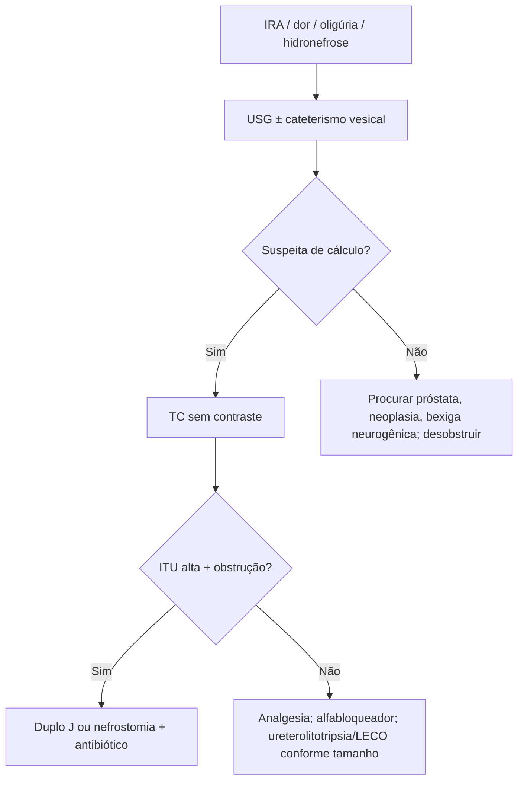

# Obstrução de Trato Urinário

> Resumo em palavras próprias do Whitebook (Condutas Cirúrgicas > Cirurgia Urológica), sem fisiopatologia, autoria e referências. Confira detalhes e doses na fonte: https://whitebook.pebmed.com.br/conteudo/?id=45423&categoryId=207&subcategoryId=214

**Definição:** obstrução em qualquer segmento do trato urinário; aguda ou crônica, parcial ou completa, uni ou bilateral. Sinônimos: uropatia obstrutiva, obstrução do fluxo urinário. Reconhecer rápido: pode levar a ITU, urossepse e insuficiência renal terminal. Mais comum em homens idosos (próstata); causa de IRA ambulatorial.

## Causas
- **Rim:** dilatação de cálice isolado (cálculo, carcinoma urotelial, coágulo, descamação de papila). **Pelve/segmentos distais:** caliectasia difusa ou hidronefrose. **Ureter:** cálculo, carcinoma urotelial, compressão externa (tumores, linfonodos, fibrose retroperitoneal), coágulo, bola fúngica, obstrução de duplo J. Tumor de bexiga pode obstruir ureteres/óstios.
- **Bilateral:** obstrução infravesical (próstata, válvula de uretra posterior) e bexiga neurogênica. Em mulheres com hidronefrose, investigar neoplasia ginecológica.
- **Por idade:** crianças — anomalias (válvulas, estenose da junção ureterovesical/ureteropélvica); adultos jovens — cálculos; idosos — hipertrofia/neoplasia prostática, neoplasias pélvicas/retroperitoneais, cálculos.

## Clínica
Dor, alteração do débito urinário, hipertensão (retenção hidrossalina ou SRAA), hematúria, creatinina elevada. A dor depende do local, grau e rapidez: cólica sugere obstrução completa aguda (cálculo); compressões extrínsecas progressivas costumam ser indolores. Débito normal não exclui; pode haver anúria, oligúria, normal ou poliúria. Bexigoma palpável em obstrução infravesical; sem achado patognomônico no trato superior.

## Diagnóstico
- Creatinina pode estar normal em casos unilaterais/parciais; urina normal ou com leucocitúria/hematúria; acidose tubular renal hipercalêmica na obstrução crônica.
- **Imagem em todo paciente com IRA de causa desconhecida.** USG (preferida; falso-positivos: diabetes insipidus, gravidez/puerpério; exclui OTU; vê retenção vesical; cateterismo também diagnostica e alivia). **TC sem contraste** primeiro se suspeita de cálculo (dor em flanco, náusea, hematúria) e em policística, ou após USG inconclusiva (padrão-ouro para litíase). RM é alternativa (cálculos mal vistos; evitar gadolínio com TFG < 30 mL/min). Dilatação do sistema coletor é o achado clássico; afinamento cortical indica obstrução crônica. Nefrostomia percutânea/urografia anterógrada não são testes iniciais (usados para aliviar e diagnosticar quando há forte suspeita e imagem inconclusiva). Cintilografia: distinguir hidronefrose não obstrutiva e medir função.
- **Pistas de risco:** próstata aumentada/neoplasia, cirurgia urológica ou pélvica prévia, malignidade abdominal/retroperitoneal, nefrolitíase prévia, hematúria macroscópica, dor recente, doença neurológica vesical.
- **Diferenciais:** causas de IRA/DRC com urina normal e sem proteinúria; anúria: OTU bilateral completa, choque, SHU, necrose cortical, obstrução arterial bilateral, glomerulonefrite rapidamente progressiva; com USG: cisto peripélvico, pelve extrarrenal, dilatação de veia renal. Gestação causa dilatação ureteral desde o 1º trimestre até semanas pós-parto.

## Tratamento
- Cálculo identificado: analgesia (AINE/opioide). **ITU alta + obstrução → drenagem com duplo J ou nefrostomia percutânea.**
- **Renal:** > 20 mm preferir percutânea; 10–20 mm qualquer método (percutânea, nefrolitotripsia, LECO); < 10 mm nefrolitotripsia (conforme o texto).
- **Alta:** sem ITU, hemodinamicamente estável, tolera via oral, dor controlada por via oral, cálculo expelível.
- **Ureteral:** eletivo — > 10 mm ureterolitotripsia, < 10 mm LECO opcional; urgência (infecção, ameaça à função renal: rim único, oligúria, anúria; refratário; > 1 cm); infecção → somente drenagem com duplo J. Dispensados: bloqueador α1 expulsivo. Alívio da dor não prova expulsão (obstrução silenciosa); repetir imagem.
- **Prevenção:** cálcio — reduzir sódio, oxalato e proteína animal, diurese 2.000 mL/dia, sem restringir cálcio abaixo do recomendado; tiazídico, citrato de potássio, alopurinol; ácido úrico — citrato, alopurinol, hidratação e alcalinização para dissolver. Sintomáticos/persistentes: cirurgia.
- **Prognóstico:** obstrução prolongada causa atrofia tubular e fibrose; obstrução ureteral total: possível recuperação da TFG se aliviada em 1 semana, pouca ou nenhuma após 12 semanas; maior recuperação em 7–10 dias após a desobstrução (alguns precisam de diálise por semanas). Mau prognóstico: sem captação de radiotraçador, atrofia cortical importante.

## Fluxograma (refeito, a partir do texto; o original não traz algoritmo)

