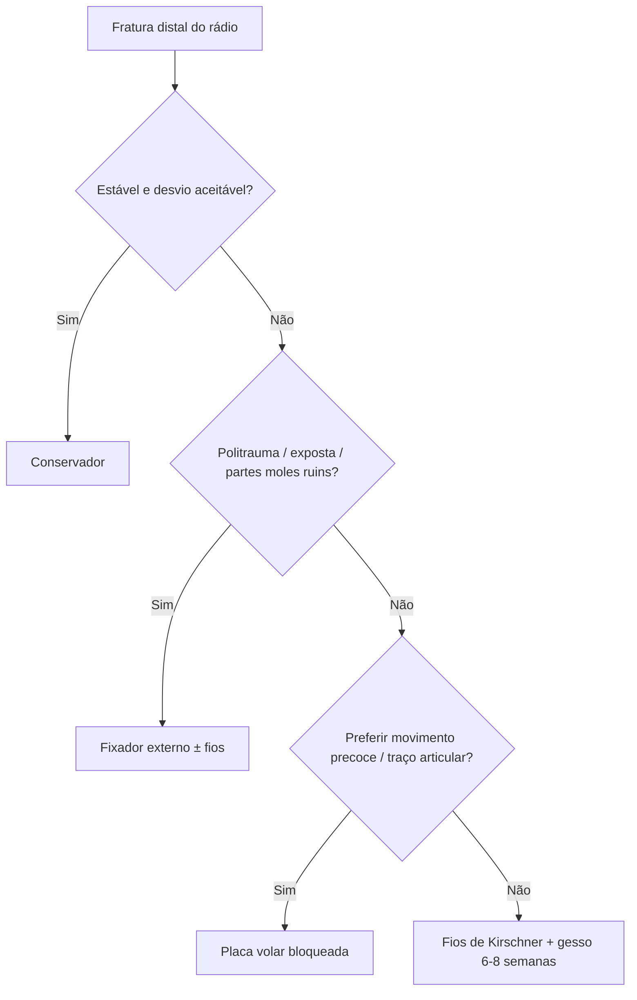

# Osteossíntese Distal do Rádio

> Resumo em palavras próprias do Whitebook (Condutas Cirúrgicas > Ortopedia), sem autoria e referências. Confira detalhes e doses na fonte: https://whitebook.pebmed.com.br/conteudo/?id=60224&categoryId=207&subcategoryId=819

**Introdução:** conservador em fraturas estáveis com desvio aceitável; **instáveis ou desviadas → cirurgia**. Opções mais comuns: placa volar, fios de Kirschner e fixador externo; placas dorsais e fixação transarticular para padrões incomuns.

## Fios de Kirschner
- **Indicação:** minimamente invasivo, mas exige imobilização gessada por **6–8 semanas** (sem movimento precoce do punho); fixador externo é alternativa ao gesso; vários tipos de fratura.
- **Posição:** mesa convencional, membro em mesa de mão, com radioscopia.
- **Redução:** tração manual; se falhar, pequenos acessos com pinças ou fios como *joystick*; aberta se irredutível. Acessos percutâneos para os fios; acesso volar se for preciso expor o foco.
- **Técnica:** entradas mais comuns na **estiloide radial** e no **tubérculo de Lister**; fios cruzados em dois pontos de entrada ou divergentes de entrada próxima, conforme o traço; em traço articular, fios paralelos à articulação; usar dois ou mais fios, que **não devem cruzar a fratura no mesmo ponto** (evita perda da redução).
- **Cuidados:** gesso axilopalmar (ou fixador transarticular). Gesso axilopalmar por **3–4 semanas** e depois gesso luva por mais 3–4 semanas (alguns usam só o luva). Depois, liberar o movimento.

## Placa e parafusos
- **Indicação:** fraturas instáveis ou desviadas; reabilitação precoce com movimento liberado se a fixação for estável; concorre com os fios (padrão e preferência decidem).
- **Redução:** direta após exposição; alguns reduzem fechado e fixam provisoriamente com fios antes da placa; placas anatômicas ajudam a reduzir.
- **Acesso:** volar baseado no de Henry, pelo plano entre flexor radial do carpo e flexor longo do polegar (ou entre artéria radial e flexor radial do carpo); seção do pronador quadrado (pode ser reinserido).
- **Implantes:** parafusos de compressão pela placa (frequente em traço articular); placas bloqueadas anatômicas úteis; placas convencionais em casos selecionados; bloqueados se osso fraco ou cominuição; posição ideal conforme o desenho do fabricante.
- **Cuidados:** movimento precoce conforme a estabilidade; tala luva ou axilopalmar por pouco tempo, para conforto.

## Fixador externo
- **Indicações:** controle de dano em politrauma/exposta; definitivo em casos selecionados (partes moles) ou quando o gesso não protege o bastante; geralmente associado a fios.
- **Acesso:** percutâneo para os pinos; exposta exige acessos separados para desbridamento, por via volar.
- **Pinos:** proximais entre braquiorradial e extensor longo do carpo, **≥ 5 cm do foco**, protegendo o nervo cutâneo lateral do antebraço e o ramo superficial do radial; **45°** do eixo longo; pré-furar; distais por incisão percutânea no terço proximal do 2º metacarpo; acoplar barra, reduzir; pinos extras perto do foco sem invadir o hematoma.
- **Cuidados:** curativo diário dos pinos; fios mantidos por 6–8 semanas; fixador retirado após consolidação em período semelhante.

## Fluxograma (refeito, a partir do texto; o original não traz algoritmo)

