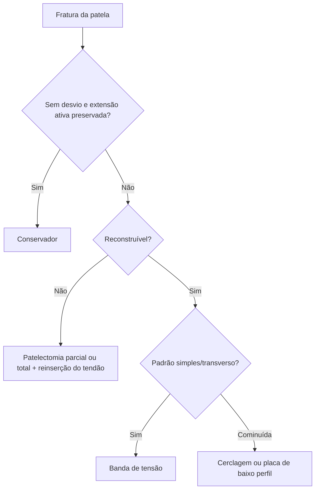

# Osteossíntese de Patela

> Resumo em palavras próprias do Whitebook (Condutas Cirúrgicas > Ortopedia), sem autoria e referências. Confira detalhes e doses na fonte: https://whitebook.pebmed.com.br/conteudo/?id=60045&categoryId=207&subcategoryId=819

**Considerações:** conservador em fraturas sem desvio com mecanismo extensor competente (teste de elevação ativa do quadríceps). O método depende do padrão, da disponibilidade e da experiência: **banda de tensão**, **cerclagem**, **placa** e técnicas de salvação. Em todas: mesa de fraturas com intensificador de imagem; isquemia pode ajudar, mas com cautela (partes moles); redução direta por exposição do foco (alguns padrões, percutânea com pinças e controle por imagem ou artroscopia); acesso anterior mediano (lesão do retináculo permite inspecionar a articulação; ou artrotomia medial/lateral).

## Banda de tensão
- **Indicação:** converte forças de distração em compressão e libera movimento precoce; padrões simples (transversos); fraturas multifragmentadas podem ser simplificadas em dois blocos; inadequada em cominuição excessiva. Parafusos canulados podem substituir os fios (com o cabo passando por dentro); placas bloqueadas de baixo perfil surgem para cominuição.
- **Técnica:** dois fios de Kirschner paralelos de **1,5 ou 2,0 mm**; fio de cerclagem passado profundamente ao tendão quadricipital, atrás dos fios, cruzado em oito na frente da patela e passado profundamente ao tendão patelar; tensionar (pode ser em dois pontos); fio habitual **1,0–1,25 mm × 30 cm**; dobrar a ponta 180° e enterrar. Fio de sutura ultrarresistente é alternativa.
- **Cuidados:** dispensa imobilização, amplitude liberada conforme tolerância; carga com muletas e imobilizador na marcha.

## Cerclagem
- **Indicação:** fraturas cominutivas sem possibilidade de banda de tensão; isolada ou combinada.
- **Técnica:** redução direta mantida com pinças/fios de Kirschner; fio de cerclagem ou sutura ultrarresistente passado circunferencialmente, justa-óssea, pelos tecidos ao redor da patela; extremidades unidas e tensionadas.
- **Cuidados:** isolada exige tala ou órtese; carga com muletas e imobilizador.

## Placa
- **Indicação:** cominuição, alternativa à cerclagem.
- **Técnica:** redução mantida com pinças/fios; placas bloqueadas específicas de baixo perfil ou placas de calcâneo.
- **Cuidados:** em geral tala ou órtese (varia com a estabilidade); carga com muletas e imobilizador.

## Técnicas de salvação
- **Indicação:** reconstrução impossível.
- **Patelectomia parcial** (cominuição do polo superior ou inferior sem reparo): ressecar o segmento e reinserir o tendão por via transóssea (sutura ultrarresistente tipo Krackow em duas fileiras, três túneis na patela, pontas amarradas) ou com âncoras; manter imobilização.
- **Patelectomia total** (cominuição completa com fragmentação cartilaginosa): retirar a patela e suturar segmentos proximal e distal do mecanismo extensor e os retináculos; imobilização.

## Fluxograma (refeito, a partir do texto; o original não traz algoritmo)

