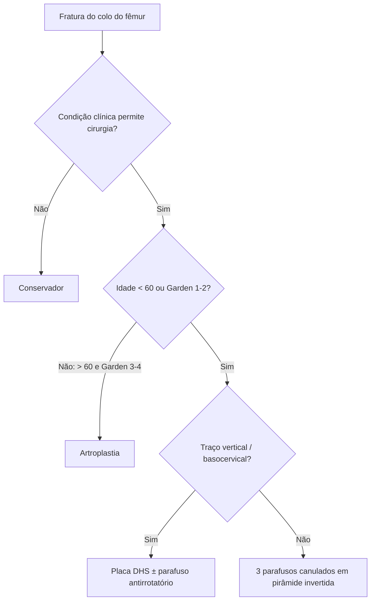

# Osteossíntese do Colo do Fêmur

> Resumo em palavras próprias do Whitebook (Condutas Cirúrgicas > Ortopedia), sem autoria e referências. Confira detalhes e doses na fonte: https://whitebook.pebmed.com.br/conteudo/?id=60000&categoryId=207&subcategoryId=819

**Definição:** cirurgias que preservam a articulação para fixar as fraturas do colo do fêmur.

## Opções de tratamento
- Conservador só nos raros pacientes com contraindicação clínica à cirurgia.
- **Osteossíntese:** qualquer fratura em < 60 anos e fraturas Garden 1 e 2 em > 60 anos. **Artroplastia:** Garden 3 e 4 em > 60 anos (a decisão considera outros parâmetros além da idade cronológica).
- Crianças seguem outras técnicas (fise de crescimento).

## Parafusos canulados
- **Indicação:** técnica popular; discute-se o número (2 × 3), disposição paralela ou divergente e uso de arruelas.
- **Posição:** mesa de tração com membro contralateral em perneira ginecológica, ou ambos os membros sob tração, ou decúbito dorsal sem tração (garantindo visão radioscópica do quadril).
- **Redução:** indireta por tração, com pequenos acessos, pinças, Hohmann, Schanz/Steinmann; irredutível → redução aberta por Smith-Petersen, variante de Hueter (porção distal) ou anterolateral (Watson-Jones). Fratura reduzida sem abertura → acessos percutâneos laterais da coxa.
- **Implantes:** a montagem de **três parafusos em pirâmide invertida** é muito popular (fio-guia inferior primeiro, depois posterossuperior, por último anterossuperior); considerar um 4º parafuso (diamante) se houver cominuição posterior. Parafusos canulados de rosca parcial de **6,5, 7 ou 8 mm**; arruelas controversas; guias específicos para posição paralela.
- **Pós-operatório:** restrição de carga por 6–8 semanas (alguns liberam carga parcial em 3–4 semanas ou de imediato).

## Placa DHS
- **Indicação:** opção para fraturas verticais e basocervicais, que se comportam como as transtrocanterianas.
- **Posição e redução:** como acima; redução aberta por Smith-Petersen ou Watson-Jones. Acesso lateral distal ao pequeno trocanter, secção da fáscia e vasto lateral afastado (submuscular ou com secção das fibras).
- **Implante:** fio-guia do parafuso deslizante rumo à cabeça, respeitando os **135°** da placa; confirmar em AP e perfil posição central e ~**5 mm** da superfície articular; **soma das distâncias ao osso subcondral em AP + perfil < 25 mm**. Perfurar 5 mm a menos que a medida do fio, parafuso 5 mm menor que a perfuração; ao final, rotação que permita a placa alinhada ao eixo femoral. Em geral basta placa de **3 parafusos**. Parafuso antirrotatório canulado mais proximal evita rotação do fragmento (sobretudo em fraturas à esquerda, onde o aperto do deslizante tende a fletir o fragmento proximal).
- **Pós-operatório:** fraturas estáveis; carga conforme tolerância (alguns restringem 3–4 semanas, outros 6–8).

## Fluxograma (refeito, a partir do texto; o original não traz algoritmo)

