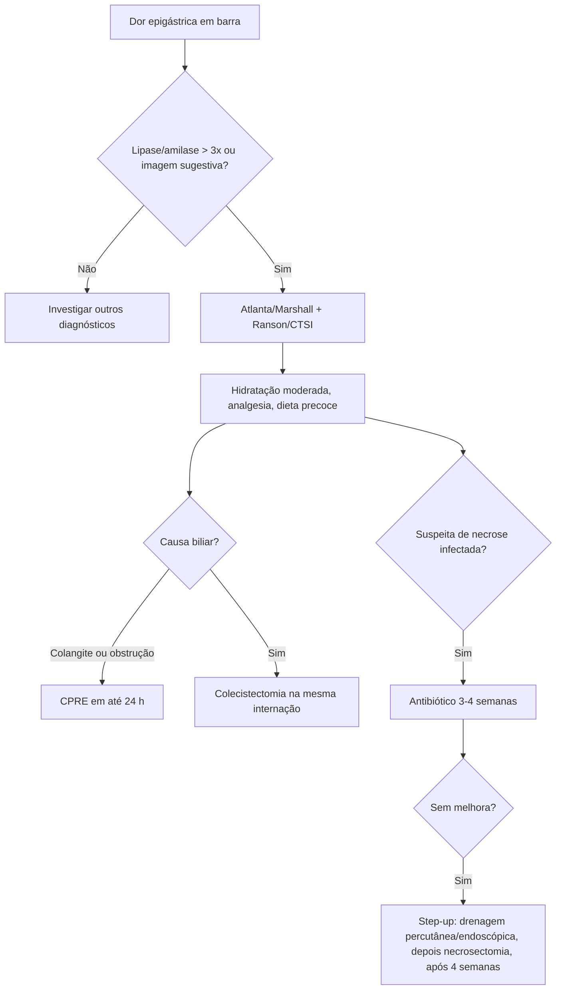

# Pancreatite Aguda

> Resumo em palavras próprias do Whitebook (Condutas Cirúrgicas > Cirurgia Geral e do Aparelho Digestivo), sem fisiopatologia, autoria e referências. Confira detalhes e doses na fonte: https://whitebook.pebmed.com.br/conteudo/?id=22595&categoryId=207&subcategoryId=211

**Definição:** abdome agudo por inflamação do pâncreas com autodigestão, com acometimento variável dos tecidos peripancreáticos e repercussão sistêmica.

## Etiologia e epidemiologia
- **Causas:** biliar (40–50%); alcoólica (10–40%); hipertrigliceridemia (1–4%); hipercalcemia (hiperparatireoidismo); pós-CPRE (3–25%; reduzir risco com indometacina retal, hidratação e stent se necessário); medicamentos (antirretrovirais, sulfonamidas, análogos de GLP-1, azatioprina, 6-mercaptopurina, tetraciclina, diuréticos, estrogênios, metildopa, codeína, enalapril, furosemida, sinvastatina, ácido valproico, metronidazol, mesalazina, losartana, amiodarona, omeprazol, isoniazida, dexametasona etc.); infecções (virais — caxumba, coxsackie, hepatites A/B/E, CMV, varicela-zóster, HIV, herpes; bacterianas — *Mycoplasma*, *Legionella*, *Leptospira*, *Salmonella*; fúngica — *Aspergillus*; parasitárias — *Toxoplasma*, *Cryptosporidium*, *Ascaris*); vasculares (vasculites, LES, poliarterite nodosa, ateroembolismo, hipotensão intraoperatória, choque, isquemia); *pâncreas divisum*; mutações (CEL, CPAI, CASR, CFTR, CTRC, PRSS1, SPINK1); trauma; disfunção do esfíncter de Oddi; cisto de colédoco/coledococele; estenose pós-necrótica; pós-biópsia; pólipo de vesícula; autoimune; acidente escorpiônico; neoplasias (periampulares, IPMN); idiopática (10–25%).
- Incidência 5–35/100.000; mortalidade média 3–17%; forma leve mais comum; grave em 10–20% (morbimortalidade 25–45%); ~21% têm recorrência e 8% destes evoluem para pancreatite crônica; tabagismo é fator independente; litíase e etilismo respondem por 80% dos casos.

## Clínica
- **Dor:** contínua, em andar superior, em barra, irradiada para o dorso; alívio na posição genupeitoral (“prece maometana”). Biliar: início súbito, máximo em 10–20 min, bem localizada; alcoólica/metabólica: surda, mal localizada, gradual.
- Náuseas e vômitos. **Gravidade:** SIRS (febre ≥ 38,5 °C), taquicardia, hipotensão → choque; taquipneia (SDRA); rebaixamento; 5–10% dos graves têm só hipotensão e SIRS, sem dor típica.
- **Pesquisar:** litíase, etilismo/libação, hipercalcemia, triglicerídeos > 1.000 mg/dL, drogas, trauma, hipovolemia, CPRE recente.
- **Exame:** dor à palpação; icterícia (incomum: coledocolitíase ou edema de cabeça); taquicardia, taquipneia, hipotensão, febre; MV reduzido à esquerda (derrame); irritação peritoneal; distensão com íleo; retinopatia de Purtscher (rara); **Grey-Turner** (flancos), **Cullen** (periumbilical), **Fox** (base do pênis); paniculite; xantomas/xantelasmas (hiperlipidemia); parotidomegalia (álcool).

## Diagnóstico
Dois de três: (1) dor típica; (2) amilase e/ou lipase > 3× o limite superior; (3) imagem sugestiva (TC ou RM).
- **Laboratório:** hemograma (leucocitose até 20.000; hemoconcentração); eletrólitos (hiponatremia, hipocalemia, hipocalcemia; hipercalcemia se for a causa); ureia (cada aumento de 10,8 mg/dL nas primeiras 24 h = mortalidade 2,2×) e creatinina (alta em 48 h prediz necrose); glicemia; **amilase** (sobe em 6–12 h, dura 3–5 dias; pode ser normal em 20% das alcoólicas e 50% das por hipertrigliceridemia; S 67–83%, E 85–98%); **lipase** (sobe em 4–8 h, dura 8–14 dias; S 79–100%, E 82–100%); enzimas não indicam gravidade; hepatograma (ALT > 150 é mais específica de causa biliar; < 150 não exclui); PCR, LDH, lactato, gasometria (alcalose se vômitos; acidose se grave), proteínas/albumina; sem causa óbvia: triglicérides e IgG4.
- **Imagem** (não é de rotina; reservada a dúvida ou gravidade): *RX* (alça sentinela, cut-off, derrame, atelectasia); *USG* na admissão para causa biliar; *TC com contraste* a partir do 3º–4º dia mostra necrose (sem realce) e complicações — necrose > 30%: mortalidade 8×, internação prolongada 17×, necrosectomia 10×; *RM/colangiorressonância*: mais sensível para necrose e coledocolitíase, alternativa em gestantes e insuficiência renal.
- **Balthazar (TC sem contraste):** A normal 0; B aumento focal/difuso 1; C alterações peripancreáticas 2; D uma coleção 3; E ≥ 2 coleções ou gás 4. **Necrose na TC com contraste:** 0 = 0; < 33% = 2; 33–50% = 4; ≥ 50% = 6. Soma ≥ 6 = grave.
- **CTSI:** 0–3 leve; 4–6 moderada; 7–10 grave.
- **Ranson** (11 critérios; 5 na admissão, 6 em 48 h). *Não biliar, admissão:* idade > 55, leucócitos > 16.000, AST > 250, glicemia > 200, LDH > 350. *Biliar:* > 70, > 18.000, AST > 250, glicemia > 220, LDH > 400. *48 h, não biliar:* PaO₂ < 60, déficit de base > 4, sequestro > 6 L, queda do Ht > 10%, ureia +10, Ca < 8. *Biliar:* déficit > 5, sequestro > 4 L, queda do Ht > 10%, ureia +4, Ca < 8. < 3 leve (0–3% mortalidade); ≥ 3 grave (11–15%); ≥ 6 muito grave (40%).
- **Pior prognóstico:** PCR > 150 em 48 h; APACHE II ≥ 8; Ranson ≥ 3; > 75 anos; obesidade; falência orgânica > 48 h; hemoconcentração (ureia, Ht > 44%).

## Atlanta revisada
- **Leve:** sem falência orgânica nem complicações. **Moderada:** falência que resolve em 48 h e/ou complicações locais/sistêmicas. **Grave:** falência orgânica > 48 h. Falência = Marshall modificado ≥ 2 em algum sistema (cardiovascular: PAS < 90 com resposta a fluidos = 1, sem resposta = 2, com pH < 7,3 = 3, < 7,2 = 4; respiratório PaO₂/FiO₂ 301–400 = 1, 201–300 = 2, 101–200 = 3, ≤ 101 = 4; renal creatinina 1,4–1,8 = 1, 1,9–3,6 = 2, 3,6–4,9 = 3, > 4,9 = 4).
- **Intersticial edematosa** (85%, branda, resolve em ~1 semana); **necrosante** (15%, pior prognóstico).
- **Fase inicial:** SIRS, falência determina a gravidade, até 1–2 semanas. **Tardia:** só na moderada/grave, inflamação persistente e complicações locais.
- **Complicações locais:** coleção peripancreática aguda e coleção necrótica aguda (< 4 semanas); pseudocisto e necrose murada/walled-off (> 4 semanas); necrose infectada; trombose portoesplenomesentérica.
- **Diferenciais:** úlcera/dispepsia, colangite, coledocolitíase, colecistite, apendicite, obstrução, perfuração, nefrolitíase/pielonefrite, hepatite aguda, isquemia mesentérica, síndrome de Gullo, SCA.

## Tratamento
- Internar todos (analgesia, hidratação, avaliar antibiótico e desbridamento); UTI se grave. Base é suporte clínico; **sem profilaxia de rotina para hemorragia digestiva**.
- **Hidratação:** cristaloide 5–10 mL/kg/h (Ringer lactato de preferência), individualizada em cardiopatas/renais crônicos; se hipotenso/taquicárdico, 20 mL/kg em 30 min e 3 mL/kg/h por 8–12 h. Metas: FC < 120, PAM 65–85, diurese > 0,5–1 mL/kg/h, Ht 35–44%, ureia caindo em 24 h. Hidratação **moderada** (a agressiva só aumentou sobrecarga hídrica); limitar às primeiras 24–48 h; reavaliar em 12, 24, 48 e 72 h.
- **Analgesia** precoce, EV: não opioides (paracetamol, dipirona, AINE) até opioides; tramadol/codeína antes dos potentes; morfina pode ser usada; fentanil é o mais seguro, mas pouco usado.
- **Cálcio/magnésio:** corrigir hipocalcemia se Ca iônico baixo ou sinais de Chvostek/Trousseau; corrigir magnésio.
- **Dieta:** leve → via oral se a dor estiver controlada (dor < 5/10 e vontade de comer), independentemente de enzimas. Se não houver via oral, **enteral** precoce (24–72 h), SNG (nasojejunal só se intolerância), sem fórmula semielementar, após reanimação; sem contraindicação absoluta se PIA < 15 mmHg, pós-necrosectomia minimamente invasiva ou peritoneostomia; suspender se PIA > 20. **Parenteral** suplementar se intolerância enteral, meta não atingida em 48–72 h, íleo/vômitos, coleções com efeito de massa, abscesso/fístula ou PIA > 20.
- **Metas nutricionais:** 25–30 kcal/kg/dia (50% carboidratos), proteína 1,5–2 g/kg/dia, lipídios < 30–35% (0,8–1,5 g/kg/dia; suspender se TG > 500); L-glutamina 0,2 g/kg/dia em NPT selecionada; sem probióticos nos graves; sem enzimas pancreáticas salvo insuficiência exócrina; monitorar eletrólitos, glicemia e TG.
- **Antibiótico:** não profilático. Indicar se suspeita de infecção: necrose com piora clínica/laboratorial, sem melhora após 7–10 dias, procalcitonina ≥ 1 ng/mL, gás na necrose. Duração 3–4 semanas. Esquemas empíricos: ciprofloxacino 400 mg 12/12 h + metronidazol 500 mg 8/8 h; ceftriaxona 2 g 24/24 h + metronidazol; cefepima 1–2 g 8/8 h + metronidazol; piperacilina-tazobactam 4,5 g 6/6 h; imipeném 1 g 8/8 h; meropeném 2 g 8/8 h (mais usado, boa penetração). PAAF guiada por TC pode orientar; falha → intervenção para controle do foco.
- **Hipertrigliceridemia:** gorduras na dieta < 15% (ideal < 5%); grave → plasmaférese (TG após cada ciclo; parar com TG < 500); leve/moderada ou sem plasmaférese → insulina EV 0,1–0,3 U/kg/h com glicemia capilar horária, glicose se necessário, TG a cada 12 h até < 500; fibrato ± ômega-3 ± niacina quando TG < 1.000.
- **Seguimento:** eletrólitos nas 48–72 h; glicemia alvo 180–220; pressão intra-abdominal seriada nos graves; TC com contraste se sepse/deterioração após 72 h.

## Intervenção (step-up)
Do menos ao mais invasivo, idealmente após a 4ª semana (necrose delimitada). Drenagem percutânea/endoscópica primeiro (pode dispensar necrosectomia); depois necrosectomia (possivelmente várias, com peritoneostomia). Indicação: necrose infectada sem resposta ao antibiótico ou com instabilidade. Em necrose estéril: obstrução intestinal/biliar por efeito de massa (4–8 semanas), dor/náusea/vômito/perda de peso persistentes após 8 semanas, ou transecção completa do ducto pancreático com coleções sintomáticas após 8 semanas.

## Pancreatite biliar
- **CPRE:** idealmente em 24 h se houver colangite; também se cálculo visível obstruindo o colédoco, ou colédoco dilatado/enzimas hepáticas crescentes sem colangite. Não indicada sem colangite e sem obstrução (pode induzir nova pancreatite). Colangiorressonância/RM para decidir em gestantes e anatomia difícil.
- **Colecistectomia:** após recuperação total, idealmente na mesma internação, em todos os casos biliares; também com lama biliar (20–40% das pancreatites sem causa óbvia). Preferir laparoscopia com colangiografia intraoperatória e exploração das vias biliares se necessário; sempre eletiva.

## Complicações
- **Coleção líquida aguda:** < 4 semanas, 30–50%, geralmente estéril e reabsorvida em mais da metade dos casos.
- **Pseudocisto:** > 4 semanas, parede não epitelizada, sem componente sólido. Tratar só se sintomático ou infectado (drenagem percutânea/endoscópica). Pode romper (ascite pancreática), infectar (abscesso) ou comprimir.
- **Coleção necrótica aguda / necrose murada** (> 4 semanas, cauda e corpo; necrose estéril não precisa de antibiótico).
- **Necrose infectada:** gás + piora clínica; infecção ao redor da 2ª–3ª semana; se estéril com toxicidade, repetir PAAF em 5–7 dias; não retardar o antibiótico por causa da cultura; preferir abordagem endoscópica à necrosectomia cirúrgica (maior risco de fístula), idealmente após ≥ 4 semanas de antibiótico, sem postergar em instáveis.
- **Trombose portoesplenomesentérica:** 50% dos necrosantes; anticoagular se extensão à porta/mesentérica com descompensação hepática ou má perfusão intestinal; trombose esplênica → varizes gástricas.
- **Sistêmicas:** descompensação de comorbidade, falência orgânica; mortalidade 25% com SIRS persistente, 8% com SIRS transitória, 0% sem SIRS.

O texto lista ainda Guia de Prescrição, Guia de Antimicrobianos, Atlas de Radiologia e um Fluxograma na fonte.

## Fluxograma (refeito, a partir do texto; o original está na fonte)

