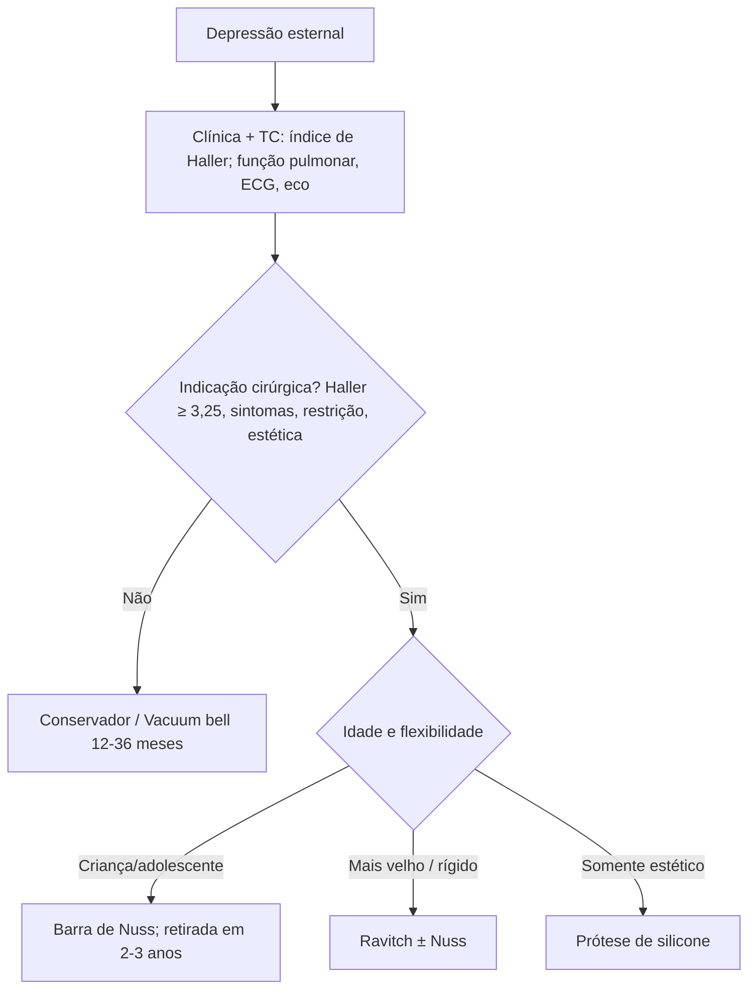

# Pectus Excavatum

> Resumo em palavras próprias do Whitebook (Condutas Cirúrgicas > Cirurgia Torácica), sem autoria e referências. Confira detalhes e doses na fonte: https://whitebook.pebmed.com.br/conteudo/?id=44544&categoryId=207&subcategoryId=215

## Introdução
- "Peito de sapateiro"/tórax escavado; deformidade mais comum da parede torácica (70–84%); incidência até 1:1.000 nascidos vivos. Em geral esporádica; até 1/3 tem familiar afetado. Homens 4–9:1.
- Associações: síndromes de Marfan, Pierre Robin, Prune Belly e Poland; paralisia cerebral, esclerose tuberosa, costela cervical bilateral, hérnia diafragmática congênita, neurofibromatose, fenda palatina, agenesia pulmonar, enfisema lobar congênito.
- **Etiologia:** desconhecida; provável crescimento anormal das cartilagens costais/alteração do tecido cartilaginoso (ocorre em doenças do conectivo, como Marfan). Forma iatrogênica: lesão dos centros de ossificação do esterno na esternotomia de cirurgia cardíaca.

## Clínica
- Muitas vezes assintomático; afundamento esternal desde o 1º ano, mais evidente na infância tardia/adolescência (estirão puberal).
- Adolescência: dor retroesternal, cansaço fácil, dispneia, palpitações; repercussão emocional (depressão, má aceitação corporal, introversão, retração social).
- "Postura de pectus": cifose torácica, ombros caídos, abdome protuberante; biotipo longilíneo e magro; nas mulheres, hipomastia ou desvio medial dos mamilos.

## Diagnóstico
Essencialmente clínico; imagens definem anatomia, gravidade, seguimento e planejamento.
- **RX:** desvio do coração para a esquerda conforme a depressão. **TC:** depressão esternal, desvio ou compressão cardíaca.
- **Prova de função pulmonar:** redução discreta dos volumes.
- **ECG:** alterações atribuídas ao deslocamento/rotação cardíaca. **Eco:** possível indentação do VD, deformidade do anel mitral ou do ventrículo (prolapso mitral); pressões normais em repouso e esforço.
- **Índice de Haller (TC):** diâmetro transverso máximo (A) ÷ menor distância anteroposterior (B); **≥ 3,25 = deformidade moderada a grave**. **Índice de Rebeis:** medida antropométrica equivalente ao nível da maior depressão.

## Classificação
- Simétrico × assimétrico (esterno rodado).
- Agudo/"em xícara" (profundo, localizado, limites nítidos) × amplo/"em pires" (raso, largo, limites imprecisos).

## Tratamento
**Conservador:** deformidades discretas a moderadas, risco cirúrgico alto ou recusa da cirurgia.
**Vacuum bell:** melhor em jovens (crianças/pré-adolescentes), deformidade moderada (até 3 cm), simétrica, tórax flexível; contraindicado em doenças esqueléticas, vasculopatias, coagulopatias e cardiopatias. Complicações: hematoma subcutâneo, petéquias, dorsalgia, parestesia transitória de membros superiores. Uso por 12–36 meses; revisões trimestrais/semestrais a anuais.

**Indicações cirúrgicas:** estética (progressão, imagem corporal), Haller ≥ 3,25, sintomas cardiorrespiratórios, movimento paradoxal na inspiração profunda, restrição pulmonar importante. Melhor idade variável (média 7–14 anos).

| Técnica | Pontos principais |
|---|---|
| Prótese de silicone (submuscular/subcutânea, molde individual) | Não aumenta o diâmetro torácico nem reduz a compressão cardíaca |
| Ravitch (esternocondroplastia) | Antes a mais usada; hoje em pacientes mais velhos (esterno menos móvel) ou associada a Nuss. + Menos dor pós-operatória, não abre a cavidade pleural; − incisão mediana ou inframamária; complicações: infecção, pneumotórax, hematoma, pneumonia, hemotórax |
| Barra de Nuss | Mais realizada hoje; preferível em crianças/adolescentes (elasticidade). + Minimamente invasiva, menos sangramento e tempo operatório, alivia a compressão e permite crescimento; − mais dor, nova cirurgia para retirar a barra, reação a corpo estranho, custo, mais reoperações/complicações em adultos |

**Pós-operatório (Nuss):** RX; em geral sem dreno pleural; analgesia com cateter peridural; sem peso e atividade física por 3 meses; barras retiradas após 2–3 anos sob anestesia geral; seguimento clínico-radiológico a cada 6 meses (rotação da barra). **Se PCR:** compressões em direção anteroposterior, excluir pneumotórax hipertensivo, considerar massagem cardíaca interna precoce (rigidez impede a externa).

**Complicações:** infecção de sítio, sangramento, lesão cardíaca/pulmonar/vasos mamários, pericardite e derrame pericárdico, pneumotórax, hemotórax/derrame pleural, pneumonia, seroma; relacionadas ao material: extrusão, infecção secundária, deslocamento/extrusão da barra, alergia.

## Fluxograma (refeito, a partir do texto; o original não traz algoritmo)

