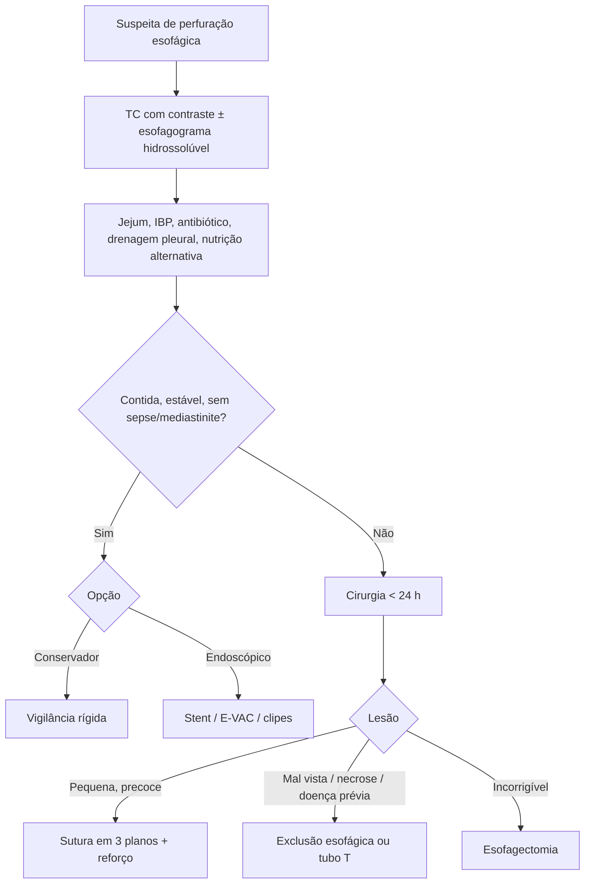

# Perfuração Esofágica

> Resumo em palavras próprias do Whitebook (Condutas Cirúrgicas > Cirurgia Torácica), sem autoria e referências. Confira detalhes e doses na fonte: https://whitebook.pebmed.com.br/conteudo/?id=39177&categoryId=207&subcategoryId=215

## Etiologia e epidemiologia
- **Causas:** espontânea/barotrauma (Boerhaave); iatrogênica (endoscopia, traqueostomia percutânea, intubação, sonda nasogástrica, ecocardiograma transesofágico, mediastinoscopia, dilatação, CPRE, cirurgia); corpo estranho (espinha, osso, dentes); cáusticos; trauma fechado/penetrante/explosão; tumor; esofagite grave; medicamentos; candidíase; megaesôfago; deiscência anastomótica; raras: levantamento de peso, parto, *status epilepticus*, defecação, manobra de Heimlich.
- Incidência variável, em alta; 6ª década, discreto predomínio masculino; mortalidade 10–40%; sem tratamento, sepse, disfunção de órgãos e mediastinite em 25%. Etiologia mais comum: iatrogênica (dilatação por acalasia/estenose). Atraso causa destruição extensa em < 24 h. Localização: torácico 72,6%, cervical 15,2%, abdominal 12,5%.

## Clínica
Dor torácica súbita irradiada para o dorso/ombro esquerdo (70%); cervical: dor, disfonia, estridor, disfagia; abdominal: peritonite; **tríade de Mackler** (Boerhaave): dor torácica, enfisema subcutâneo, vômitos; hematêmese/melena (raros); febre 44%, taquicardia, dispneia 26%; SIRS/sepse/falência em 24–48 h. Exame: hipotensão, enfisema subcutâneo, sinal de Hamman, derrame pleural. História: endoscopia, corpo estranho, cáusticos, êmese copiosa, etilismo, emagrecimento/disfagia (tumor).

## Diagnóstico
- Leucocitose com desvio, anemia variável. **RX:** enfisema, pneumotórax, pneumomediastino, níveis hidroaéreos, derrame, infiltrado. **Esofagograma com contraste hidrossolúvel** (não baritado): sensibilidade baixa (~36%); repetir em 4–6 h se negativo com alta suspeita. **TC com contraste (método de eleição):** ar periesofágico, abscessos, coleções, etiologia (tumor), complicações. **EDA:** pouca insuflação; essencial para corpo estranho; pode ser terapêutica.
- **Toracocentese** (derrame ≥ 1 cm, idealmente com USG): exsudato neutrofílico, restos alimentares, fétido, amilase 1,5–9× o normal, pH ~6, empiema; corante (azul de metileno) no dreno.
- **Diferenciais:** IAM, TEP, dissecção de aorta, pancreatite, pericardite, pneumonia, pneumotórax ou pneumomediastino espontâneo, úlcera perfurada.

## Tratamento
O intervalo entre diagnóstico e intervenção determina o prognóstico.
- **Geral:** via aérea, volume, jejum, NPT ou nutrição enteral alternativa (gastro/jejunostomia ou sonda posicionada por EDA), SNG em sifonagem (idealmente guiada por EDA), IBP, analgesia, fisioterapia; antibiótico polimicrobiano (ex.: cefuroxima + gentamicina + metronidazol); antifúngico só em casos selecionados.
- **Conservador:** sem crepitação, pneumotórax, pneumoperitônio ou extravasamento intraperitoneal; ruptura contida no mediastino ou numa loculação pleural; perfuração instrumental precoce sem ingestão oral; estabilidade; perfuração tardia bem tolerada; vigilância rígida.
- **Endoscópico** (cada vez mais 1ª opção, se sem mediastinite/sepse, perfuração contida drenando para trás do esôfago, sintomas mínimos, sem neoplasia obstrutiva):
  - *Stent* metálico autoexpansível recoberto: perfuração espontânea, iatrogênica, fístula, malignidade; garantir drenagem pleural/mediastinal e nutrição; sucesso: diagnóstico precoce e orifício pequeno; ≥ 4 cm além da lesão; evitar EES/EEI (disfagia, tosse, migração, refluxo); manter 2–4 semanas; complicações: migração, granulação, erosão, úlcera, sangramento, pneumonia, refluxo, fístula, perfuração; eficácia 63–89%.
  - *E-VAC/Endo-Sponge*: esponja de poliuretano em SNG 14 F, pressão −125 a −175 mmHg; deiscência anastomótica, maus candidatos cirúrgicos, falha de outras terapias, fístula crônica, defeitos grandes (pode precisar de *stent* junto); troca a cada 3–5 dias (4 a 9 trocas, 12–36 dias); complicações: estenose, granulação, hemorragia, trauma nasal, sepse prolongada; sucesso 94%.
  - *Clipes* (OTSC): perfuração aguda com pouca inflamação, melhores até 8 mm (falha > 13 mm); anestesia geral; esofagograma e jejum por 24 h; complicações: deslocamento, úlcera contralateral, laceração da língua; sucesso 56–100%.
- **Cirúrgico** (emergência, < 24 h; perdendo espaço para o endoscópico; mortalidade ~20% em cirurgia aberta; reduz a mortalidade em 50–70% se precoce; ainda necessário para complicações como empiema, loculações, mediastinite): mediastinite/derrame, Boerhaave, contaminação mediastinal importante, doença esofágica prévia (câncer, acalasia), perfuração intra-abdominal, pneumotórax, corpo estranho retido, paciente instável/séptico. Tática conforme o tempo, local, gravidade, viabilidade, reserva, estabilidade, contenção.
  - *Geral:* lavagem do mediastino e desbridamento, decorticação, drenagem pleural bilateral e mediastinal, acesso enteral.
  - *Esôfago:* sutura primária em 3 planos com reforço (intercostal, pleura, gordura pericárdica, músculos cervicais) + drenagem (lesão pequena, diagnóstico precoce; contraindicada em esôfago cervical mal visto, necrose mediastinal, lesão extensa, neoplasia, acalasia, instabilidade); fístula esofagocutânea controlada por tubo T (retirar em 4–6 semanas); exclusão esofágica (esofagostomia cervical + gastro/jejunostomia); esofagectomia de urgência (lesão incorrigível, doença esofágica grave; mortalidade 15–40%; reconstrução após 3–6 meses, trans-hiatal ou transtorácica).
  - *Pós-operatório:* dieta zero ≥ 5 dias; enteral por jejunostomia em 48–72 h; antibiótico 7–10 dias; esofagograma no 7º dia (se normal, retirar SNG e reiniciar dieta); TC de seguimento; reconstrução do trânsito em 6–12 meses (frequentemente coloplastia retroesternal).
- **Complicações:** DRGE, dismotilidade, abscesso pulmonar, empiema, mediastinite, sepse, óbito.

## Fluxograma (refeito, a partir do texto; o original não traz algoritmo)

