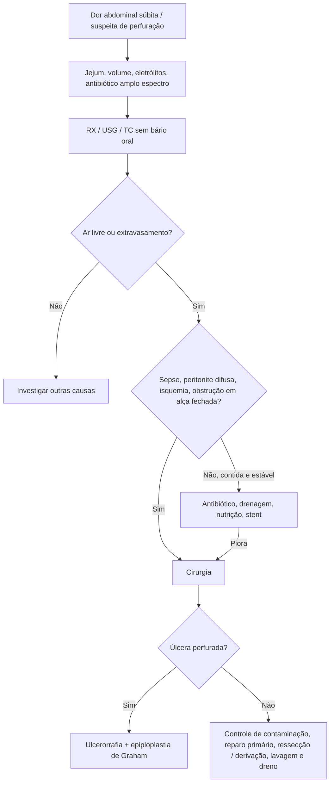

# Perfuração Gastrointestinal

> Resumo em palavras próprias do Whitebook (Condutas Cirúrgicas > Cirurgia Geral e do Aparelho Digestivo), sem fisiopatologia, autoria e referências. Confira detalhes e doses na fonte: https://whitebook.pebmed.com.br/conteudo/?id=45398&categoryId=207&subcategoryId=211

**Definição:** perda da integridade da parede do tubo digestivo com saída do conteúdo para o mediastino, a cavidade peritoneal ou o retroperitônio. Suspeita-se pela clínica e confirma-se pela imagem (ar livre/pneumoperitônio). O quadro depende do órgão e do material extravasado (ar, líquido entérico, fezes). O tipo e o grau de contaminação dependem do sítio, da duração e do estado fisiológico do paciente.

## Etiologia
- **Corpo estranho/trauma:** trauma penetrante, iatrogenia (endoscopia), ingestão de lâminas, ossos, cáusticos.
- **Obstrução intestinal:** extrínseca (linfoma, aderências, volvo, GIST); intrínseca (bezoar, diverticulite, apendicite, neoplasia, estenoses isquêmicas, inflamatórias ou por radiação).
- **Fragilidade da parede:** úlcera péptica, Crohn, síndrome de lise tumoral.
- **Isquemia:** choque, hipoperfusão, tromboembolismo, isquemia arterial visceral, trombose portal.
- **Infecção:** *Salmonella* Typhi, *C. difficile*, CMV, tuberculose.

## Quadro clínico
- Entre os tipos de abdome agudo, o perfurativo é o 3º mais comum; a **úlcera péptica perfurada** é a principal causa (parede anterior do bulbo duodenal). Fatores: *H. pylori* e AINEs. Perfuração colônica na diverticulite é frequente (conduta pelo estágio de Hinchey e pela condição clínica). Mortalidade até 10%.
- **Sintoma principal:** dor súbita e intensa, muitas vezes com horário preciso de início; alívio transitório. Náusea, vômito, anorexia, síncope.
- Esôfago cervical: dor cervical, disfagia, odinofagia, enduramento. Abdome superior: dor no ombro (sinal de Kehr). Retroperitônio: dor dorsal.
- Perfurações proximais (estômago/duodeno): peritonite química precoce; colônicas: dor mais tardia, com peritonite bacteriana ou abscesso.
- **Fatores/antecedentes:** endoscopia, colonoscopia, sondagem, cirurgias; aspirina, AINEs (diclofenaco, ibuprofeno), corticoides, quimioterapia, imunossupressores; corpos estranhos (prótese dentária, espinha de peixe, ossos); hérnias, volvo; DII, úlcera, diverticulose, doença cardiovascular, infecções (tifo, tuberculose, esquistossomose, CMV, amebíase), neoplasias, colagenoses e vasculites (Ehlers-Danlos, Behçet, Churg-Strauss).

## Exame físico
Cicatrizes, feridas, ostomias (cor, necrose), hérnias, equimoses; abdome rígido, doloroso e distendido, peristaltismo reduzido; descompressão dolorosa, sinal do degrau, posição antálgica; massa palpável (abscesso/flegmão) e toque retal; fístula externa; região inguinal e períneo; pescoço e tórax (enfisema subcutâneo, derrame pleural); **sinal de Hamman** (estertores crepitantes mediastinais na sístole) na perfuração esofágica; febre, taquicardia, taquipneia, hipoxemia; exame pélvico em mulheres.

## Diagnóstico
Suspeita clínica; confirmação por ar fora do tubo digestivo (pneumoperitônio ou pneumomediastino) ou complicações (abscesso, fístula).
- **Laboratório:** inespecífico — leucocitose, PCR elevada, hiperlactatemia, hiperamilasemia.
- **RX** de tórax e abdome (decúbito e ortostase): detecta pneumoperitônio e enfisema subcutâneo rapidamente, mas não localiza a origem.
- **USG:** profissional experiente detecta pneumoperitônio; líquido livre e abscessos.
- **TC:** alta sensibilidade e especificidade; localização do gás sugere sítio e causa; mostra descontinuidade, extravasamento de contraste, obstrução, pneumatose, espessamento, abscesso, fístula, corpo estranho, fecalito. Preferir contraste venoso e oral hidrossolúvel. **Não usar bário oral** na suspeita de perfuração (granulomas, peritonite grave com mortalidade > 50%).
- **Endoscopia:** útil, diagnóstica e terapêutica na suspeita de perfuração esofágica.
- **Diferenciais:** barotrauma (pressão positiva/PEEP), ruptura alveolar, abscesso pulmonar, pneumoperitônio residual pós-procedimento (endoscopia, paracentese, diálise peritoneal, instrumentação vaginal), peritonite bacteriana (excluir em cirróticos), pneumatose cistoide, gastrostomia endoscópica.

## Tratamento
**Manejo inicial:** jejum, reposição volêmica, correção hidroeletrolítica, antibiótico de amplo espectro (gram-positivos, gram-negativos e anaeróbios), controle do foco (cirúrgico, endoscópico ou radiológico) e suporte orgânico (hemodiálise, intubação, ECMO VV).

**Não operatório:** perfuração contida, fístula e contaminação limitada na imagem, sem sepse. Antibiótico + drenagem da coleção, suporte nutricional e stent quando indicado; drenagem por radiologia intervencionista, gastrostomia e jejunostomia conforme a altura. Diverticulite perfurada estável e sem irritação peritoneal pode ser tratada de modo conservador.

**Operatório:**
- Indicações: sepse abdominal; dor contínua ou em piora progressiva; peritonite extensa/difusa; isquemia intestinal; obstrução completa ou em alça fechada.
- Úlcera péptica perfurada: ulcerorrafia + epiploplastia à Graham (proteção com patch de omento).
- Diverticulite perfurada sem indicação cirúrgica e evolução desfavorável: videolaparoscopia com toalete e drenagem da cavidade, sem abordar a perfuração.
- A WSES recomenda laparoscopia como abordagem preferencial nos casos adequados, com melhores desfechos; seleção do paciente e experiência do cirurgião são cruciais.
- Técnica: controle da contaminação, reparo primário sempre que possível, lavagem e drenagem; ressecção/anastomose ou derivação conforme o segmento, o tempo da perfuração, a contaminação e o risco anastomótico (caso a caso).

## Fluxograma (refeito, a partir do texto; o original está na fonte, se existir)

