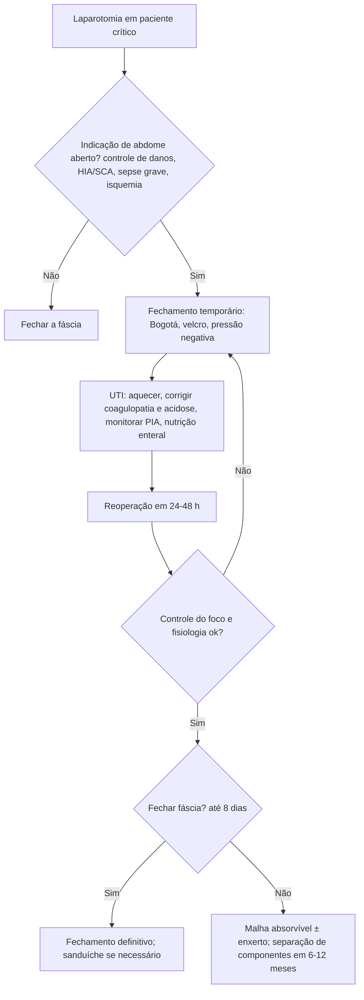

# Peritoneostomia (Abdome Aberto)

> Resumo em palavras próprias do Whitebook (Condutas Cirúrgicas > Cirurgia Geral e do Aparelho Digestivo), sem fisiopatologia, autoria e referências. Confira detalhes e doses na fonte: https://whitebook.pebmed.com.br/conteudo/?id=51496&categoryId=207&subcategoryId=211

**Definição:** deixar a fáscia abdominal intencionalmente aberta (sem aproximar) após laparotomia em pacientes críticos selecionados, permitindo inspecionar as alças e drenar o conteúdo. Usos mais comuns: controle de danos e síndrome compartimental abdominal (SCA). Na literatura: *open abdomen*. **Etapas:** laparotomia inicial → fechamento abdominal temporário → fechamento definitivo.

**Por que funciona:** abrir o abdome reduz a pressão intra-abdominal (PIA) em 40–75% do valor inicial e restabelece a homeostase. Riscos do abdome aberto: desidratação, distúrbios hidroeletrolíticos, hipotermia, aderências e perfuração intestinal. Com o tempo, a janela fecha: após 48 h forma-se material gelatinoso de fibrina; em 4–5 dias surge o “abdome congelado” (fechamento fascial quase impossível); em 8–10 dias as bordas da fáscia retraem e forma-se saco visceral congelado.

## Indicações
Cirurgia de controle de danos (necessidade de *second look*), HIA persistente, SCA (prevenção e tratamento), fasciíte necrosante, sepse abdominal grave, pancreatite aguda grave, emergências vasculares, isquemia mesentérica aguda. Classificação: **anatômica** (impossível aproximar a fáscia), **fisiológica** (disfunção sistêmica), **logística** (previsão de reintervenções precoces).

### Controle de danos
Objetivo: controlar rápido sangramento e contaminação, encurtar a cirurgia e voltar à UTI para recuperação fisiológica; evitar a tríade letal (hipotermia, acidose, coagulopatia). Gatilhos: temperatura < 34 °C; pH < 7,2; déficit de base < 15 mmol (< 6 em > 55 anos); transfusão > 4 L (10–12 CH); reposição intravascular > 12 L; hipotensão persistente; INR ou TTPa > 50% do normal. Preditores de SCA: tamponamento ou reoperação planejada, lesão visceral extrema ou edema retroperitoneal, obesidade, pressão vesical elevada ao tentar fechar, perda de parede, reanimação agressiva. Achados intraoperatórios: edema de mucosa, distensão do delgado médio, serosas escurecidas, tecidos frios, sangramento difuso, parede edemaciada e não complacente. A fáscia não é fechada; o fechamento ocorre após estabilização, geralmente em 24–48 h (até 72 h).

### SCA / hipertensão intra-abdominal (HIA)
HIA = PIA sustentada ≥ 12 mmHg; SCA = PIA persistente ≥ 20 mmHg com nova disfunção orgânica (ver Síndrome Compartimental Abdominal). Medir a PIA a cada 4–6 h, otimizar perfusão, medidas clínicas (sedação, analgesia, bloqueio neuromuscular, SNG, restrição de fluidos, diurese, drenar coleções, paracentese, descompressão retal) e laparotomia descompressiva se refratária. Objetivos da cobertura: reduzir PIA, permitir expansão visceral, cobertura temporária, evitar retração da fáscia e drenar fluidos continuamente.

### Sepse abdominal grave
Peritonite secundária grave (purulenta/fecal) em paciente que não tolera reparo definitivo ou fechamento por disfunção orgânica; controle de contaminação incompleto em um tempo (necessita reintervenção para cirurgia definitiva e anastomose); risco de HIA por edema visceral. Fatores de pior prognóstico: choque séptico, lactato > 3, pH < 7,25, sexo masculino, idade > 70, múltiplas comorbidades. Reoperar em 24–48 h para lavagem, drenagem, controle local e, se possível, fechamento. Em sepse abdominal a peritoneostomia associa-se a mais fístulas, abscessos e fechamento tardio — individualizar.

### Emergências vasculares
Maior risco de SCA/HIA (reexpansão volêmica, hematomas, reperfusão), mesmo após reparo endovascular. Fatores: PAS < 90 mmHg por > 18 min no pré-operatório, PCR pré-operatória, temperatura < 33 °C, déficit de base > 13, reposição intraoperatória > 3,5 mL/h (conforme o texto). Considerar para reavaliação em fisiologia alterada, edema visceral ou anastomose tardia.

### Pancreatite aguda grave
Indicada em falha da abordagem escalonada (*step-up*) associada à SCA; não para necrosectomia de necrose infectada, exceto com risco alto de SCA.

## Fechamento abdominal temporário
Protege as vísceras com a fáscia aberta; deve prevenir HIA, perda de fluidos e lesão visceral, facilitar reexploração e impedir retração. Qualidades desejáveis: aplicação e remoção fáceis, acesso rápido, drenagem, facilidade de fechamento primário, baixa morbimortalidade, manejo simples, custo e disponibilidade aceitáveis.
- **Opções:** pele com clipes/sutura, bolsa de Bogotá, telas sintéticas, materiais com velcro ou zíper (Wittmann), pressão negativa (Barker/vacuum pack, VAC, ABThera).
- **Bolsa de Bogotá:** plástico estéril não aderente suturado à pele; barata, simples e rápida; difícil controlar perdas e não promove o fechamento tardio.
- **Velcro/sintético:** duas placas na fáscia com cobertura plástica; aproximar a cada reoperação.
- **Pressão negativa:** bons resultados no abdome infectado; reduz carga bacteriana, retira exsudato, melhora perfusão, granulação e inflamação; maior sucesso de fechamento. Sistemas improvisados: plástico fenestrado sobre as vísceras, material macroporoso (gaze, compressa, esponja) com dreno, curativo oclusivo; a **técnica de Barker** é a mais comum. Pressão: −100 a −150 mmHg (VAC: −125); −25 a −50 se risco de sangramento/coagulopatia; preferir contínua. O risco de fístula enterocutânea não foi comprovado e a pressão negativa pode tratá-la; anastomoses não contraindicam.

## Manejo clínico
- **Objetivos:** reduzir o insulto, corrigir volemia, coagulopatia, hipotermia e acidose, nutrir, ventilar e prevenir SCA.
- **Hipotermia:** monitorar, fluidos aquecidos, circuito aquecido, retirar roupas úmidas, aquecer o ambiente, manta térmica; alvo 37 °C 4 h após a admissão na UTI.
- **Coagulopatia:** hemocomponentes ± tromboelastografia; alvos TP < 15 s, plaquetas > 100.000, fibrinogênio > 100.
- **Acidose:** reposição guiada por lactato, atento a hipervolemia e hipercloremia.
- **Ventilação:** peritoneostomia não indica por si ventilação mecânica; risco maior de SDRA (ventilação protetora); reajustar parâmetros após a descompressão; derrame pleural pode exigir drenagem; sedação leve e analgesia regulares; extubar com cautela.
- **Nutrição:** hipercatabolismo; **dieta enteral precoce** recomendada (maior fechamento primário, menos fístulas, PAV e mortalidade); mais necessidade de fluidos, K, P, Mg, Ca e proteína; contraindicada com descontinuidade, obstrução ou fístula de alto débito sem acesso distal.
- **Antibiótico:** sem profilaxia sem infecção; quanto maior o tempo aberto, maior a colonização. Mobilização precoce: sem recomendação (risco de evisceração).
- **Reoperação:** idealmente em 24–48 h; mais cedo se choque hemorrágico persistente (> 2 CH/h por 3 h) ou SCA terciária; tentar fechamento progressivo a cada reintervenção; fechamento definitivo após 8 dias aumenta a morbidade.

## Fechamento definitivo
Condições: PIA < 15–20 mmHg com fáscia aproximada temporariamente, sem vazamento GI (ou de baixo débito), estabilidade clínica, sem problemas de cicatrização previstos, foco infeccioso controlado, nutrição e função pulmonar adequadas. Idealmente em até 8 dias (até 2 semanas); fechamento primário em cerca de 75%.
- **Fechamento fascial sequencial (técnica do sanduíche):** esponjas sobre as alças sob plástico; pontos de PDS 1 a 1–2 cm da borda e ~5 cm entre si, tensão moderada; plástico estendido 5–10 cm além da pele; esponjas do sistema a vácuo e curativo oclusivo; trocar a cada 48 h sem remexer as alças (salvo abscessos), aproximando fáscia e pele progressivamente.
- **Fechamento tardio:** quando não se fecha a fáscia, usar malha absorvível (poligalactina/Vicryl, ácido poliglicólico) subfascial sobrepondo 2–4 cm sem tensão; **não** usar malha não absorvível (polipropileno) pelo risco de fístula e sepse. Após granulação, enxerto de pele parcial espessa se a pele não puder ser mobilizada (retirar após 9–12 meses). Hérnias ventrais complexas: reparo eletivo após 6–12 meses por separação de componentes.

## Complicações
Sangramento, catabolismo, hipotermia, desnutrição, íleo, perda de fluidos e proteínas, TEV, perfuração, fístulas enteroanastomóticas (alto ou baixo débito), isquemia entérica, evisceração, abscessos, ISC, translocação bacteriana, sepse, disfunção de múltiplos órgãos, hérnias ventrais complexas com perda de domínio, impacto psicológico.

## Fluxograma (refeito, a partir do texto; o texto original não traz uma figura)

