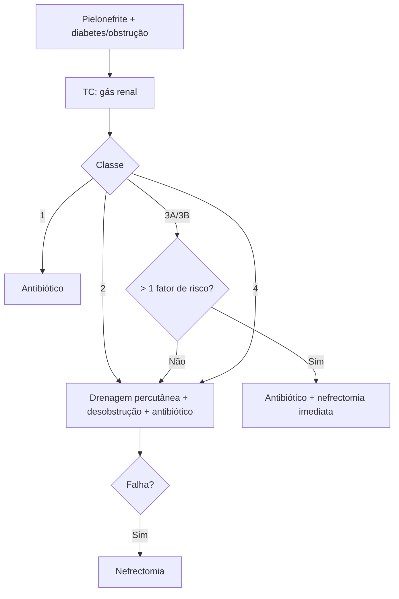

# Pielonefrite Enfisematosa

> Resumo em palavras próprias do Whitebook (Condutas Cirúrgicas > Cirurgia Urológica), sem fisiopatologia, autoria e referências. Confira detalhes e doses na fonte: https://whitebook.pebmed.com.br/conteudo/?id=48324&categoryId=207&subcategoryId=214

**Definição:** emergência urológica; infecção necrotizante aguda do parênquima e do espaço perirrenal por microrganismos produtores de gás (parênquima, sistema coletor ou gordura perinefrética). Glicose tecidual alta e má oxigenação (microangiopatia diabética) favorecem. Agentes: E. coli e Klebsiella pneumoniae (mais comuns), Proteus, Enterococcus, Pseudomonas, Clostridium, raramente fungos; pode ser polimicrobiana.

## Epidemiologia e clínica
- Mortalidade 40–90%; adultos, mais em mulheres.
- Pielonefrite aguda com dor lombar, febre e náusea (início agudo ou 2–3 semanas); pneumatúria só se acomete o sistema coletor; hematúria, confusão (sepse); dor lombar, crepitação se gás subcutâneo.
- **Risco:** diabetes (principal), uropatia obstrutiva, urolitíase, hipertensão, sexo feminino.

## Diagnóstico
- Leucocitose, plaquetopenia, creatinina, PCR e procalcitonina elevadas, hipoalbuminemia; urina com piúria e hematúria.
- RX mostra gás renal em 30%; USG; **TC é o exame de escolha** (extensão e conduta).
- **Classificação por TC (Huang e Tseng):** Classe 1 gás só no sistema coletor; Classe 2 gás só no parênquima; Classe 3A extensão perinéfrica; 3B pararrenal; Classe 4 bilateral ou rim único.
- **Classificação por TC (Michaeli):** tipo I necrose do parênquima sem coleção, gás radiado/mosqueado (mais fulminante, maior mortalidade); tipo II coleção renal/perirrenal com gás bolhoso ou no sistema coletor.
- **Pior prognóstico:** plaquetopenia, insuficiência renal, alteração de consciência, choque.
- **Diferenciais:** pielonefrite aguda, pionefrose, abscesso renal, pielonefrite xantogranulomatosa, fístula enterorrenal/cutaneorrenal, perfuração retroperitoneal, abscesso de psoas com gás, intervenção urológica/radiológica recente.

## Tratamento
Antibiótico parenteral até estabilizar e melhorar, completando 14 dias com via oral.
- **Classe 1:** antibiótico isolado (sem abscesso ou obstrução).
- **Classe 2:** drenagem percutânea + desobstrução + antibiótico.
- **Classe 3A/3B com ≤ 1 fator de risco:** drenagem percutânea + desobstrução + antibiótico; **> 1 fator de risco:** antibiótico + nefrectomia imediata.
- **Classe 4:** drenagem percutânea + desobstrução + antibiótico; nefrectomia como último recurso.
- Falha da drenagem percutânea → nefrectomia.

## Fluxograma (refeito, a partir do texto; o original não traz algoritmo)

