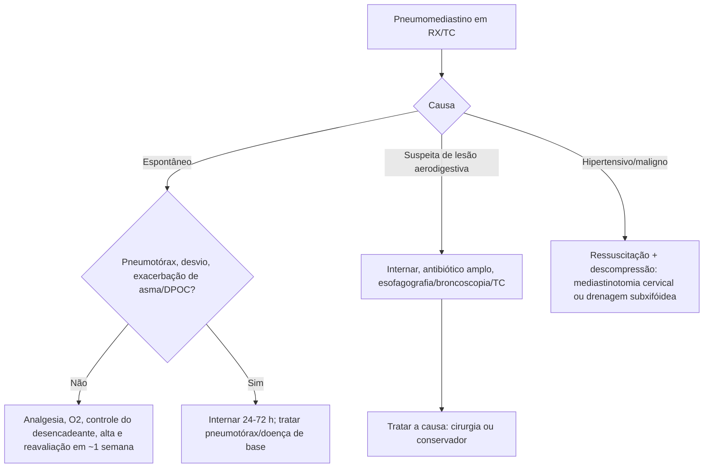

# Pneumomediastino

> Resumo em palavras próprias do Whitebook (Condutas Cirúrgicas > Cirurgia Torácica), sem fisiopatologia, autoria e referências. Confira detalhes e doses na fonte: https://whitebook.pebmed.com.br/conteudo/?id=53393&categoryId=207&subcategoryId=215

**Definição:** presença de ar no mediastino (enfisema mediastinal).

## Epidemiologia e clínica
- Espontâneo/primário: ~1 em 25–30 mil pacientes; subdiagnosticado (casos leves; RX não detecta até 30%); homens jovens e tabagistas; desencadeantes em até 50%: exacerbação de asma, DPOC, bronquite; em até 30% sem fator identificado. Raro pneumomediastino hipertensivo/maligno (sobretudo neonatos em ventilação mecânica). Nos secundários (mediastinite, perfuração esofágica, lesão de via aérea) a epidemiologia segue a doença de base.
- **Sintomas:** dor torácica (60–100%; retroesternal, irradia para dorso/pescoço; início súbito), dispneia (75%), tosse (80%), cervicalgia (36%), enfisema subcutâneo (70%), edema cervical, rinolalia, disfonia, odinofagia/faringalgia, epigastralgia, disfagia/êmese; pneumotórax associado em ~40% (hipertensivo raro). Pneumomediastino maligno: ↓ retorno venoso, tamponamento, compressão de via aérea.
- **Exame:** taquicardia, taquipneia, ansiedade, enfisema subcutâneo, em geral bom estado geral; **sinal de Hamman** (crepitações sincrônicas ao batimento cardíaco, ápice/borda esternal esquerda) em apenas 18%.

## Diagnóstico
- Alta suspeição com história e fatores predisponentes. Leucocitose e PCR inespecíficos; ECG inconclusivo.
- **RX de tórax PA** (rendimento > 90%): linhas ou bolhas de gás delineando estruturas, pleura mediastinal, sinal do anel, sinal da dupla luz brônquica, diafragma contínuo, sinal extrapleural, sinal da vela (criança), gás no ligamento pulmonar, sinal V de Naclerio; enfisema grande ou pneumotórax podem dificultar.
- **TC de tórax (padrão-ouro):** confirma, mede a extensão, mostra a causa e diferenciais. Espontâneo: ar mediastinal anterior com enfisema subcutâneo; lesão visceral/de via aérea: derrame pleural, ar subdiafragmático, opacidades. USG não é rotina (enfisema cervical, perda das janelas paraesternal e apical com preservação da subxifóidea).
- **Esofagografia/broncoscopia/EDA:** não rotineiras no espontâneo; indicar se > 40 anos, vômitos repetidos, dor abdominal, leucocitose, derrame pleural, atelectasia importante, pneumopericárdio ou pneumoperitônio. Considerar provas funcionais em espontâneo sem fator predisponente (sobretudo crianças).
- **Classificação (não consensual):** *espontâneo/idiopático* (21–51%; ruptura alveolar; fatores em ~75%: Valsalva — parto/síndrome de Hamman, mergulho, anorexia, vômitos, gases tóxicos, levantamento de peso, corpo estranho, gritos, assoar o nariz, defecação, espirometria; distúrbios respiratórios — DPOC, intersticial, bronquiectasia, cistos, asma, tosse, infecções, COVID-19; tabagismo e drogas — cocaína, crack, maconha, metanfetamina; polimiosite/dermatomiosite; barotrauma) × *secundário* (trauma, iatrogenia — endoscopia, intubação, traqueostomia, pleural, acesso central, cirurgias; Boerhaave/carcinoma esofágico; deiscência de coto brônquico; trauma torácico; mediastinite necrotizante, TB, histoplasmose, infecção dentária/retrofaríngea; pneumocistose).
- **Diferenciais clínicos:** SCA, pericardite, TEP, pneumonia, pneumotórax, espasmo/perfuração esofágica, DRGE, causas musculoesqueléticas. **Radiológicos:** pneumopericárdio, pneumotórax medial, pneumoperitônio/retroperitônio, enfisema subcutâneo, efeito de Mach, cisto aéreo subcarinal, cistos paratraqueais, divertículo traqueal.
- **Complicações:** recidiva, pneumomediastino hipertensivo, enfisema subcutâneo importante, pneumotórax, pneumorraquia.

## Tratamento
- **Espontâneo:** em geral autolimitado, manejo ambulatorial; internação breve (24–72 h) se pneumotórax, desvio mediastinal ou exacerbação de asma/DPOC. Analgesia oral, ansiolíticos, antitussígenos (codeína), controle do fator precipitante; oxigênio suplementar acelera a absorção em até 6×; sem antibioticoprofilaxia; sem cirurgia/drenagem (salvo pneumotórax associado). Recorrência ~1,2%; resolução em cerca de 1 semana (raramente > 2 meses); reavaliar depois; se recorrer, investigar causas.
- **Secundário:** internar sempre; antibiótico de amplo espectro (mediastinite subclínica); tratar a causa (cirurgia ou outros métodos, ver lesões de via aérea e perfuração esofágica); mortalidade maior.
- **Hipertensivo/maligno:** neonatos em ventilação; tamponamento, compressão de via aérea e instabilidade; ressuscitação e suporte até descomprimir (mediastinotomia cervical ou drenagem mediastinal subxifóidea); atenção se falha do tratamento conservador.

## Fluxograma (refeito a partir do texto; o original é uma figura “Fluxograma de Manejo do Pneumomediastino”)

