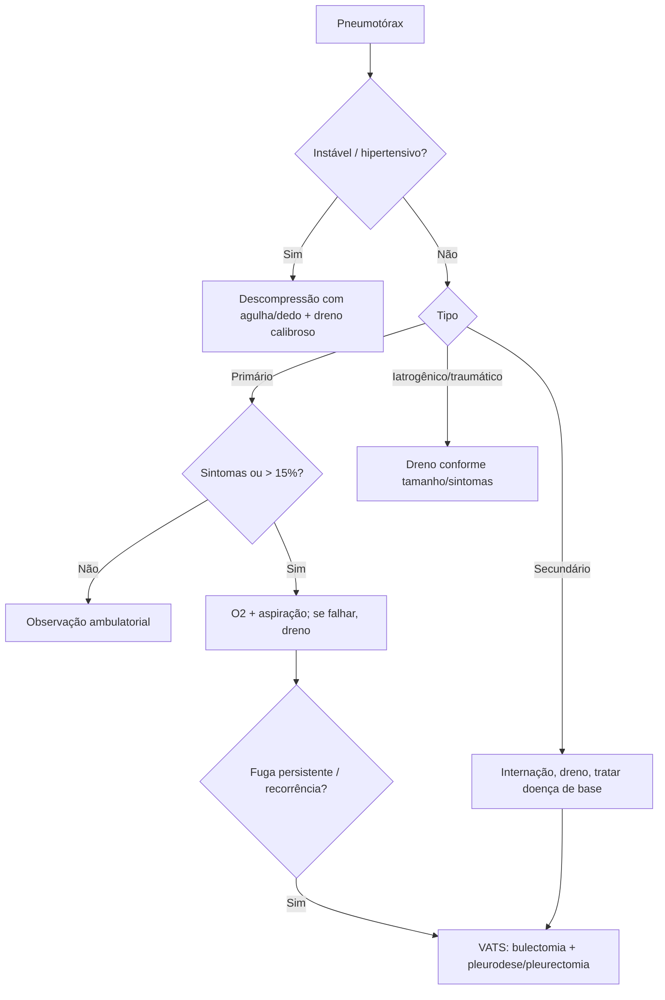

# Pneumotórax

> Resumo em palavras próprias do Whitebook (Condutas Cirúrgicas > Cirurgia Torácica), sem fisiopatologia detalhada, autoria e referências. Confira detalhes e doses na fonte: https://whitebook.pebmed.com.br/conteudo/?id=22596&categoryId=207&subcategoryId=215

**Definição:** ar na cavidade pleural, entre pulmão e parede torácica, com colapso pulmonar variável e prejuízo da mecânica ventilatória. Quando a pressão intrapleural sobe, pode haver desvio mediastinal contralateral, compressão cardíaca e do outro pulmão, ↓ retorno venoso, hipóxia e choque obstrutivo.

## Epidemiologia e clínica
- Mais frequente em homens; o secundário tem maior mortalidade; recorrência mais comum em gestantes.
- Pode ser assintomático (sobretudo o primário). Dor torácica aguda/subaguda (pleurítica), dispneia súbita, desconforto respiratório, palpitação; menos: tosse seca, ortopneia.
- Exame: dessaturação, taquipneia, taquicardia, cianose, alteração do nível de consciência/agitação; sinais de trauma, enfisema subcutâneo, Horner (raro), tiragem e musculatura acessória; ↓ expansibilidade, ↓/abolição do murmúrio e da voz sussurrada, hipertimpanismo, ↓ frêmito; sinal de bronze de Trousseau. Sinais de gravidade (hipertensivo): deterioração abrupta, ↑ pressões de pico/platô ou ↓ volume corrente na ventilação mecânica, dificuldade de ventilar em PCR, hipotensão, desvio traqueal contralateral, turgência jugular.
- **Classificação:** espontâneo primário (PEP, sem doença pulmonar), espontâneo secundário (PES; asma, DPOC, fibrose cística, TB, SIDA, linfangioleiomiomatose), traumático, iatrogênico (punção venosa central, toracocentese, biópsia pleural, barotrauma), perfuração esofágica.

## Pneumotórax espontâneo primário
- Ruptura de bolhas subpleurais apicais; pico a partir dos 20 anos (raro ≥ 40); bilateral ≤ 2%; incidência 7,4–18/100.000 homens e 1,2–6/100.000 mulheres; recorrência 23–37% (maioria no 1º ano, sobretudo nos primeiros 30 dias; ~32%). Derrame pleural associado em 10–20%. Fatores: tabagismo (dose-dependente), variação da pressão atmosférica, biotipo longilíneo, Marfan, história familiar.
- **Objetivos:** retirar o ar e reduzir a recorrência. Assintomático ou sintomas mínimos: observação ambulatorial (se fácil acesso ao serviço) — procedimento só se pneumotórax > 15% do hemitórax. Sintomáticos: tratamento agudo + observação hospitalar + O2 100% por máscara (↑ reabsorção em 4×). Enfisema subcutâneo: conservador; se houver dreno, checar posição/obstrução.
- **Aspiração simples:** punção no 2º espaço intercostal, linha hemiclavicular, seringa de 60 mL e torneira de três vias; aspirar o máximo, fechar a torneira; RX após 4 h; reexpandido → retirar cateter e retorno em 48–72 h. Eficaz como 1º procedimento em 2/3; repetir até 2,5 L (BTS 2010); > 4 L de ar sugere menor sucesso.
- **Drenagem torácica:** falha da aspiração, instabilidade, sintomas graves, fuga persistente (> 2,5 L ou > 4 L sem resistência), recorrência (controverso). Dreno pequeno (< 22 Fr) ou pigtail < 14 Fr, no ápice; selo d'água 2–3 cm ou válvula de Heimlich (alta precoce, reavaliar a cada 2–5 dias). **Nunca clampear com fuga aérea.** Retirar com reexpansão por imagem e ausência de fuga > 12–24 h. Falha: dreno mais calibroso, aspiração ou cirurgia (não colocar drenos adicionais). Sucção: não rotina; se fuga ≥ 48 h ou sem reexpansão; uso precoce pode causar edema de reexpansão (≥ 3 dias de evolução); preferir alto débito/baixo volume.
- **Cirurgia (VATS):** tratamento inicial ou controle de recidivas — bulectomia (grampeador/ligadura), pleurectomia parietal parcial ± bulectomia apical, pleurodese (abrasão mecânica de escolha; talco; argônio); também para recorrência após VATS; toracotomia com mesmas indicações (mais dor). Recorrência: parar de fumar, cirurgia ou pleurodese pelo dreno. Voar só 2–4 semanas depois do episódio.

## Pneumotórax espontâneo secundário
Idosos (> 60), 3:1 homens, mais recorrência e gravidade (menor reserva), muito ligado a DPOC; mortalidade maior (DPOC, câncer de pulmão, pneumonia, cardiopatia, fibrose cística, fibrose pulmonar). Diagnóstico mais difícil; diferencial: grande bolha (*vanishing lung*). Em HIV+: pneumocistose, TB, criptococose, bactérias; tratamento conservador/dreno.
- **Conduta:** internar, observação mínima de 24 h; O2 (cuidado com retenção de CO2 em DPOC); pneumologista precoce; menor resposta à aspiração — quase todos precisam de dreno; evitar O2 em alto fluxo ou pressão positiva (prolongam a fístula). Válvula de Heimlich com seguimento; pleurodese química (talco *slurry*, tetraciclina) em alto risco operatório; *patch* de sangue autólogo; cirurgia (VATS após expansão; toracotomia). Indicações de intervenção ativa: 2º episódio ipsilateral, 1º contralateral, bilateral sincrônico, fuga ≥ 5–7 dias ou falha de reexpansão, hemotórax espontâneo; profissões/atividades de risco (mergulhadores, aeronavegantes, viajantes frequentes), gestação.

## Pneumotórax ex-vácuo
Pressão pleural muito negativa (≥ −50 mmHg) ao redor de lobo colapsado por obstrução brônquica aguda (corpo estranho, secreção, tubo mal posicionado) ou toracocentese em pulmão encarcerado; a pleura permanece íntegra. Confirma-se pela melhora após desobstruir. **Tratar a obstrução** (broncoscopia, reposicionar tubo); não resolve com dreno.

## Pneumotórax iatrogênico
Causas por ordem: punção transtorácica por agulha > toracocentese > punção de subclávia > pressão positiva; também biópsia pleural/transbrônquica, laparoscopia, cirurgia cardíaca, bloqueios intercostais, biópsia hepática. Não costuma recorrer. Em ventilação mecânica: dreno imediato e mantido ≥ 48 h após cessar a fuga. Assintomático ≤ 40%: observação + O2 + RX seriado; sintomático, > 40% ou progressivo: dreno em selo d'água.

## Diagnóstico
- Gasometria: hipoxemia, alcalose respiratória, ↑ gradiente A-a.
- **RX** (PA em inspiração, ortostase): linha pleural visceral com ausência de trama pulmonar além dela, sinal do sulco profundo, "punho cerrado" (colapso total), hemitórax aumentado, diafragma retificado, desvio contralateral. Supino: mais difícil (ar anteromedial, subpulmonar). Pequenos: expiração forçada ou decúbito lateral com o lado suspeito para cima. Falso-positivo: pregas cutâneas. Hidropneumotórax: nível horizontal. **Tamanho:** BTS 2010 — distância da pleura à parede no hilo < 2 cm pequeno, > 2 cm grande; índice de Light: % = 100 − (diâmetro pulmonar³ / diâmetro do hemitórax³ × 100); Rhea: ~10% por cm.
- **USG:** mais sensível que RX (sobretudo supino); sensibilidade ~100%, especificidade 96,5%, VPN 100%; à beira-leito; sem *lung sliding*, linhas A sem linhas B, sinal do código de barras/estratosfera no modo M; limitações: operador, enfisema subcutâneo, não mede tamanho.
- **TC (padrão-ouro):** dúvidas, enfisema subcutâneo, bolhas, drenos mal posicionados, doença pulmonar associada, fístulas broncopleurais.
- A dispneia define intervenção ativa; o tamanho é indicação relativa.

## Pneumotórax traumático
Maioria com dreno intercostal; oculto (só na TC): observar + O2 (reavaliar se em ventilação mecânica); hemopneumotórax: dois drenos (superior ar, inferior sangue) pode ser necessário; reexpansão em ~72 h; fuga/sem reexpansão ≥ 72 h: checar dreno e considerar cirurgia; cirurgia imediata se fratura de traqueia/brônquio calibroso ou ruptura esofágica (hidropneumotórax com amilase elevada). Voo 2–4 semanas após resolução radiológica.

## Pneumotórax hipertensivo
Emergência clínica. O2; **toracocentese descompressiva** no 5º espaço intercostal anterior à linha axilar média (ATLS 2018); toracostomia digital como opção; Jelco 14–16 G com torneira e seringa com SF: borbulhar/assobio = positivo (manter aberto e seguir ao dreno definitivo); segunda punção ou outro sítio (4º–5º espaço lateral) se falhar. **Definitivo:** toracostomia com dreno calibroso.

## Gestação
PEP estável: aspiração ou O2; PES ou sofrimento fetal: dreno/cateter; considerar pleurodese após o parto (alto risco de recorrência).

*(O fluxograma de pneumotórax do original é um conteúdo à parte, não reproduzido aqui.)*

## Fluxograma (refeito, a partir do texto)

