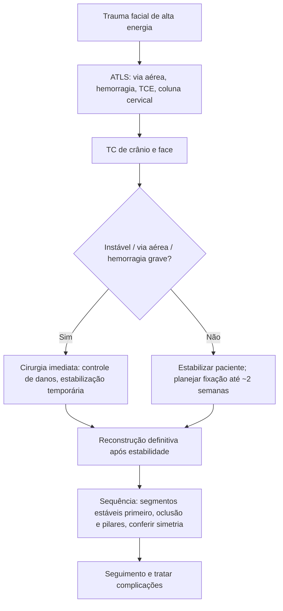

# Politrauma Facial

> Resumo em palavras próprias do Whitebook (Condutas Cirúrgicas > Cirurgia Plástica), sem autoria e referências. Confira detalhes e doses na fonte: https://whitebook.pebmed.com.br/conteudo/?id=63403&categoryId=207&subcategoryId=947

**Definição:** lesões de vários segmentos do esqueleto facial, em geral por alta energia e com lesões multissistêmicas. **Fraturas panfaciais** acometem os terços superior, médio e inferior e se associam muito a TCE, lesão cervical e outras lesões graves.
**Objetivos:** preservar a via aérea, controlar hemorragia, restabelecer a oclusão, reconstruir o arcabouço ósseo, restaurar função e estética e minimizar sequelas.

## Causas
Agressão 36%, colisão automobilística 32%, queda 18%, esporte 11%, acidente ocupacional 3%, arma de fogo 2%. Colisões e arma de fogo predizem fraturas panfaciais. Frequentemente coexistem TCE, trauma cervical, torácico, abdominal e fraturas ortopédicas.

## Avaliação
- **Anamnese:** mecanismo e energia, perda de consciência, alterações visuais, epistaxe, rinorreia/otorreia, oclusão, parestesias, dor facial, limitação da abertura.
- **Exame (ATLS):** olhos (acuidade, diplopia, proptose, enoftalmia, movimentos); face (assimetria, degraus, crepitação, deformidade nasal, trismo, telecanto traumático); oclusão (mordida aberta, má oclusão, perda da dimensão vertical, desvio mandibular, mobilidade dentária, fraturas dentoalveolares); partes moles (perda cutânea, exposição óssea, pálpebras, ducto parotídeo, nervo facial).
- **Imagem:** **TC** é fundamental (e TC de crânio para TCE; repetir se houver lesão intracraniana; cortes axiais da face podem sair da TC de crânio inicial). A **oclusão dentária** é a referência para reconstruir; modelos dentários e **fotografias prévias** ajudam a ver a anatomia habitual (telecanto, hipertelorismo, prognatismo, desvio nasal).
- **Cirurgia imediata** se: via aérea comprometida, hemorragia grave, grandes feridas abertas ou outra cirurgia necessária. Procedimentos detalhados esperam estabilidade clínica; o tratamento das fraturas pode ser adiado **até 2 semanas** se não houver lesão craniana ou outra indicação urgente.

## Transferir para centro de trauma
Via aérea comprometida, hemorragia incontrolável, perda visual, aumento da PIO, hematoma retrobulbar, aprisionamento muscular orbitário, reflexo oculocardíaco, fraturas panfaciais, grande perda de partes moles, arma de fogo na face, lesão do nervo facial ou do ducto parotídeo, fratura do seio frontal com parede posterior, cominuição ou fístula liquórica.

## Cirurgia
- **Planejamento:** localização e extensão das fraturas, estruturas lesadas, perda de partes moles (pele, mucosa, nervo), perda óssea, lesão dentoalveolar.
- **Fase inicial (vulnerável):** controle da hemorragia, desbridamento, estabilização temporária, controle da contaminação, cirurgia curta; evitar reconstruções extensas, apenas *second look*. Reconstrução definitiva após estabilidade hemodinâmica, melhora da perfusão, correção metabólica e recuperação imunológica, considerando lesões sistêmicas, inflamação, condições anestésicas e edema.
- **Momento da fixação:** estudos não mostraram benefício da fixação precoce (< 24–72 h) sobre a tardia (> 72 h) quanto a infecção, qualidade da redução, UTI e ventilação mecânica.
- **Técnica:** perdas ósseas grandes ou cobertura inadequada → reconstrução em tempo diferido (enxerto ósseo autólogo, retalhos microcirúrgicos, aloplásticos); estabilização por fixação maxilomandibular, fixação interna rígida e/ou fixadores externos; reconstrução definitiva no mesmo ato ou em segundo tempo conforme estabilidade, contaminação e partes moles.
- **Oclusão:** referência principal para a mandíbula; perda dentária posterior extensa compromete a dimensão vertical (talas oclusais). Em panfacial com fratura-luxação condilar, reduzir anatomicamente **ao menos um côndilo**; deslocamento mínimo: individualizar.
- **Via aérea:** traqueostomia é o método de escolha em comprometimento de via aérea superior ou ventilação prolongada; **intubação submentoniana** é alternativa em pacientes selecionados (amplo acesso e avaliação intraoperatória da oclusão).
- **Sequência:** reconstruir primeiro os segmentos mais estáveis como referência para os instáveis; conferir sempre oclusão, largura, projeção e simetria. **Pilares:** nasomaxilar (medial: suporte central), zigomaticomaxilar (lateral: largura e projeção malar), pterigomaxilar (posterior: estabilidade do terço médio).
- **Antibióticos:** profilaxia não de rotina; sem benefício consistente de uso prolongado; se indicada, profilaxia peroperatória curta (< 24 h).

## Complicações
Déficits motores e sensitivos, diminuição da altura facial posterior, mordida aberta anterior, aumento da largura facial, menor projeção anteroposterior, telecanto traumático, má oclusão, obstrução nasal e deformidades, fístula liquórica, anosmia, enoftalmia, ectrópio e cegueira.

## Fluxograma (refeito, a partir do texto; o original não traz algoritmo)

