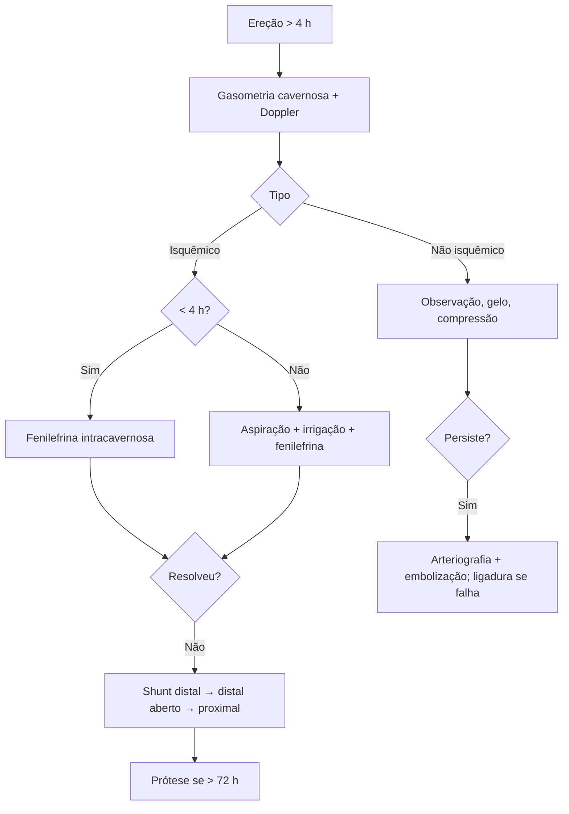

# Priapismo

> Resumo em palavras próprias do Whitebook (Condutas Cirúrgicas > Cirurgia Urológica), sem fisiopatologia, autoria e referências. Confira detalhes e doses na fonte: https://whitebook.pebmed.com.br/conteudo/?id=44549&categoryId=207&subcategoryId=214

**Definição:** ereção do pênis ou clitóris não relacionada a estímulo ou desejo sexual, com duração > 4 horas. Raro (0,73–5,4/100.000 homens/ano); distribuição bimodal (5–10 anos e 20–50 anos).

## Tipos
- **Isquêmico (baixo fluxo, veno-oclusivo), 95%:** emergência urológica. Falha do relaxamento do músculo liso cavernoso → síndrome compartimental com hipóxia e acidose; alterações do músculo liso após 12 h e dano irreversível após 24–48 h (necrose, fibrose); duração se associa à disfunção erétil posterior. Possível defeito de regulação do óxido nítrico.
- **Recorrente (stuttering):** subtipo isquêmico; ereções curtas, em geral durante o sono, que ficam mais longas e frequentes; típico de anemia falciforme (ou medicamentos/idiopático).
- **Não isquêmico (alto fluxo, arterial):** fístula arteriocavernosa, geralmente pós-trauma (peniano/perineal, injeção; trauma fechado como ciclismo; início dias a semanas depois) ou malformação arterial; não é emergência (sangue oxigenado), autolimitado em > 60%.

## Etiologia
Idiopático; hematológica (anemia falciforme, talassemia, leucemia); drogas (cocaína, maconha); fármacos (iPDE5, alfabloqueadores, PGE1 intracavernosa, antidepressivos, antipsicóticos, anticoagulantes); neoplasia pélvica (rara); neurológica (lesão medular/cauda equina); toxinas (aranha, escorpião, CO); infecção (SARS-CoV-2); amiloidose; trauma; procedimentos urológicos.

## Avaliação
- Anamnese: duração (> 4 h, salvo recorrente), dor, episódios prévios e tratamentos, medicamentos/drogas, hematologia, neoplasia, procedimentos e trauma.
- Exame: isquêmico = ereção rígida, dolorosa, corpos cavernosos cheios com glande mole (pode evoluir para gangrena); não isquêmico = menos dolorosa e menos rígida, trauma, **sinal da compressão perineal** (reduz o fluxo da fístula). Examinar genitália, períneo e abdome (trauma/malignidade).
- **Gasometria do corpo cavernoso:** isquêmico — sangue escuro, pO₂ < 30 mmHg, pCO₂ > 60 mmHg, pH < 7,25; não isquêmico — sangue vermelho vivo, pO₂ > 90, pCO₂ < 40, pH ≥ 7,40.
- Hemograma, reticulócitos, eletroforese de hemoglobina, esfregaço (corpúsculos de Howell-Jolly na falciforme), toxicologia.
- **USG com Doppler:** isquêmico — fluxo mínimo/ausente nas artérias cavernosas; não isquêmico — fluxo elevado, fístula ou pseudoaneurisma. RM com gadolínio avalia necrose/fibrose tardia (sensibilidade 100%) e orienta prótese precoce; TC/RM em casos selecionados; arteriografia da pudenda interna para embolização.

## Tratamento
- Metas: analgesia, resolver a ereção, tratar a causa, preservar a função erétil, evitar recorrência.
- **Isquêmico:** < 4 h → fenilefrina intracavernosa; > 4 h → aspiração lateral dos corpos cavernosos (5 mL, com anestesia local, ± irrigação com SF 0,9% gelado) + fenilefrina. **Fenilefrina:** 1 mL diluída em SF (100–500 µg/mL) em um lado, a cada 3–5 min até resolver ou por 1 h (máx. 1 mg/h); pode-se repetir aspiração e injeção por horas; melhores resultados nas primeiras 6 h. Efeitos: hipertensão, cefaleia, arritmia — monitorar PA (e ECG se cardiopata).
- Falha → **shunt distal**; novo fracasso → novo shunt distal ou proximal. Recorrentes: tratar igual; prevenção com hormonais (estrogênio, antiandrogênicos) e inibidores de 5α-redutase. Tratar simultaneamente a doença hematológica.
- **Shunts:** distal percutâneo (Winter/Ebbehoj, em “T”) primeiro; distal aberto (Al-Ghorab, Burnett) após falha; proximal (Quackels, Grayhack) com mais complicações (TEP, trombose), sucesso 50–70%. A maioria oclui com o tempo; o dano cavernoso, não o shunt, causa a DE. Complicações: edema, hematoma, infecção, fístula uretral, necrose peniana, tromboembolismo.
- **Prótese peniana** no mesmo tempo do shunt em apresentação tardia (> 72 h), alto risco de DE (previne fibrose, encurtamento e curvatura); sem consenso do momento ideal.
- **Não isquêmico:** conduta conservadora (gelo, compressão da fístula, observação); aspiração e simpaticomiméticos contraindicados; resolução espontânea em 60–70%. Sem resolução ou se não puder observar: arteriografia + embolização (75–90%); se falha, repetir ou ligadura cirúrgica aberta (exceção) com USG intraoperatória.

## Fluxograma (refeito, a partir do texto; o original não traz algoritmo)

