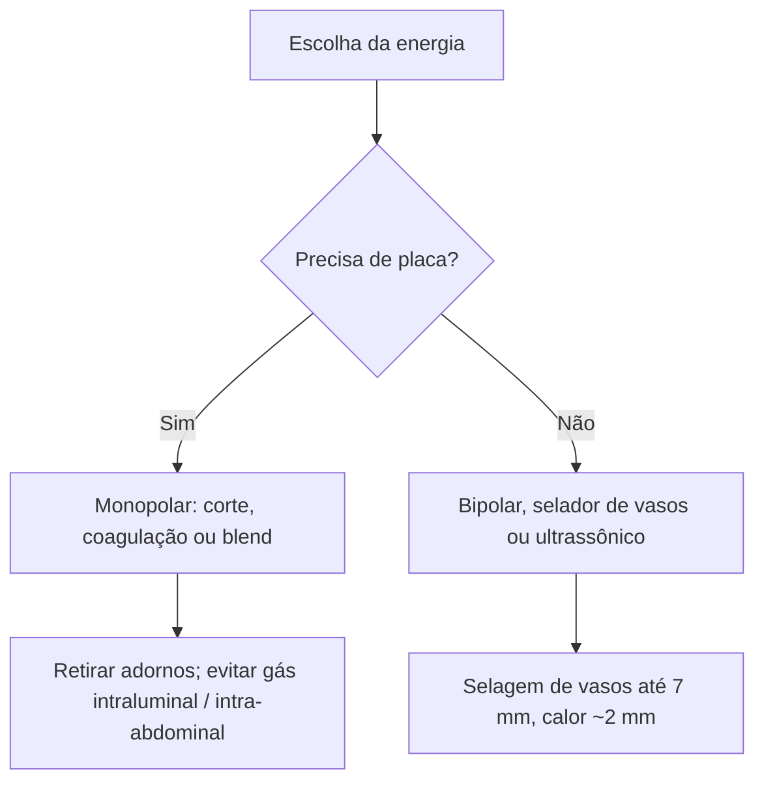

# Princípios de Eletrocirurgia

> Resumo em palavras próprias do Whitebook (Condutas Cirúrgicas > Cirurgia Geral e do Aparelho Digestivo), sem fisiopatologia, autoria e referências. Confira detalhes e doses na fonte: https://whitebook.pebmed.com.br/conteudo/?id=39179&categoryId=207&subcategoryId=211

**Definição:** cortar e coagular tecidos com corrente elétrica de alta frequência.

## Princípios
- As unidades eletrocirúrgicas (ESU) convertem a frequência da rede (50–60 Hz) em **500.000 a 3.000.000 Hz**, para evitar a estimulação muscular e nervosa, que ocorre principalmente abaixo de 10.000 Hz.
- Efeitos no tecido: fulguração, dissecção/coagulação, vaporização/ablação.
- **Segurança:** retirar adornos metálicos (queimadura); não usar bisturi elétrico em objetos intra-abdominais que contenham gás (risco de explosão).
- A **densidade elétrica** (efeito no ponto de aplicação) deve ser controlada para não lesar tecido.

## Monopolar × bipolar
- **Monopolar:** a corrente sai de um eletrodo único, age no alvo e retorna ao gerador por um eletrodo de dispersão (placa), posicionado em área de menor resistência.
- **Bipolar:** corrente restrita entre os dois eletrodos do instrumento (pontas da pinça/tesoura); **não precisa de placa**.

## Corte × coagulação × blend
- **Corte:** corrente contínua de baixa voltagem concentrada em pequena área; aquecimento rápido, vaporização com fumaça; onda sinusoidal, mais precisa.
- **Coagulação:** corrente interrompida/modulada de alta voltagem espalhada em grande área; aquecimento lento, desidratação; menos eficaz para cortar, ideal para selar vasos; menor frequência e maior amplitude, mais dispersão.
- **Blend:** mistura das duas, melhora a coagulação de pequenos vasos durante o corte e a dissecção durante a hemostasia.

## Dispositivos avançados
- **Selador bipolar de vasos:** energia bipolar e pressão fundem colágeno e elastina; selo permanente suporta até 3× a pressão sistólica normal; sela vasos de até **7 mm**; calor disperso ~2 mm; sem placa; só modo coagulação.
- **Bisturi ultrassônico (alternativo):** converte energia ultrassônica em mecânica; cristal piezoelétrico faz a lâmina vibrar **55.500 vezes/s**, rompe pontes de hidrogênio, desnatura proteínas e separa tecidos; menos dispersão térmica, carbonização e fumaça; sem placa de aterramento.

## Fluxograma (refeito, a partir do texto; o texto original não traz uma figura)

