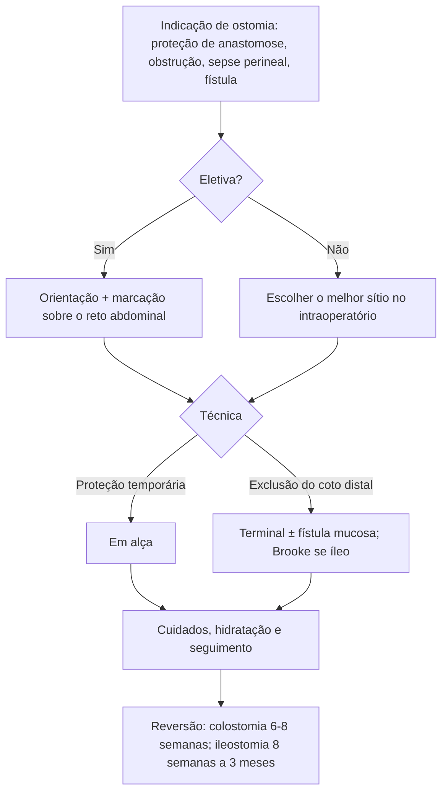

# Princípios de Ostomias Intestinais

> Resumo em palavras próprias do Whitebook (Condutas Cirúrgicas > Cirurgia Geral e do Aparelho Digestivo), sem fisiopatologia, autoria e referências. Confira detalhes e doses na fonte: https://whitebook.pebmed.com.br/conteudo/?id=23249&categoryId=207&subcategoryId=211

**Definição:** abertura cirúrgica de víscera oca que comunica a luz com a pele, para saída de gases, fezes ou secreções.

## Classificação
- **Segmento:** ileostomia, jejunostomia, colostomia.
- **Técnica:** *terminal* (extremidade proximal exteriorizada; coto distal fechado ou como fístula mucosa); *em alça* (“cano de espingarda”: alça contínua com duas bocas, sem seccionar); *double-barrel* (cólon; duas bocas separadas lado a lado); *híbrida/loop-end* (alça + coto distal fechado); *bolsa de Kock* (ileostomia continente, cateterizável, sem bolsa externa).
- **Fístula mucosa:** exteriorização do segmento distal excluído (geralmente com colostomia/ileostomia terminal), para drenar muco e gases e reduzir distensão e infecção.
- **Ileostomia à Brooke:** terminal com eversão, protrusa em “bico” (2–3 cm acima da pele).
- Existem ainda ostomias urinárias (Bricker, Wallace, Mitrofanoff), de alimentação/drenagem (jejunostomia de Witzel, gastrostomia descompressiva, hepaticostomia) e de reconstrução complexa (IPAA com ileostomia protetora).
- **Tempo:** temporária ou definitiva.

## Indicações
Proteção de anastomose em situação de risco (desnutrição importante, instabilidade, imunossupressão, corticoide em alta dose) e de anastomoses distais (< 5 cm da margem anal); descompressão em obstrução distal; controle de foco infeccioso perineal; desvio de fístulas; incontinência fecal.

## Aspectos fisiológicos
Menor área absortiva e perda da continência voluntária. **Ileostomia:** mais alterações hidroeletrolíticas, perda de sais e sais biliares, débito de 500 mL a 1,5 L/dia, odor discreto. **Colostomia:** quanto mais distal, mais consistentes as fezes e menor a perda hidroeletrolítica.

## Preparo e marcação
- Orientação pré-operatória por estomaterapeuta ou cirurgião sempre que houver chance de ostomia (rotina, dieta, cuidados, sexualidade, emoções, complicações); nem sempre possível em urgência. A marcação prévia reduz dermatite e vazamento; o planejamento pode mudar no intraoperatório.
- O estoma deve ficar **sobre o reto abdominal**. Considerar contraturas, postura, mobilidade (cadeirante, andador), abdome globoso, pregas, cicatrizes, outras ostomias, linha da cintura, mamas, crista ilíaca, hérnia, campo de visão e destreza; idade, diagnóstico, ocupação, experiência prévia, preferência do paciente e do cirurgião, tipo de cirurgia; separar horizontalmente ostomias urinárias e intestinais.
- Técnica da marcação: explicar e envolver o paciente; avaliar vestido e sentado, em várias posições; ponto ≥ 5 cm da incisão para adesivo de 5–7 cm; identificar as bordas do reto (levantar o tronco ou tossir); marcar no quadrante adequado, dentro do campo visual (cadeirantes, obesos e abdome protuberante podem precisar de posição mais alta); marcar lados opostos se possível; rever com o paciente. **“Triângulo dos estomas”:** losango entre cicatriz umbilical, púbis e espinhas ilíacas anterossuperiores.

## Técnica
Mobilizar a alça sem tensão (bastão não evita retração); trajeto na parede nem apertado (isquemia, obstrução) nem largo (hérnia); tela profilática (sublay) opcional em ostomias permanentes; fixação aponeurótica opcional; eversão de Brooke nas ileostomias; maturar após fechar as demais incisões.
**Reversão:** colostomia 6–8 semanas; ileostomia após 8 semanas até 3 meses, com anastomose cicatrizada.

## Cuidados e orientações
- **Bolsas:** drenáveis ou fechadas, uma ou duas peças, placas flexíveis ou rígidas, transparentes ou opacas, recortáveis ou pré-cortadas, com filtro ou não. Abertura ≤ 3 mm maior que o estoma; esvaziar com 1/3 cheia; trocar 1–2×/semana (ou se alergia/vazamento), de preferência no banho; observar tamanho, forma, cor da mucosa, muco; limpar com água e sabão neutro; aparar pelos; sol 15–20 min/dia na pele ao redor; evitar álcool, benzina, clorexidina, cremes; evitar trocas excessivas; proteger de insetos (miíase).
- **Dieta:** evitar excesso de fibra insolúvel e alimentos como pipoca, coco, azeitona preta, cogumelo, frutas secas, vegetais e carnes fibrosos (ou comer pouco e mastigar bem); colostomizados sem restrições.
- **Hidratação** (ileostomia e colostomia ascendente): débito normal 500–1.300 mL/dia rico em Na e K; aumentar ingesta em ao menos 500–750 mL; mais se débito alto ou sudorese; água, sucos, caldos, soluções de reidratação; reconhecer sinais de desidratação.
- **Constipação:** fibras e fluidos; laxativos; irrigação colônica (500–1.500 mL, diária ou em dias alternados, só em colostomias distais: sigmoide/descendente); desimpactação digital. Secreção mucoide é normal.
- **Gases/odor:** evitar carboidratos fermentáveis (feijão, repolho, couve-flor, brócolis, aspargo) e amidos/fibras solúveis (batata, milho, macarrão, trigo, aveia, ervilha); simeticona; filtros; evitar goma de mascar, canudo, fumo (aerofagia). Evitar medicamentos entéricos/liberação lenta/comprimidos grandes (absorção) e laxativos em ileostomia (desidratação).
- **Cotidiano:** banho com ou sem bolsa; evitar esportes de contato; cintas em esforço; sexo: esvaziar e fixar a bolsa; viajar com bolsas extras na bagagem de mão; água filtrada; evitar calor intenso.
- **Direitos:** Decreto 5.296/2004 (ostomizado como deficiente físico); Portaria ANS 400/2009; RN ANS 325/2013 (cobertura dos equipamentos).

## Complicações
Fatores: cirurgia de emergência, sítio mal escolhido, altura do estoma < 10 mm, obesidade, DII, diabetes, tabagismo. **Precoces** (≤ 30 dias): sangramento, hematoma, edema, dermatite, vazamento, alto débito, ulceração, isquemia, necrose. **Tardias:** hérnia paraestomal, prolapso, obstrução, retração, estenose.
- **Edema:** parte da cicatrização, regride em 1–2 semanas; persistente pode obstruir; acompanhar permeabilidade e cor.
- **Sangramento:** compressão local; cauterização (eletrocautério, nitrato de prata) ou sutura/ligadura (cuidado com isquemia).
- **Deiscência mucocutânea:** descontinuidade total/parcial da sutura; causas: orifício largo, tensão; reabordagem.
- **Evisceração:** orifício muito maior que a alça; reabordagem.
- **Retração** (≥ 0,5 cm abaixo da pele, em até 6 semanas): tensão, necrose prévia; obesidade; bolsa convexa com cinta, perda de peso, reabordagem.
- **Separação mucocutânea:** circunferencial → revisão imediata; parcial → preencher com alginato de cálcio, pó de barreira, hidrofibra.
- **Dermatite periestomal** (mais na ileostomia): estoma a 2–3 cm da pele; adesivo justo ao estoma; barreira (Cavilon, Stomahesive); bolsa drenável; antifúngico se micose; sulfadiazina de prata 1% se instalada; avaliar cirurgia se refratária.
- **Granuloma:** relacionado aos pontos ou ao trauma do adesivo; usar fio absorvível.
- **Prolapso:** mais em transversostomia em alça, por mobilização excessiva; não complicado — compressa fria e açúcar/mel com redução manual; complicado/isquêmico — ressecção e reconstrução.
- **Estenose:** isquemia, necrose, tração, retração, doença recorrente (Crohn, neoplasia). Pequena: observar; por edema: sonda de Foley até a fáscia sem inflar o balão; moderada: dilatação cuidadosa, dieta; grave (cólica, débito explosivo): cirurgia (zetaplastia, laparotomia).
- **Varizes periestomais** (hepatopatas, metástases, colangite esclerosante): curta expectativa de vida — desconexão mucocutânea; maior — TIPS, shunt, transplante.
- **Pioderma gangrenoso periestomal** (< 1%, associado a RCU): diagnóstico de exclusão com biópsia e culturas; esteroide intralesional/tópico/sistêmico; tacrolimo ou infliximabe se refratário; evitar trauma (patergia).
- **Outras:** hérnias para/periestomais; nefro/urolitíase (perda de água, Na e bicarbonato); colelitíase (menor circulação êntero-hepática).
- **Frequência (ileostomia × colostomia):** dermatite 25–34% × 7–20%; hérnia parostomal 9–22% × 18–40%; estenose 2–17% × 1–14%; retração 11–24% × 1–8%; prolapso 8–75% × 2–18%; íleo 11–18% × 0–7%.

## Hérnia parostomal e periostomal
Mais frequente causa de tratamento cirúrgico. Fatores: abertura excessiva da parede, relação com o reto abdominal, obesidade, corticoide, ostomia secundária, sepse; DPOC, idade, abertura aponeurótica pequena, denervação, distensão, desnutrição, diabetes, neoplasia, baixo tônus. *Parostomal:* junto ao estoma; *periostomal:* no envoltório do estoma antigo. **Classificação de Devlin:** intersticial, subcutânea, intraestomal, periestomal. Repercussões (“síndrome do eventrado parostomal”): alterações respiratórias, TEV, dorsalgia, problemas psicológicos, irritação cutânea, obstrução, disfunção do estoma, dificuldade de autocuidado. Diagnóstico: exame físico; USG/TC na dúvida ou hérnia pequena. Tratamento: conservador (dieta, evitar tensão abdominal, proteção local, apoio psicológico) ou cirúrgico definitivo (hérnias grandes com repercussão, doença de base controlada, ou complicação aguda): reparo fascial, reparo com estoma in situ ± tela, mudança do estoma com tela, laparoscopia. Complicações: obstrução aguda, isquemia mesentérica.

## Fluxograma (refeito, a partir do texto; o original traz ilustrações das técnicas)

