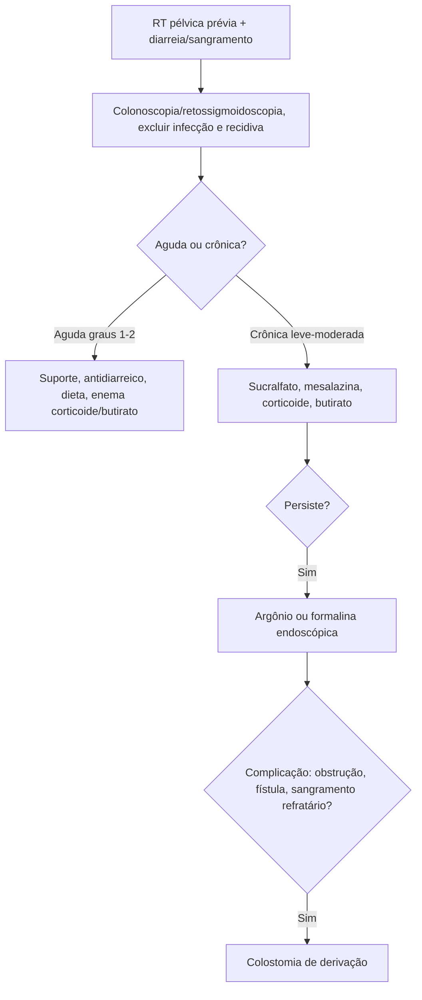

# Proctite e Enterite Actínica

> Resumo em palavras próprias do Whitebook (Condutas Cirúrgicas > Cirurgia em Coloproctologia), sem fisiopatologia, autoria e referências. Confira detalhes e doses na fonte: https://whitebook.pebmed.com.br/conteudo/?id=44553&categoryId=207&subcategoryId=213

**Definição:** lesão do trato gastrointestinal causada por radioterapia (RT) pélvica (câncer de reto, ânus, colo uterino, útero, próstata, bexiga, testículo). Reto e sigmoide são os mais afetados. Efeitos agudos em 50–75% dos pacientes e tendem a regredir.

## Formas
- **Aguda:** durante a RT ou até 6 meses depois.
- **Crônica:** sintomas > 6 meses ou surgimento após latência (em geral 8–12 meses, podendo chegar a 30 anos). Proctite hemorrágica é a manifestação mais comum.

## Clínica
- **Aguda:** diarreia com muco (mais comum), dor abdominal, fadiga, tenesmo, urgência, incontinência.
- **Crônica:** proctite hemorrágica, anemia, dor e tenesmo persistentes, estenose e obstrução, úlceras, fístulas (retovaginal, urinária); também estenose uretral e cistites de repetição.
- **Fatores de risco:** dose > 45 Gy, grandes campos, tabagismo, doença vascular/do colágeno, diabetes, quimioterapia adjuvante, DII prévia, IMC baixo (IMC maior protege).

## Diagnóstico
- História de RT pélvica + aspecto endoscópico: mucosa pálida e friável, telangiectasias largas e serpiginosas, úlceras crônicas, estenoses, áreas sangrantes.
- Biópsia ajuda a diferenciar isquemia, DII e lesão medicamentosa. Sem exame laboratorial específico; hemograma (anemia) e distúrbios metabólicos na obstrução; fezes (incluindo toxina de C. difficile) para excluir infecção.
- TC/RM de pelve se suspeita de obstrução, perfuração, fístula ou recidiva tumoral.
- **Diferenciais:** colites infecciosas (C. difficile, parasitas, ISTs, CMV), DII, doença diverticular, colite isquêmica, doença enxerto-versus-hospedeiro, colites medicamentosas, colite de desuso (estomas de desvio).

## Classificações
**Aguda (RTOG):** 0 sem alterações; 1 hiperemia/edema leves; 2 diarreia persistente, muco, tenesmo moderado; 3 dor intensa, sangramento recorrente, ulceração grave; 4 necrose, perfuração, sangramento grave.
**Crônica (EORTC):** 0 sem sintomas; 1 sangramento ocasional, dor leve; 2 sangramento frequente, ulceração superficial, estenose parcial; 3 telangiectasias difusas, sangramento grave, estenose acentuada, fístulas; 4 úlceras profundas, necrose, obstrução completa, perfuração.

## Tratamento
- **Aguda (graus 1–2):** hidratação, antieméticos, antidiarreicos (loperamida, racecadotrila), dieta com menos gordura e laticínios, enemas de corticoide ou butirato, octreotida se refratária, pausa temporária da RT se grave.
- **Crônica leve/moderada (graus 1–2):** enema de sucralfato 10%, 20 mL 2×/dia (melhor evidência entre os fármacos); enemas/supositórios de mesalazina; corticoide tópico (hidrocortisona 100 mg); butirato; oxigenoterapia hiperbárica (resultado variável). Obstrução leve: laxativos ou dilatação com balão. Persistência → endoscopia ou grau 3.
- **Endoscópica (grau 3):** coagulação com plasma de argônio (energia de alta frequência por gás ionizado) eficaz em 80–90%, às vezes várias sessões (complicações raras: dor anal, cólica, úlcera, perfuração); formalina tópica (esclerose química das telangiectasias, até 80%; risco de dor, estenose, necrose, fístula); alternativas: eletrocoagulação bipolar, laser, radiofrequência, crioterapia.
- **Cirurgia (~10% dos crônicos graves, grau 4):** sangramento refratário, estenose obstrutiva, fístula, dor incapacitante apesar de tratamento clínico/endoscópico. Preferir colostomia de derivação; rafia de perfurações em dois planos; evitar ressecção (cicatrização ruim no tecido irradiado, risco muito alto de fístula anastomótica). Alta morbimortalidade.
- **Prevenção:** técnicas modernas de RT que poupem o reto; dieta rica em fibras; butirato tópico; hidrocortisona tópica preveniu proctite aguda em ensaio clínico; N-acetilcisteína, amifostina e L-carnitina são radioprotetores só em modelo animal.

## Fluxograma (refeito, a partir do texto; o original traz uma figura sobre fístulas)

