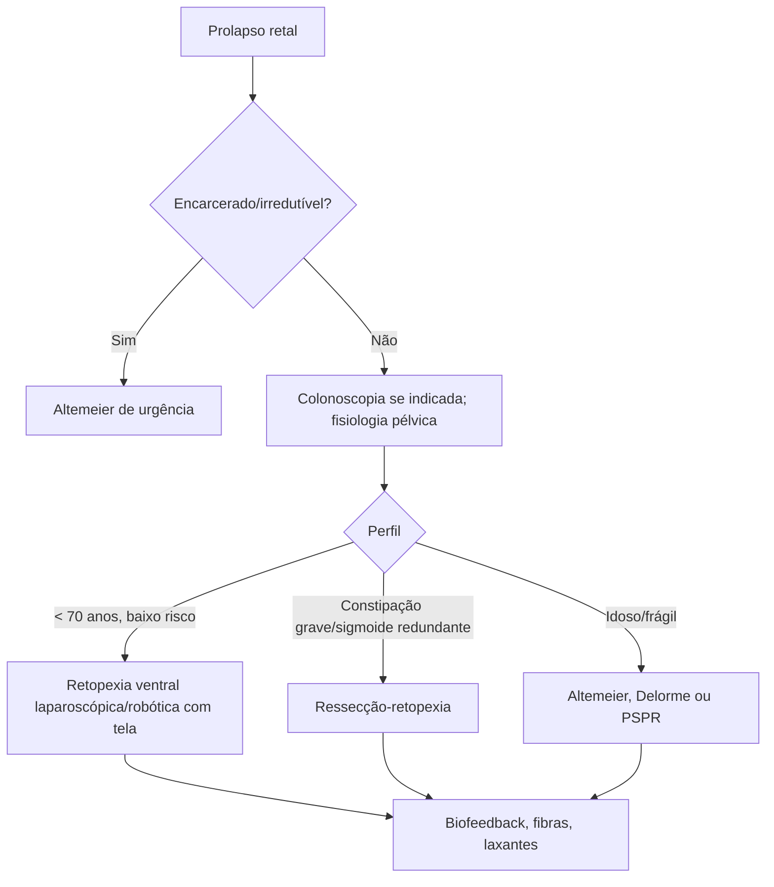

# Prolapso Retal

> Resumo em palavras próprias do Whitebook (Condutas Cirúrgicas > Cirurgia em Coloproctologia), sem fisiopatologia, autoria e referências. Confira detalhes e doses na fonte: https://whitebook.pebmed.com.br/conteudo/?id=39182&categoryId=207&subcategoryId=213

**Definição:** distúrbio benigno do assoalho pélvico com extrusão parcial ou total da parede retal pelo ânus. Pode ser a primeira apresentação de câncer colorretal → baixo limiar para colonoscopia pré-operatória com sinais de alarme. **Tipos:** total (procidência; todas as camadas, anéis concêntricos), parcial/mucoso (só mucosa), oculto/intussuscepção (invaginação interna sem exteriorização). Afeta continência, evacuação e qualidade de vida.

## Fatores e epidemiologia
- Fraqueza do assoalho pélvico (denervação do pudendo — neuropatia em até 50% —, diástase dos elevadores), idade, multiparidade/partos vaginais, constipação crônica, doenças neurológicas, cirurgia pélvica, sigmoide redundante, perda da fixação sacral, hipotonia esfincteriana, genética; coexiste com cistocele, retocele, prolapso uterino. Teorias: hérnia do assoalho, intussuscepção progressiva, úlcera retal solitária.
- Prevalência ≈ 1% em > 65 anos; mulheres (7ª década), homens (pico na 4ª); 1/3 em nulíparas; em jovens, associação neuropsiquiátrica (autismo, atraso do desenvolvimento, polifarmácia). Risco: > 40 anos, sexo feminino, partos, cirurgia pélvica, esforço, diarreia ou constipação crônica, fibrose cística, demência, AVE, defeitos do assoalho.
- Nota do texto: estratégia thread-drawing + dilatação anal seriada reduz estenose pós-PPH (prolapso mucoso/hemorroidário), não se aplica ao prolapso retal total.

## Clínica
Exteriorização do reto ao esforço ou espontânea, com redução manual; incontinência fecal (50–75%); constipação/evacuação obstruída (25–50%, inclusive no oculto); sangramento pós-evacuação; tenesmo; muco. Dor intensa = encarceramento/isquemia. Avaliar incontinência urinária e outros prolapsos.

## Diagnóstico
- **Clínico:** inspeção em repouso e com Valsalva (se não visível em Sims, examinar sentado ou de cócoras com esforço); toque retal (tônus geralmente reduzido, massas, retocele); intróito vaginal; anuscopia/retoscopia (úlcera retal anterior solitária em 10–15%).
- **Complementares:** defecorressonância pélvica, defecografia; manometria anorretal, EMG anal, latência motora do pudendo (PNTML); teste de expulsão do balão (triagem funcional); colonoscopia (sobretudo > 45 anos); tempo de trânsito colônico em constipação grave.
- **Diferenciais:** hemorroidas internas prolapsadas, prolapso oculto, prolapso mucoso, úlcera retal solitária.
- **Complicações:** encarceramento/isquemia, ulceração e sangramento, incontinência persistente, HDB, recorrência pós-cirúrgica.

## Tratamento
- **Clínico:** fibras ≥ 30 g/dia, água, laxativos osmóticos, rotina evacuatória; biofeedback (constipação dissinérgica/incontinência, em geral após a cirurgia); cuidados da pele e mucosa (cremes de barreira). Prolapso agudo edemaciado: redução manual + compressas frias (açúcar tópico pode ajudar); irredutível → cirurgia de urgência.
- **Objetivos da cirurgia:** eliminar o prolapso, corrigir disfunções funcionais (nem sempre possível), evitar novas disfunções.
- **Via por perfil:** baixo risco < 70 anos — abdominal minimamente invasiva (VMR, PMR; menor recidiva, melhor função); constipação grave — ressecção-retopexia; idosos/frágeis — perineais (Altemeier, Delorme, PSPR; menos agressivas, recidiva 11–20%); emergência (estrangulado) — Altemeier.
  - **Retopexia ventral com tela (VMR):** padrão-ouro em baixo risco; menos constipação de novo; recorrência ≈ 3%; complicações da tela < 2% (estenose, fístula retovaginal, extrusão, dor pélvica, dispareunia, discite sacral).
  - **Retopexia posterior com tela (PMR):** recidiva muito baixa (< 1% em homens), mais constipação que a VMR.
  - **Ressecção-retopexia:** constipação refratária com sigmoide redundante; menor recorrência; mais complicações anastomóticas.
  - **Retopexia por sutura:** pouco usada, mais recidiva.
  - **Altemeier** (proctossigmoidectomia perineal ± levatoroplastia, anastomose coloanal): idosos e urgências; baixa morbidade; recidiva ≈ 11–15%.
  - **Delorme** (ressecção mucosa + plicatura muscular): prolapsos pequenos; recidiva mais alta.
  - **PSPR:** ressecção grampeada perineal; rápida, para muito frágeis; resultados heterogêneos.
  - Vantagens da via perineal/minimamente invasiva: recuperação rápida, menor morbidade, dor, internação e perda de sangue.
- **Complicações pós-operatórias:** recidiva, obstrução, fístulas (anastomótica, retovaginal), incontinência, constipação nova ou piorada, estenose, infecção.

## Fluxograma (refeito, a partir do texto; o original traz figura e tabela de vias)

