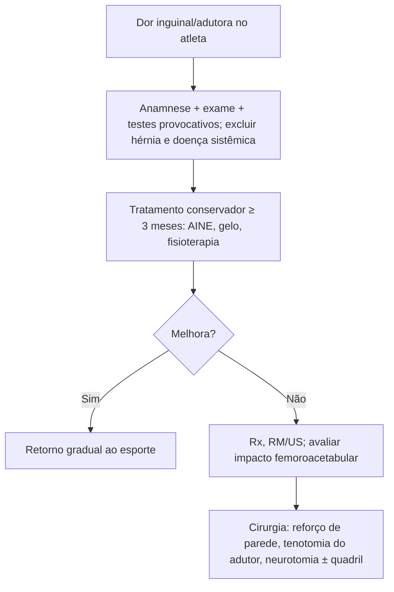

# Pubalgia no Atleta e Adulto Ativo

> Resumo em palavras próprias do Whitebook (Condutas Cirúrgicas > Ortopedia), sem fisiopatologia detalhada, autoria e referências. Confira detalhes e doses na fonte: https://whitebook.pebmed.com.br/conteudo/?id=39183&categoryId=207&subcategoryId=819

**Definição:** dor inguinal, abdominal baixa ou na origem dos adutores, sem hérnia inguinal verdadeira, ligada à atividade física (lesão aguda ou trauma repetitivo crônico). Sinônimos: hérnia do esportista, virilha de Gilmore, lesão dos músculos centrais, síndrome inguinal do jogador de hóquei.

## Epidemiologia
Mais comum em homens (pelve mais estreita, menos estável) e atletas de alto rendimento, em esportes de aceleração/desaceleração e rotação (futebol, rugby, hóquei, futebol americano, corrida, tênis). Associa-se ao impacto femoroacetabular.

## Clínica
- Dor inguinal, abdominal baixa ou adutora, em geral unilateral, que piora com esforço e aumenta gradualmente, melhora com repouso e recorre ao voltar à atividade. Início agudo é menos comum (hiperextensão do tronco ou hiperabdução do quadril).
- Pode piorar com aumento da pressão abdominal (tosse, espirro); esforço evacuatório causa desconforto leve.
- Irradiação para região inguinal anterior, coxa medial, períneo ou escroto (compressão de nervos ilioinguinal, ílio-hipogástrico, genitofemoral).
- Dor profunda anterior/lateral após ficar sentado muito tempo, ou com flexão, abdução e torção, sugere lesão intra-articular do quadril associada.

## Exame físico
Palpar o ligamento inguinal (lateral → proximal); excluir hérnia palpando o anel inguinal externo com Valsalva; sensibilidade do abdome inferior, inguinal, coxa anteromedial e genitália (disestesias = compressão nervosa); exame do quadril (movimento ativo/passivo, FABERE). Dor à palpação do ramo púbico na inserção do reto abdominal e tendão conjunto; dor à **adução resistida a 45°**, à **flexão resistida a 90°** e ao abdominal com resistência. Testes provocativos: sentar a partir da posição supina com pés fixos e braços estendidos, mantendo 5 s (positivo se dói na inserção do reto abdominal); supino com perna fletida a 30°, resistir à abdução com a mão no calcanhar medial (uni ou bilateral). Sinais de doença sistêmica → buscar outra causa.

## Diagnóstico
**Clínico.** Imagem se houver indicação cirúrgica:
- **Radiografia de quadril** (AP e perfil em ortostase): impacto femoroacetabular, artrite, displasia, osteíte púbica, avulsões pélvicas, fraturas de estresse, apofisite, doença degenerativa.
- **RM** (títulos dos achados não vieram claros no texto; conferir na fonte): rupturas do reto abdominal (quase patognomônicas, raras), alterações do tendão conjunto, ligamento inguinal e adutor longo, edema da medula da sínfise e líquido; sensibilidade 68% e especificidade 100% para doença do reto abdominal; 86% e 89% para o adutor; pode subestimar a lesão central; edema subcondral púbico e anormalidades da cápsula/aponeurose se correlacionam mais com dor persistente.
- **Ultrassom** (dinâmico): tendinopatia e lesão muscular central, canal inguinal, hérnias ocultas, atenuação do tendão conjunto; operador-dependente.
- Injeção intra-articular: persistência da dor apesar dela sugere pubalgia; injeção na sínfise ocasionalmente é diagnóstica.

## Diferencial
Impacto femoroacetabular, necrose avascular, doença degenerativa do quadril, fraturas pélvicas, distensão/ruptura do reto abdominal distal ou do adutor, tenoperiostite e ruptura do adutor longo, bursite, neoplasias, hérnia de disco, neuropatia do obturador/ilioinguinal, espondiloartrites, hérnia inguinal ou femoral, causas urológicas (prostatite, tumor testicular, hidrocele, varicocele, cólica ureteral), ginecológicas (endometriose, DIP, cisto), digestivas (neoplasia, DII, diverticulite) e radiculopatia L1.

## Tratamento conservador (1ª linha)
Individualizar conforme nível do atleta, prazo de retorno e fase da temporada; afastamento temporário. AINEs, corticoide oral, infiltração na origem do reto abdominal e adutor longo; fase aguda: repouso do esporte, gelo 3–4×/dia por ~20 min; fisioterapia (estabilização, fortalecimento, postura). Tentar por **≥ 3 meses**, com retorno gradual. Em análise de 12.144 pacientes, só **14%** precisaram de cirurgia. Em atletas de elite com pressa, o reparo cirúrgico pode ser preferido.

## Tratamento cirúrgico
Indicado na **falha do conservador**; feito por ortopedista ou cirurgião geral experiente; laparoscópico ou aberto, com ou sem tela. Princípios: reforço da parede posterior, fixação dos retos ou tendão conjunto, tenotomia do adutor (se dor/disfunção adutora) e neurotomias; tratar o impacto femoroacetabular em tempo estagiado ou simultâneo. Retorno pleno em **6–8 semanas** (4 meses se houver cirurgia femoroacetabular associada); 80–100% voltam ao esporte.

## Fluxograma (refeito, a partir do texto; o original não traz algoritmo)

