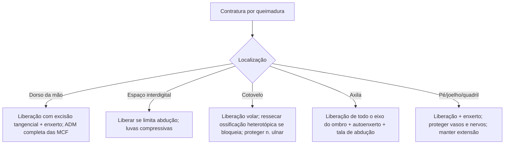

# Reconstrução de Extremidades em Queimados

> Resumo em palavras próprias do Whitebook (Condutas Cirúrgicas > Cirurgia Plástica), sem autoria e referências. Confira detalhes e doses na fonte: https://whitebook.pebmed.com.br/conteudo/?id=63098&categoryId=207&subcategoryId=947

**Objetivo:** a reabilitação do queimado visa preservar a função a longo prazo e começa no início do tratamento agudo. O bom tratamento agudo reduz a necessidade de reconstrução, mas problemas ocorrem; as deformidades mais comuns do membro superior são as contraturas do dorso da mão e do espaço interdigital.

## Membros superiores
- **Contratura do dorso da mão:** prevenir com posicionamento adequado antes e depois da operação. Preferir **excisão tangencial** (poupando a gordura subcutânea dorsal) à excisão até a fáscia; assim a liberação cicatricial desliza e aceita bom enxerto. A liberação deve devolver amplitude completa e sem resistência das articulações metacarpofalangeanas.
- **Contratura do espaço interdigital:** minimizada por cirurgia precoce adequada e luvas compressivas. No espaço normal a borda volar é distal à dorsal; na contratura típica o padrão se inverte (a sindactilia congênita costuma ser dorsal). Tratar quando limita a abdução dos dedos; não comprometer a borda palmar do espaço.
- **Cotovelo e ossificação heterotópica:** queimaduras muito profundas dificultam manter a amplitude. A extensão limitada costuma ser problema de partes moles volares, que responde à liberação simples. A ossificação heterotópica (em torno do tendão do tríceps) causa bloqueio mecânico; pode regredir com os anos, mas se interfere na recuperação é tratada cirurgicamente, com dissecção cuidadosa, retirada do osso e **proteção do nervo ulnar**.
- **Contratura axilar:** pode atrapalhar funções como alimentar-se. A liberação deve abranger todo o eixo de rotação do ombro, com defeito fechado por **autoenxerto de pele**; no pós-operatório, talas de abdução que maximizem a amplitude sem tração ou compressão do plexo braquial e dos vasos.

## Membros inferiores
- Quem ficou muito tempo em decúbito dorsal tolera mal a posição vertical imediata: treino em mesa inclinada e sentar gradual. Prevenir edema com meias/bandagens elásticas.
- Deformidades mais comuns: contratura em extensão dorsal do pé, em flexão poplítea e em flexão do quadril (as duas últimas, comuns em lactentes e crianças pequenas).
- **Dorso do pé:** contratura das metatarsofalangeanas altera a marcha; operar se atrapalha a deambulação; liberação incisional com grande enxerto de pele parcial, sobretudo se há gordura viável.
- **Flexão poplítea:** liberação e enxerto, mantendo a extensão do joelho no pós-operatório; proteger as estruturas neurovasculares superficiais da fossa poplítea.
- **Flexão do quadril:** tratar cedo (interfere na deambulação); cuidado com vasos e nervos femorais, cuja anatomia pode estar distorcida pelo tecido contraído.

## Fluxograma (refeito, a partir do texto; o original não traz algoritmo)

