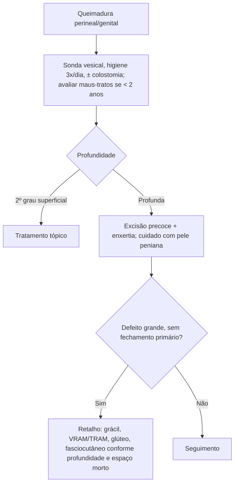

# Reconstrução de Períneo e Genitália em Queimados

> Resumo em palavras próprias do Whitebook (Condutas Cirúrgicas > Cirurgia Plástica), sem autoria e referências. Confira detalhes e doses na fonte: https://whitebook.pebmed.com.br/conteudo/?id=63134&categoryId=207&subcategoryId=947

**Considerações gerais:** a região genital e perineal exige cuidado especial (anatomia complexa, umidade, proximidade do ânus e risco de contaminação). Em geral ocorre em grandes queimados, raramente isolada.

## Condutas iniciais
- **< 2 anos com escaldadura isolada** de períneo/genitália: investigar maus-tratos.
- **Acometimento vulvar ou peniano:** sondagem vesical precoce para manter a uretra pérvia e evitar retenção.
- **Colostomia** pode ajudar a reduzir a contaminação; lavar a área com água e sabão pelo menos **3×/dia** e após cada evacuação; curativo tópico com sulfadiazina de prata 1% é opção.
- **2º grau superficial:** tratamento tópico basta (boa vascularização, cicatrização rápida).
- **Queimaduras profundas:** excisão precoce e enxertia; atenção à pele do pênis (risco de necrose, podendo exigir amputação).

## Reconstrução (defeito grande que não fecha primariamente)
Opções de retalho: miocutâneo do grácil, reto abdominal (VRAM/TRAM), posterior da coxa, de virilha, fasciocutâneo pudendo, glúteos, reto femoral, tensor da fáscia lata, vasto lateral, DIEP, perfurante da artéria glútea superior e anterolateral da coxa; a escolha pode depender do posicionamento. A maioria dá preenchimento de partes moles; o volume pode prejudicar a estética em defeitos superficiais.
- **Grácil:** principal retalho para defeitos perineais e pélvicos; confiável, com morbidade funcional mínima (os outros adutores assumem). **Avaliar doença vascular de membros inferiores** (claudicação, pulsos), que pode contraindicá-lo.
- **Glúteo miocutâneo:** feito em decúbito ventral; robusto em defeitos perianais. Defeito superficial: virilha, pudendo ou posterior da coxa. Espaço morto grande: **VRAM ou TRAM**.
- **Reto abdominal:** pele robusta (pode ser desepitelizada para volume ou tubularizada em neovagina), bem perfundido pela artéria epigástrica inferior profunda, preenche o espaço morto; vantagens sobre o grácil bilateral.
- **Glúteo máximo dividido e glúteo da coxa:** úteis em defeitos pélvicos, baixa morbidade; o glúteo da coxa pode manter sensibilidade (ramo sensitivo posterior da coxa) e ser tubularizado para vagina distal.
- **Fasciocutâneos regionais:** bons em defeitos superficiais, com contorno mais cosmético.
- Retalhos de membro inferior (tensor da fáscia lata, vasto lateral, reto femoral) se abdome ou outras áreas doadoras não estão disponíveis.

## Complicações
Infecção que pode evoluir para **síndrome de Fournier**, necrose peniana e testicular, retrações com disfunção erétil, perda do reflexo cremastérico, estenose uretral, complicações geniturinárias. No grácil, isquemia da pele sobre o retalho (ilha mal posicionada ou perfurantes septocutâneas não incluídas): evitar com ampla dissecção da fascia dos dois lados do músculo.

## Fluxograma (refeito, a partir do texto; o original não traz algoritmo)

